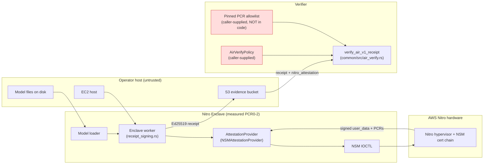
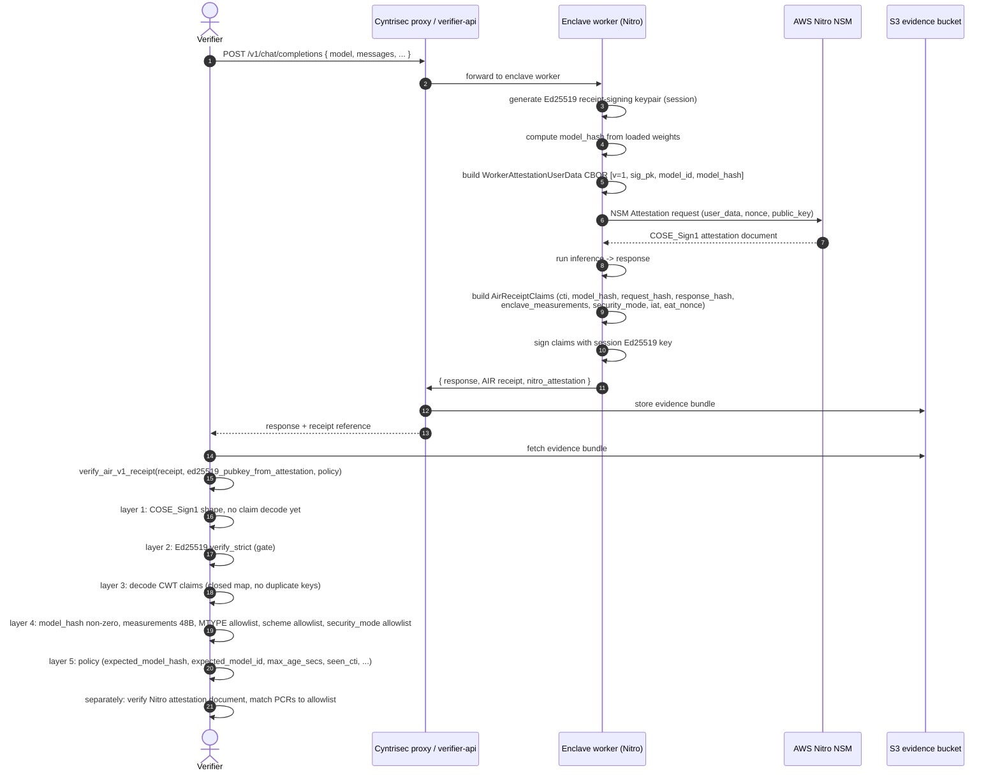
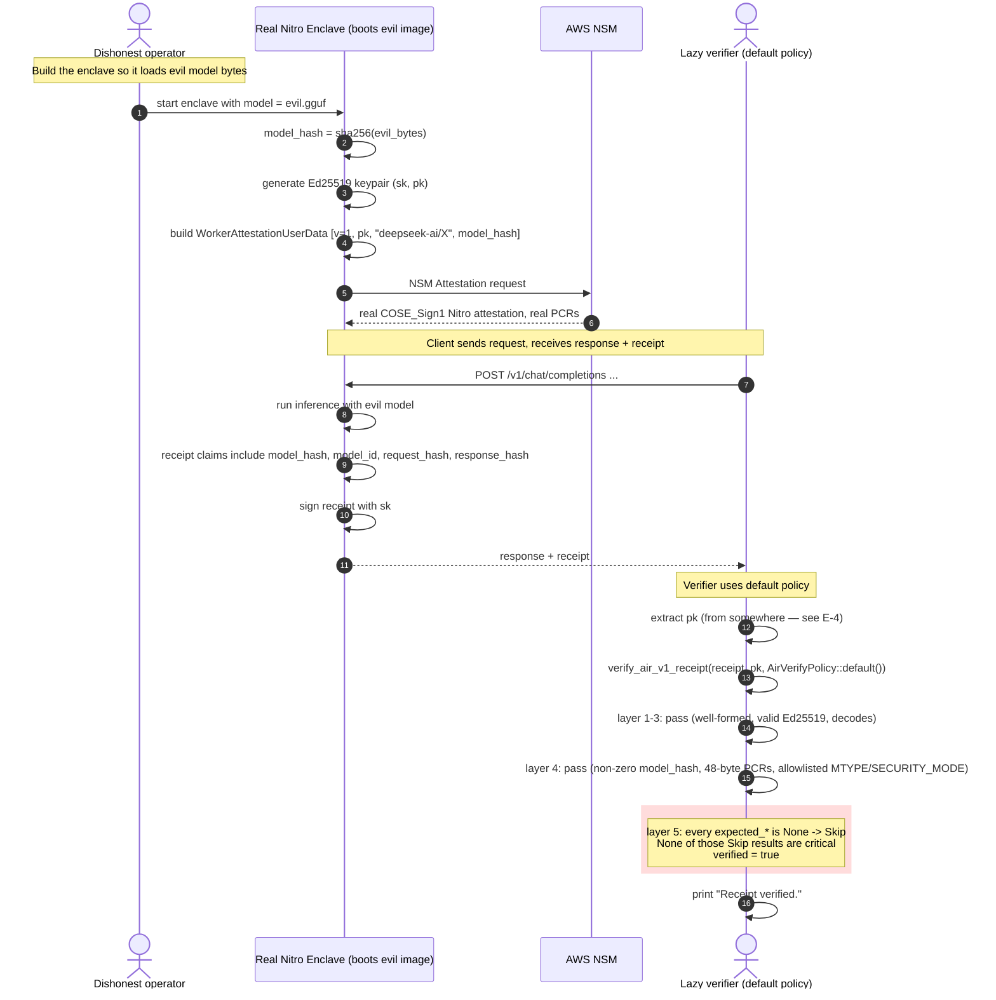

# EphemeralML / Cyntrisec: Soundness Findings

**Subject:** `github.com/cyntrisec/EphemeralML`. Open-source runtime
and crate family behind Cyntrisec's AWS BYOC confidential AI stack.
Includes gateway, enclave worker, verifier API, AIR v1 receipt
implementation, and deployment tooling. Targets AWS Nitro Enclaves
primarily, with GCP Confidential Space (TDX) and NVIDIA H100 CC paths.
Per-inference cryptographic receipts (the "AIR v1" format).

**Scope:** Soundness of the *runtime prover* (the enclave worker) and
the verifier-API / SDK that consumes its receipts. The question is:
can a dishonest operator produce AIR v1 receipts that the verifier
accepts without actually running the bound model inside a genuine
attested TEE?

**Headline:** EphemeralML is the most carefully-engineered verifier of
the systems analysed so far. It has explicit **verify-before-parse**
(layer 1 → 2 → 3), strict Ed25519 (`verify_strict` with
`legacy_compatibility` off), a **closed claims map** with duplicate-key
rejection, fail-closed allowlists for `security_mode` and
`model_hash_scheme`, a 32-byte non-zero `model_hash` invariant, and an
explicit `WorkerAttestationUserData` CBOR structure bound into the
Nitro `user_data`. The remaining soundness gaps live in (a) the
verifier's *policy fields*: `expected_model_hash`, `expected_model_id`,
`expected_attestation_doc_hash`, `expected_nonce`, and PCR matching
are **all opt-in via `AirVerifyPolicy`**, and the `verified` boolean
returns true when their checks are `Skip`; (b) the `mock`
attestation-provider feature, which generates structurally valid but
semantically meaningless attestations.

All findings refer to the repository state at the time of cloning
(`depth=1` snapshot).

---

## Roles

- **Operator (Prover, P)** — runs the customer-side AWS account
  hosting the Nitro Enclave worker (or GCP Confidential Space). Per
  the README, the operator launches a signed CloudFormation template;
  AWS controls the Nitro hypervisor; the customer controls the EC2
  instance and the S3 evidence bucket.
- **Enclave Worker** — the in-enclave Rust process built from
  `enclave/`. Trusted-by-measurement: the enclave binary contributes
  to the Nitro PCR0/PCR1/PCR2 measurements.
- **AWS Nitro Secure Module (NSM)** — issues the COSE_Sign1
  attestation document, signing with the AWS Nitro attestation
  certificate chain.
- **Receipt Signing Key** — per-session Ed25519 keypair generated
  inside the enclave. Public key is bound into the Nitro `user_data`
  (`WorkerAttestationUserData` CBOR).
- **End User / Auditor (Verifier, V)** — runs the verifier API, the
  `cyntrisec-proxy`, or a third-party AIR v1 verifier. Calls
  `verify_air_v1_receipt(data, public_key, policy)`. Trusts only the
  AWS Nitro root + their pinned PCR allowlist + their `AirVerifyPolicy`
  configuration.
- **Receipt Aggregator (Optional)** — the S3 evidence bucket, which
  stores the per-inference bundle: AIR receipt + Nitro attestation +
  policy/model metadata.

---

## Components and trust boundary

| Component | Where it lives | Trust |
|---|---|---|
| AWS Nitro hypervisor | AWS-controlled hardware | Root of trust |
| Nitro NSM driver | Inside the enclave kernel | Trusted |
| Enclave binary (PCR0–PCR2) | Built from `enclave/` source | Trusted **only when PCRs match an externally pinned allowlist** |
| `WorkerAttestationUserData` CBOR | Generated inside enclave, bound into NSM `user_data` | Trusted (Nitro-signed) |
| `AirReceiptClaims` (CWT/COSE_Sign1, Ed25519) | Signed inside enclave | Trusted iff `verify_air_v1_receipt` returns `verified == true` AND policy is set |
| `AirVerifyPolicy` (caller-supplied) | Runs on verifier machine | Trust depends on which `expected_*` fields the caller sets |
| `mock` feature build | Only present when compiled with `--features mock` | **Untrusted** — produces structurally valid attestations with synthetic PCRs |
| Model files on enclave disk / fetched at runtime | Operator-controlled storage | Hashed; `model_hash` in receipt binds to bytes seen by enclave |
| Receipt freshness via `iat` + `cti` | Set inside enclave | Trusted via signature; replay-detection requires caller-supplied `seen_cti` |



---

## Honest flow



The intended end-state is that the verifier learns:

1. The receipt was signed by an Ed25519 key whose public counterpart
   is bound into a Nitro attestation document.
2. The Nitro attestation document was signed by AWS's Nitro chain.
3. The Nitro PCRs match a known-good enclave build.
4. The `WorkerAttestationUserData` inside the attestation binds the
   *same* `model_hash` and `model_id` the receipt carries.
5. The receipt's `request_hash` / `response_hash` match what the
   client sent / received.

Each link must be checked. Where the implementation lets a caller
silently skip one, soundness drops.

---

## Finding E-1 — Policy bindings (`expected_model_hash`,
`expected_model_id`, `expected_nonce`, `expected_attestation_doc_hash`,
`expected_platform`) are all opt-in, and their `Skip` is not critical

**Severity:** High.

**Location:** `common/src/air_verify.rs:250-301, 385-415, 700-922`.

```rust
pub struct AirVerifyPolicy {
    pub max_age_secs: u64,
    pub clock_skew_secs: u64,
    pub expected_model_hash: Option<[u8; 32]>,
    pub expected_request_hash: Option<[u8; 32]>,
    pub expected_response_hash: Option<[u8; 32]>,
    pub expected_attestation_doc_hash: Option<[u8; 32]>,
    pub expected_model_id: Option<String>,
    pub expected_security_mode: Option<String>,
    pub allow_evaluation_mode: bool,
    pub expected_platform: Option<String>,
    pub expected_nonce: Option<Vec<u8>>,
    pub require_nonce: bool,
    pub seen_cti: Option<SeenCtiFn>,
}

impl Default for AirVerifyPolicy {
    fn default() -> Self {
        Self {
            max_age_secs: 3600,
            clock_skew_secs: 300,
            expected_model_hash: None,
            // ... all other expected_* None
            allow_evaluation_mode: false,
            require_nonce: false,
            seen_cti: None,
        }
    }
}
```

The `verified_from_checks` function:

```rust
fn verified_from_checks(checks: &[AirCheck]) -> bool {
    let critical_skip = checks.iter().any(|check| {
        matches!(check.status, AirCheckStatus::Skip) && is_critical_check_name(check.name)
    });

    !critical_skip
        && checks
            .iter()
            .all(|c| matches!(c.status, AirCheckStatus::Pass | AirCheckStatus::Skip))
}

fn is_critical_check_name(name: &str) -> bool {
    matches!(
        name,
        "SIZE" | "COSE_DECODE" | "UNPROTECTED" | "ALG" | "CONTENT_TYPE"
            | "PAYLOAD" | "CLAIMS_DECODE" | "EAT_PROFILE" | "SIG" | "CTI"
            | "MHASH_PRESENT" | "MEAS" | "MTYPE" | "MHASH_SCHEME" | "SECURITY_MODE"
    )
}
```

Notably **absent** from the critical list: `MHASH` (model_hash match),
`MODEL` (model_id match), `ADHASH` (attestation_doc_hash match),
`PLATFORM`, nonce match. So when the caller does not set
`expected_model_hash`, the layer-5 `MHASH` check records `Skip`, but
since `MHASH` is not in `is_critical_check_name`, `verified` returns
`true` anyway.

**Mechanism:** A caller invoking
`verify_air_v1_receipt(data, public_key, &AirVerifyPolicy::default())`
gets:

- Layer 1: shape ok.
- Layer 2: Ed25519 verify_strict ok (gate).
- Layer 3: closed-map decode ok.
- Layer 4: `MHASH_PRESENT` (non-zero), `MEAS` (48-byte), `MTYPE`
  (nitro-pcr or tdx-mrtd-rtmr), `MHASH_SCHEME`, `SECURITY_MODE` —
  all Pass for a well-formed receipt.
- Layer 5: every `expected_*` check is `Skip`. None of those `Skip`
  results count as critical, so `verified = true`.

The verifier returns true having only confirmed: *"this Ed25519
signature is valid for some receipt that claims to come from a
nitro-pcr platform and has a non-zero 32-byte model_hash."* It has not
confirmed:

- Whether this receipt is for the model the client expected
  (`expected_model_id` skipped).
- Whether the receipt's `model_hash` is the publisher's expected hash
  (`expected_model_hash` skipped).
- Whether this receipt is for *this* client's request
  (`expected_nonce` skipped, `expected_request_hash` skipped).
- Whether the Nitro attestation document the user_data came from
  matches what was published (`expected_attestation_doc_hash` skipped).
- Whether the receipt comes from the platform the user expected
  (`expected_platform` skipped).

**Attack:** An operator who controls the model files can serve any
model whose receipt has a valid Ed25519 signature from a key bound
into a real Nitro attestation. The receipt's `model_hash` will be the
hash of *whatever bytes the enclave saw at load time*. A verifier
using the default policy accepts this as a "verified" receipt.

The attack is closed only if the caller pins **all four** of:
`expected_model_hash`, `expected_model_id`,
`expected_attestation_doc_hash`, and PCR allowlist (which lives
outside this verifier entirely).

**Mitigation:**

- Promote `MHASH`, `MODEL`, `ADHASH`, and platform / nonce checks to
  critical when the corresponding policy field is `None` — i.e.,
  unset policy fields should *not* implicitly pass. Either require
  callers to opt out explicitly (`expected_model_hash:
  Skip(reason)`), or change `verified_from_checks` to count every
  `Skip` as a failure unless the caller flagged the check as
  intentionally skipped.
- Alternatively, provide an `AirVerifyPolicy::strict()` constructor
  that fails closed and document `default()` as
  developer-environment-only.

---

## Finding E-2 — `feature = "mock"` produces structurally valid
attestations that the verifier cannot distinguish without external PCR
pinning

**Severity:** Medium (acknowledged in code, but consequential).

**Location:**

- `enclave/src/attestation.rs:441-604` — `DefaultAttestationProvider`
  picks `mock_provider` when `cfg(all(feature = "mock", not(feature =
  "production")))`.
- `enclave/src/mock.rs` (not shown here, but referenced from
  `DefaultAttestationProvider::new()`).

```rust
#[cfg(any(feature = "mock", feature = "production"))]
impl DefaultAttestationProvider {
    pub fn new() -> Result<Self> {
        Ok(Self {
            #[cfg(feature = "production")]
            nsm_provider: NSMAttestationProvider::new()?,
            #[cfg(all(feature = "mock", not(feature = "production")))]
            mock_provider: crate::mock::MockAttestationProvider::new(),
        })
    }
}
```

**Mechanism:** The build feature set determines which provider ships.
A binary built with `--features mock` but without `--features
production` (or with both, and `production` losing the `cfg(not)`
disambiguation if Cargo features pick mock first) emits attestations
with `module_id: "mock-enclave"` and synthetic PCRs.

The `verify_air_v1_receipt` function never inspects `module_id` or
the underlying Nitro document — that is the caller's job. If the
caller checks PCRs against a pinned allowlist that excludes the
mock-PCR values, the mock attestation is rejected at the Nitro layer.
But the AIR receipt itself, signed with the mock provider's
Ed25519 key, passes `verify_air_v1_receipt` cleanly.

**Attack:** Operator builds with `--features mock` (intentionally or
accidentally), exposes the verifier-API. A verifier hitting that
verifier-API and receiving the mock-receipt:

- AIR receipt verifies (mock provider still signs with a real
  Ed25519 key).
- Nitro attestation parses (mock provider issues a structurally
  valid mock document).
- The verifier must independently pin PCRs against a known-good
  Nitro measurement and reject anything else. Without that pinning,
  the mock passes.

The README's statement *"Local mock mode is only a developer proof
path and does not provide hardware attestation"* is correct, but the
runtime detection of "this is a mock attestation" is left to the
caller's PCR check, not enforced anywhere in `air_verify.rs`.

**Mitigation:**

- Add a `mock` flag inside the AIR receipt (e.g.,
  `security_mode = "mock"`), and make `is_known_security_mode`
  reject it under default policy unless `allow_mock_mode: true`.
- Make the mock provider write a recognizable sentinel PCR (e.g.,
  all-zeros) and have the verifier API reject any receipt whose
  `enclave_measurements.pcr0` is all-zeros.

---

## Finding E-3 — `seen_cti` replay detection is caller-supplied;
default policy permits replay

**Severity:** Medium.

**Location:** `common/src/air_verify.rs:243, 280, 919-930`

```rust
pub type SeenCtiFn = Box<dyn Fn(&[u8; 16]) -> bool + Send + Sync>;

pub struct AirVerifyPolicy {
    // ...
    pub seen_cti: Option<SeenCtiFn>,
}
```

```rust
// in layer5_policy (approximate, around line 919):
if let Some(ref seen_fn) = policy.seen_cti {
    // ... check fn returns true on replay
}
```

**Mechanism:** AIR v1 uses a `cti` (16-byte unique identifier) per
receipt. Layer-4 checks that `cti` is non-zero. Layer-5 *can* check
replay if the caller provides a `seen_cti` callback. The default is
`None`, so no replay detection runs.

**What goes wrong:** A captured AIR receipt (or evidence bundle) can
be replayed indefinitely against a `default()` verifier. The
`max_age_secs = 3600` freshness window puts a 1-hour cap on replay,
but within that window any caller using default policy accepts the
same receipt as if it were fresh.

For S3-stored evidence bundles intended for *offline* verification
hours later, the freshness window must be widened (or set to
`unbounded`), which removes even the 1-hour mitigation.

**Mitigation:**

- Document `seen_cti` as a recommended-for-production setting.
- Promote `REPLAY` check to critical when `seen_cti` is provided so
  callers cannot accidentally drop it.

---

## Finding E-4 — Verifier does not check that the
`receipt_signing_pubkey` came from a real Nitro attestation

**Severity:** Architectural / consequential.

**Location:** `common/src/air_verify.rs:328-383` — the function
signature is:

```rust
pub fn verify_air_v1_receipt(
    data: &[u8],
    public_key: &ed25519_dalek::VerifyingKey,
    policy: &AirVerifyPolicy,
) -> AirVerifyResult
```

**Mechanism:** The verifier takes the Ed25519 public key as an
argument. It does **not** know where the caller got the key. The
intended flow is:

1. Caller fetches the Nitro attestation document for the session.
2. Caller verifies the Nitro signature against the AWS Nitro
   certificate chain.
3. Caller decodes `WorkerAttestationUserData` (CBOR) from
   `attestation.user_data`.
4. Caller pulls `receipt_signing_pubkey` from that CBOR.
5. Caller passes it to `verify_air_v1_receipt`.

If steps 1–3 are skipped or done sloppily — e.g., the caller pulls
the public key directly from a JSON field returned by the operator's
gateway without verifying the Nitro attestation — the receipt
signature can be valid for an operator-chosen key with no TEE binding.
The receipt looks fine; the `verified` boolean returns true.

The verifier API's `verify_dispatch.rs` (not fully audited here)
presumably does this binding correctly, but a third-party caller using
just `common/src/air_verify.rs` could miss it.

**Mitigation:**

- Accept a `(receipt_signing_pubkey, nitro_attestation_document)`
  pair and verify the Nitro document in the same call, asserting
  that the CBOR `WorkerAttestationUserData.receipt_signing_pubkey`
  matches the key the caller passed in.
- Or rename the API to make the precondition clear:
  `verify_air_v1_receipt_with_attested_key(...)`.

---

## Finding E-5 — `model_hash_scheme` is `Option<String>`; absent value
passes silently

**Severity:** Low / definitional.

**Location:** `common/src/air_verify.rs:673-684`

```rust
match &claims.model_hash_scheme {
    None => checks.push(AirCheck::pass("MHASH_SCHEME")),
    Some(s) if crate::air_receipt::is_known_model_hash_scheme(s) => {
        checks.push(AirCheck::pass("MHASH_SCHEME"))
    }
    Some(s) => checks.push(AirCheck::fail(
        "MHASH_SCHEME",
        AirCheckCode::UnknownModelHashScheme(s.clone()),
        format!("unknown model_hash_scheme: {s}"),
    )),
}
```

**Mechanism:** When `model_hash_scheme` is absent from the claims, the
check passes. When present and on the allowlist, it passes. When
present but unknown, it fails. So an enclave that omits the scheme
gets the same result as one that asserts a known scheme.

**Consequence:** The verifier cannot tell *what* the `model_hash`
field's bytes mean: SHA-256? SHA-512 truncated? SHA-256 over an
EROFS root hash? A SafeTensors digest? Different schemes for the same
plaintext model produce different `model_hash` values. A verifier
comparing `expected_model_hash` to `claims.model_hash` assumes both
sides used the same scheme.

**Mitigation:**

- Require `model_hash_scheme` to be present and on the allowlist.
- Or have the receipt builder always emit it.

---

## Finding E-6 — `expected_attestation_doc_hash` would close the
"matching key but for the wrong attestation" gap, but is opt-in

**Severity:** Medium.

**Location:** `common/src/air_verify.rs:262, 801-820`

Without `expected_attestation_doc_hash`, the verifier accepts any
receipt whose `attestation_doc_hash` claim is well-formed. Two
attestation documents can both bind the same `receipt_signing_pubkey`
if the operator generates two Nitro attestations close in time with
the same session key (e.g., during a key-rotation glitch, or
maliciously). The receipt's `attestation_doc_hash` claim would point
at one; the verifier accepting the receipt has no way to know which.

In normal operation this is unlikely, but a soundness-strict policy
should pin `expected_attestation_doc_hash` so the receipt commits to
exactly one attestation.

**Mitigation:** Either make this field default-strict (cf. E-1), or
document a strong recommendation to set it for any production verifier.

---

## Finding E-7 — `allow_evaluation_mode: false` and
`is_known_security_mode` allowlist are correct and load-bearing —
don't regress

**Severity:** Positive note.

**Location:** `common/src/air_verify.rs:294-300, 686-696`

```rust
// fail-closed allowlist
if crate::air_receipt::is_known_security_mode(&claims.security_mode) {
    checks.push(AirCheck::pass("SECURITY_MODE"));
} else {
    checks.push(AirCheck::fail(
        "SECURITY_MODE",
        AirCheckCode::UnknownSecurityMode(claims.security_mode.clone()),
        format!("unknown security_mode: {}", claims.security_mode),
    ));
}

// later, layer5_policy:
None if claims.security_mode == "evaluation" && !policy.allow_evaluation_mode => {
    // fail
}
```

This is the right default: receipts with `security_mode =
"evaluation"` are rejected unless the verifier explicitly opts in.
`SECURITY_MODE` is critical, so an unknown value fails the whole
receipt. Worth calling out because most other policy checks lack
this strength.

---

## Finding E-8 — Receipt size limit and `verify-before-parse` are
well-implemented

**Severity:** Positive note.

**Location:** `common/src/air_verify.rs:417-534`

The layer 1 / 2 / 3 ordering is genuinely careful:

- Layer 1 rejects oversized receipts before any parse.
- Layer 1 rejects non-empty unprotected headers (which would not be
  signed and could carry attacker-controlled bytes).
- Layer 1 rejects non-empty `crit` headers (which would force the
  verifier to honour unknown directives — fail-closed instead).
- Layer 1 fixes `alg = EdDSA` and `content_type = CWT` — closed set,
  rejection on mismatch.
- Layer 2 is the signature gate. The comment at lines 542-552 is
  specifically about `verify_strict`'s canonical-S and small-order
  rejections, and explicitly notes that
  `legacy_compatibility` is off in the workspace `Cargo.toml`. This
  is the right level of care.
- Layer 3 only runs after layer 2 succeeds. Closed claims map and
  duplicate-key rejection are enforced inside
  `decode_claims_from_bytes`.

This pattern should be the reference for the other systems analysed
in this series.

---

## Finding E-9 — `expected_request_hash` / `expected_response_hash`
are policy fields, but the natural caller (a chat client) won't know
them until *after* the inference returns

**Severity:** Low / API ergonomic.

**Location:** `common/src/air_verify.rs:258-260, 759-799`

The policy fields `expected_request_hash` and `expected_response_hash`
are intended for offline verification: a third-party auditor with a
copy of the request body and the response body can compute the
expected hashes and check against the receipt. For *live* clients,
this works the same way: client sends request, hashes own bytes,
later verifies the receipt against those hashes.

The concern: if the client only computes
`expected_response_hash` from the bytes the server returns, and the
verifier check is `claims.response_hash == sha256(response_bytes)`,
the server can simultaneously return response bytes B and sign a
receipt with `response_hash = sha256(B)`. Both will match. The
binding is only meaningful if the response bytes are *also* committed
elsewhere — e.g., via a TLS transcript or by being end-to-end
encrypted to the client. Otherwise, the receipt's "this is the
response you got" claim collapses to "the server told me this hash
and the bytes hash to it" — a tautology under server control.

This is consistent with how every receipt-based system works, but
worth being explicit: receipts authenticate *content*, not
*delivery*. The user must ensure response bytes are delivered through
a channel they trust (the proxy's TLS, an end-to-end-encrypted
channel, etc.).

**Mitigation:** Document this property explicitly. The current
`cyntrisec-proxy` runs locally, so client and proxy share trust; for
remote verifiers consuming S3 evidence bundles, the property is
"response_hash binds to the bytes the enclave saw."

---

## Composed end-to-end attack

The cleanest chain is **E-1**: a verifier that uses
`AirVerifyPolicy::default()` accepts any well-signed receipt for any
model, because every `expected_*` policy field defaults to `None` and
the corresponding `Skip` is not critical.



To close the attack, the verifier needs:

- `expected_model_hash = Some(publisher_published_hash)` →
  catches evil model.
- `expected_model_id = Some("deepseek-ai/X")` → catches mislabelling.
- `expected_attestation_doc_hash = Some(...)` → catches attestation
  swap.
- PCR allowlist applied *separately* on the Nitro attestation
  document → catches the "real enclave running unintended code" case.
- `seen_cti` callback → catches replay.

None of these are enforced by default.

---

## Summary table

| # | Title | Severity | Root cause | One-line fix |
|---|-------|----------|------------|--------------|
| E-1 | Policy bindings opt-in; `Skip` not critical | High | `is_critical_check_name` excludes MHASH/MODEL/ADHASH/PLATFORM | Treat unset policy `Skip` as failure under default |
| E-2 | `feature = "mock"` ships valid-looking attestations | Medium | Build-feature gating; verifier doesn't reject mock | `security_mode = "mock"` rejected by default |
| E-3 | `seen_cti` opt-in → replay window | Medium | `seen_cti: None` default | Require callback or document strongly |
| E-4 | `verify_air_v1_receipt` takes pubkey as argument | Architectural | Function doesn't link key to Nitro attestation | Add `verify_with_attested_key` wrapper |
| E-5 | `model_hash_scheme` absent passes | Low | `None` arm of match passes | Require scheme to be present |
| E-6 | `expected_attestation_doc_hash` opt-in | Medium | Same as E-1 | Promote when set; document strongly |
| E-7 | `allow_evaluation_mode: false` default | Positive | — | Don't regress |
| E-8 | `verify-before-parse` is correct | Positive | — | Use as reference for other systems |
| E-9 | response_hash authenticates content, not delivery | Documentation | Inherent to receipts | Document explicitly |

---

## What EphemeralML does well (and the other systems should copy)

- **Verify-before-parse.** Layer 1 (shape) → Layer 2 (signature gate)
  → Layer 3 (claims decode). A non-verifying signature never sees the
  claims decoder. This is the right way to do CWT/COSE and almost
  nothing else in the comparison set is this careful.
- **`verify_strict` with `legacy_compatibility = off`.** Explicit
  rejection of malleability paths. The comment block at
  `air_verify.rs:542-552` documents the choices precisely.
- **Closed claims map + duplicate-key rejection.** No surprise fields,
  no aliasing.
- **Fail-closed allowlists** for `security_mode` and
  `model_hash_scheme` (when present). Unknown values fail rather than
  pass-through.
- **`MHASH_PRESENT`** (non-zero check) — small but right. Catches the
  "uninitialised buffer wrote zeros and we accidentally signed it"
  bug class.
- **`is_critical_check_name`** as a concept — separating "you can't
  skip this even if you want to" from "you might choose to skip this"
  is a useful explicit boundary. The implementation just chose the
  wrong line for the policy fields (E-1).
- **`WorkerAttestationUserData` is deterministic CBOR with a fixed
  array layout and explicit version byte.** This is exactly the right
  structure for binding receipt key + model ID + model hash into a
  Nitro attestation.

---

## Suggested headline framing

> *EphemeralML's verifier is the most carefully-written of the
> systems analysed in this series — verify-before-parse, strict
> Ed25519, closed claims map, fail-closed allowlists. The remaining
> soundness gap is structural: the `AirVerifyPolicy::default()`
> verifier accepts a receipt that is well-formed and well-signed
> without checking whether it is for the right model, the right
> request, or the right attestation document. Every binding the
> system was designed to provide is an `expected_*: Option<T>` that
> the caller must remember to set. The framework's careful default
> rejections (`allow_evaluation_mode: false`) and load-bearing
> allowlists (`is_known_security_mode`) prove that the authors know
> how to make defaults fail closed — they just didn't apply that
> discipline uniformly to the policy bindings.*
>
> *The fix is one line of code (promote the policy `Skip`s to
> critical) plus careful API thinking. Worth the effort because this
> verifier is otherwise a model implementation.*
