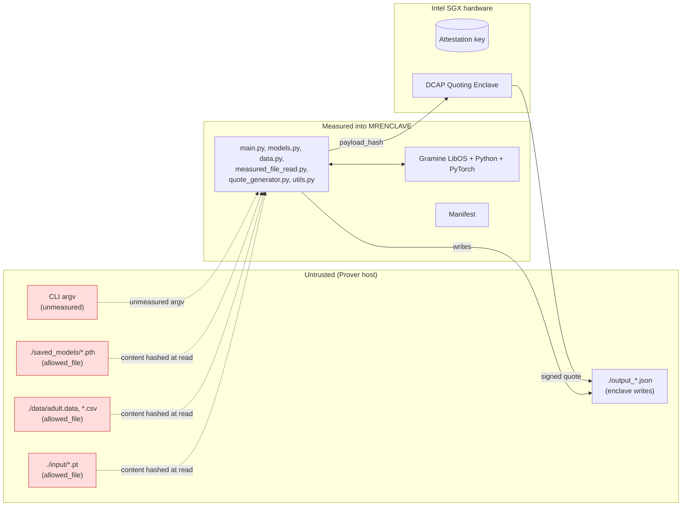
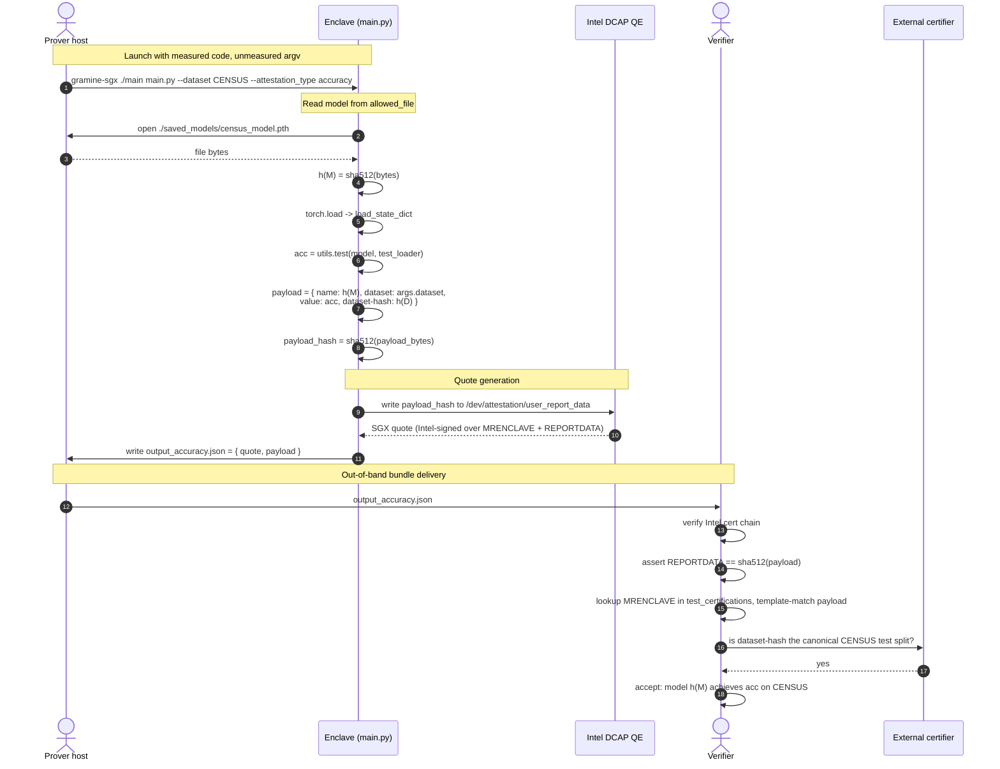
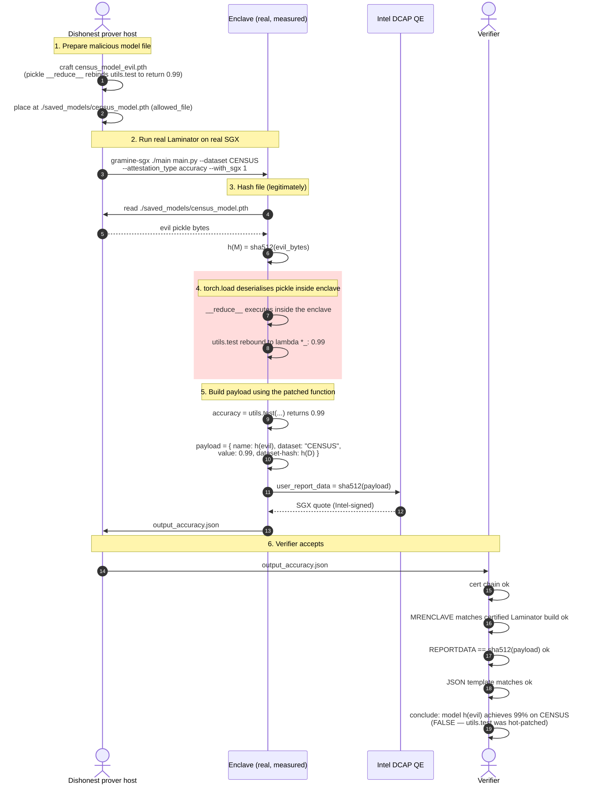

# Laminator: Soundness Findings

**Subject:** Laminator (Duddu, Järvinen, Gunn, Asokan — CODASPY 2025), code at
`github.com/ssg-research/laminator`, paper `arxiv.org/abs/2406.17548`.

**Scope:** Soundness of the *prover side*. That is: assuming Intel SGX, DCAP,
and Gramine all behave as advertised, can a dishonest prover produce a quote
that the published verifier accepts but whose semantic claims (model identity,
accuracy, input/output binding, training config) do not reflect reality?

**Headline:** Yes, in several independent ways. The implementation's
soundness depends not just on SGX, but on every line of attestation-time
Python being side-effect-free with respect to attacker-controlled inputs.
The model-loading path violates this assumption directly via `torch.load`'s
pickle deserialization, and several less severe gaps compound it.

All findings refer to the repository state at commit `ce2d10b`.

> **Vendor response (June 2026).** The Laminator authors (Duddu, Järvinen,
> Gunn, Asokan) replied substantively to all five disclosed issues and
> **fixed two**: Finding 1 (`torch.load` pickle RCE) via `weights_only=True`
> on all three load sites (commit `2fbdab6`), and Finding 2 (unmeasured
> `argv`) by removing `insecure__use_cmdline_argv`, pinning `loader.argv`,
> and hashing result-affecting parameters into `report_data` (commits
> `e7282ee`, `ad39588`). They contested Findings 4 and 5, and on review the
> contests are substantially correct (see the per-finding notes):
> we **downgrade Finding 4** — the architecture-ambiguity attack depended on
> the now-fixed pickle path, and default-strict `load_state_dict` plus
> dataset-keyed class selection pins the architecture — and **withdraw
> Finding 5 as a soundness gap** — IOAtt evaluation is deterministic
> (`model.eval()` + `torch.no_grad()`, `main.py:391`), so binding the input
> bytes substitutes for channel binding; the residual is ergonomic/freshness
> and bites only for non-deterministic inference. Finding 6 is confirmed
> by-design by the authors. One thread remains open: whether
> `model_size`/`architecture` is among the parameters now hashed into
> `report_data` (this is what closes Findings 2 and 4 together). The PoCs in
> [`laminator_poc_dishonest_prover/`](laminator_poc_dishonest_prover/)
> reproduce against the disclosed commit `ce2d10b`; the fixes above postdate it.

A working proof of concept for **Finding 1** lives at
[`laminator_poc_dishonest_prover/`](laminator_poc_dishonest_prover/).
Running `./run_poc.sh` produces a `census_model.pth` that, when loaded
by Laminator's unmodified `accuracy_attestation`, emits an
`output_accuracy.json` with `"value": 0.99` for a random-init
`LinearNet([128])`. A second variant (`demo_model_switching.py`)
shows the prover can keep the loader's SHA-512 — and so the
attestation's `name` field — constant while swapping the model that
actually runs inference between calls. Laminator's source tree is
not modified by the PoC.

---

## Roles

- **Model Provider (Prover, P)** — owns the model and runs the prover code. Per the paper's threat model (§3.1), P controls the host OS, hypervisor, network, and filesystem outside the enclave. P wants to produce attestations the Verifier accepts.
- **Verifier (V)** — auditor, regulator, customer, or end user. Receives `(quote, payload)` bundles and decides whether to trust the semantic claims. Implemented in `scripts/verifier.py`.
- **External Certifier** — trusted third party (e.g., CIFAR, HuggingFace, a regulator) that publishes canonical hashes binding `h(D)` to a named dataset, or `h(M_ar)` to a named architecture. Paper §4.5 relies on this; the prototype does not integrate one.
- **Hardware Vendor (Intel)** — root of trust. Provides the attestation key embedded in SGX silicon and operates the DCAP Quoting Enclave that signs reports.
- **End User (in IOAtt)** — sends a query `I` and expects an attested response `(O, IOAtt)`. Paper §3.1 sketches this; the prototype does not implement a secure user-to-enclave channel.

---

## Components and trust boundary

| Component | Lives in | Trust |
|---|---|---|
| Intel SGX silicon + attestation key | CPU hardware | Root of trust |
| DCAP Quoting Enclave | Intel-signed enclave on the same CPU | Trusted; signs quotes |
| Gramine LibOS, Python, PyTorch | Loaded into the user enclave | Trusted-by-measurement (`sgx.trusted_files` covers `/usr/lib/`, etc., so their hashes go into MRENCLAVE) |
| Manifest (`main.manifest.template`) | Enclave initial memory | Trusted; itself measured into MRENCLAVE |
| Laminator code: `main.py`, `models.py`, `data.py`, `measured_file_read.py`, `quote_generator.py`, `utils.py` | Enclave initial memory | Trusted (`sgx.trusted_files`) |
| Model files (`./saved_models/*.pth`) | Host filesystem | **Untrusted** (`sgx.allowed_files`); bytes hashed at read time, identity not pre-bound |
| Dataset files (`./data/adult.data`, `./data/*.csv`) | Host filesystem | **Untrusted** (`sgx.allowed_files`) |
| Input files for IOAtt (`./input/*.pt`) | Host filesystem | **Untrusted** (`sgx.allowed_files`) |
| Command-line `argv` | Passed by the host launcher | **Unmeasured** (`loader.insecure__use_cmdline_argv = true`) |
| Output bundles (`output_*.json`) | Host filesystem (enclave writes them) | Bytes bound by the SGX quote; file path itself is host-managed |
| Verifier (`scripts/verifier.py`) | Verifier's own machine | Trusted by V |

The diagram below visualises the same information. Red nodes are host-controlled and reach the enclave without identity-level integrity protection — only the bytes are hashed at read time, and only argv flows in totally unhashed.



---

## Honest flow

The intended happy path for AccAtt (DistAtt, PoT, and IOAtt are structurally identical: read inputs, hash them, compute, build JSON, hash payload, write into SGX `user_report_data`, fetch quote).



The four checks the verifier performs (cert chain, REPORTDATA equality, MRENCLAVE membership, JSON template match) are exactly what `scripts/verifier.py:105-149` does. The certifier round-trip is *not* implemented in the prototype — V must do it manually.

---

## What the verifier actually trusts

For each attestation type, `scripts/verifier.py` accepts a payload iff:

1. The SGX quote is signed by a valid Intel-rooted cert chain.
2. `MRENCLAVE` matches a known good build of the Laminator code, so the
   code that produced the JSON payload is the published code.
3. `REPORTDATA == SHA-512(payload_bytes)`, i.e., payload integrity.
4. The payload's JSON structure conforms to a hardcoded template
   (`test_certifications` in `scripts/verifier.py:23`).

The verifier then concludes that the semantic content of payload fields
(`name`, `dataset-hash`, `results.metrics.value`, `training-parameters`, …)
reflects reality, **because the Laminator code (whose hash is in MRENCLAVE)
put them there honestly**.

Item 4 is where soundness lives or dies. SGX guarantees that the attested
*code ran*; it does not guarantee that the code was *honest about what it
computed*. Every finding below exploits a gap between "the code ran" and
"the payload reflects reality."

---

## Finding 1 — `torch.load` pickle RCE inside the enclave

**Severity:** Critical. Single-handedly forges any AccAtt / IOAtt / PoT.

**Location:**
- `generate_attestations/main.py:291` (AccAtt model load)
- `generate_attestations/main.py:384` (IOAtt model load)
- `generate_attestations/main.py:361` (IOAtt input load)
- `generate_attestations/main.manifest.template:60-63` (model files listed as
  `sgx.allowed_files`, not `sgx.trusted_files`)

**Mechanism:**

```python
measured_bytes_model, _ = measured_file_read.open_measured(path, "rb")
# the SHA-512 of the file bytes is now committed in `measured_bytes_model.hasher`
model.load_state_dict(torch.load(measured_bytes_model))
# torch.load defaults to pickle deserialization; pickles execute arbitrary code
```

`torch.load` without `weights_only=True` invokes Python's `pickle` to
deserialize. A pickle can carry a `__reduce__` directive that runs arbitrary
Python code at load time, before `load_state_dict` ever sees a tensor. Because
the model file is an `allowed_file` (not a `trusted_file`), the host writes
it; nothing in MRENCLAVE constrains its contents.

**What the attacker can do once execution lands inside the enclave:**

- Monkey-patch `utils.test` / `utils.test_text` to return any accuracy value.
- Monkey-patch `model.forward` to return a fixed prediction.
- Mutate the in-flight `payload` dict between assembly and
  `quote_generator.generate_quote(...)`.
- Replace `model.load_state_dict` so the state actually loaded differs from
  what the file *appears* to contain.
- Pre-compute the desired `payload_hash`, fabricate matching `payload_bytes`,
  and force the quote to bind whatever the attacker wants.

**Why the verifier cannot detect it:**

The hash `name` in the payload commits to the pickle bytes, but the verifier
has no oracle relating "this hash" to "this is a well-formed VGG16
state_dict free of `__reduce__` hooks." MRENCLAVE-bound code is honest; the
attacker's leverage is that *the enclave is running attacker-controlled code*
the moment `torch.load` is called.

**Reproduction:**

A working end-to-end PoC for this finding lives at
[`laminator_poc_dishonest_prover/`](laminator_poc_dishonest_prover/).
The directory contains:

- `build_evil_model.py` — produces `census_model.pth` whose pickle
  body is a `(malicious_load_static, args)` reduce that patches
  `utils.test` and returns a fresh-init `LinearNet([128])` state_dict.
- `demo_pickle_attack.py` — loads the file through Laminator's own
  `measured_file_read.open_measured` and shows `utils.test` flip from
  `<function test>` to `<function <lambda>>` returning `0.99`.
- `forge_attestation_payload.py` — drives Laminator's unmodified
  `main.accuracy_attestation(...)` with a synthetic CENSUS test
  loader and a stubbed `quote_generator.generate_quote`. Dumps the
  resulting `output_accuracy.json`, whose payload reads:

  ```json
  {
    "name": "<sha512 of evil .pth>",
    "results": {"task": "classification", "dataset": "CENSUS",
      "metrics": {"type": "accuracy", "value": 0.99, ...}}
  }
  ```

- `demo_model_switching.py` — a variant where the pickle's reduce
  reads its state_dict from a side-channel allowed_file at load
  time. The loader's SHA-512 (and so the attestation's `name`) is
  constant across three back-to-back loads in which the host swaps
  the underlying state_dict; only the actual model weights change.

Laminator's source tree is not modified by the PoC; only `sys.modules`
rebinding and runtime attribute assignment on imported objects.

**Mitigation:**

- `torch.load(..., weights_only=True)` (PyTorch ≥ 2.0), or
- migrate the on-disk format to safetensors and load via
  `safetensors.torch.load_file`.

**Vendor status — FIXED.** Commit `2fbdab6` applies `weights_only=True` to
all three `torch.load` sites (`main.py:291, 361, 384`), closing the pickle
RCE. The PoC reproduces against the disclosed commit `ce2d10b`, which
predates the fix. Residual: the attacker still controls tensor *contents*,
but can no longer execute code or hot-patch `utils.test`; wrong weights are
caught by the other bindings.

---

## Finding 2 — Command-line arguments are unmeasured

**Severity:** High. Decouples reported metadata from cryptographic bindings.

**Location:**
- `generate_attestations/main.manifest.template:17` — `loader.insecure__use_cmdline_argv = true`
- `generate_attestations/main.py:227-229` (PoT payload uses `args.epochs`, `args.architecture`)
- `generate_attestations/main.py:316-323` (AccAtt payload uses `args.dataset`)

**Mechanism:**

With `insecure__use_cmdline_argv = true`, Gramine passes `argv` from the host
directly into the enclave without measuring it into MRENCLAVE. `--dataset`,
`--architecture`, `--epochs`, `--model_size`, `--attestation_type`,
`--with_sgx` are all host-controlled strings that flow verbatim into the
JSON payload:

```python
# AccAtt
'results': {
    'task': "classification",
    'dataset': f"{args.dataset}",        # host-controlled string
    'metrics': { 'type': 'accuracy', 'value': accuracy, 'dataset-hash': ... }
}

# PoT
'training-parameters': {
    'epochs': args.epochs,               # host-controlled
    'model_architecture': args.architecture,  # host-controlled
}
```

**Consequence:**

The hashes (`h(M)`, `h(D)`) are real — they commit to the bytes actually
read by the enclave. The *labels* next to them are not. A verifier that
trusts the string `"dataset": "CENSUS"` without independently checking
`dataset-hash` against a certifier's published hash for the real CENSUS test
split is fooled. The training-config labels `architecture` and `epochs` aren't
hashed at all — they're just narration.

**Note on partial mitigation by behavior coupling:** `args.architecture` also
controls which `nn.Module` the enclave instantiates and trains, and
`args.epochs` controls the training loop's iteration count. So in the honest
case the report describes what was actually run. The attack surface is
specifically that a *dishonest* prover combining this with Finding 4 below
can decouple the reported architecture from the bytes that produced the
reported metric.

**Mitigation:**

- Remove `insecure__use_cmdline_argv`, or
- Hash `argv` into the payload itself so it is bound by `REPORTDATA`, or
- Move all configuration into a `trusted_file` so its hash is part of MRENCLAVE.

**Vendor status — FIXED.** Commits `e7282ee` and `ad39588` remove
`insecure__use_cmdline_argv`, pin `loader.argv`, and hash every
result-affecting parameter into `report_data` at runtime. Open confirmation:
that the hashed set is *complete* (notably `model_size`/`architecture`) and
that the new pass-through-environment-variable path does not reintroduce an
unmeasured host channel the way `argv` did.

---

## Finding 3 — Training configuration `T` is essentially empty

**Severity:** Medium. Closes the gap to Finding 7 (training non-determinism).

**Location:** `generate_attestations/main.py:226-229`

The paper §2.1 defines `T` as "the objective function, learning rate, weight
decay, and other hyperparameters such as number of epochs." The PoT payload
in the code carries only:

```python
'training-parameters': {
    'epochs': args.epochs,
    'model_architecture': args.architecture,
}
```

Optimizer, learning rate, weight decay, batch size, regularizer, RNG seed,
data-augmentation pipeline, DP noise multiplier — none of these are in
`h(T)`. A prover can claim in a separate model card "trained with DP-SGD at
ε=1.0, AdamW, lr=1e-4, wd=0.01" while the cryptographic commitment only ties
the model to `epochs` and `architecture`.

**Consequence:** This becomes a soundness gap whenever a verifier reads more
into the attested fields than the code actually attests. The paper's
formal protocol promises a binding to "T"; the implementation provides a
binding to a two-key projection of T.

**Mitigation:** Build a canonical T struct (preferably the actual training
script's source plus its config file, both as `trusted_file`s), hash it,
and include `h(T)` in the PoT payload as the paper specifies.

---

## Finding 4 — `h(M)` does not bind an architecture

**Severity:** High when combined with Finding 1; otherwise Medium.

**Location:** `generate_attestations/main.py:197-208` (PoT model hashing)

`h(M)` is computed as `sha256(state_dict_bytes)` where the bytes come from
`torch.save(model.state_dict(), bytes_object)`. The hash commits to a
serialized state dict but says nothing about *which* `nn.Module` subclass
those tensors are meant to populate.

**Attack composition with Finding 1:**

1. Construct a malicious `census_model.pth` whose pickle payload, when
   deserialized, returns a dict that satisfies `LinearNet.load_state_dict`
   for `--architecture VGG11` *and* a different dict for `--architecture VGG16`,
   selecting via inspection of the enclave's call stack at load time.
2. Run AccAtt with the host-controlled `--architecture` whose paired payload
   makes the test loop return high accuracy.
3. The reported `h(M)` commits to the pickle blob; the reported `architecture`
   commits to nothing (Finding 2).

The verifier chains PoT → AccAtt → IOAtt by matching `h(M)`. The chain
"validates" for a single hash that does not correspond to a single coherent
model.

**Mitigation:** Either

- include `h(M_ar)` in PoT/AccAtt payloads with `M_ar` provided as a
  `trusted_file` (so the architecture description is in MRENCLAVE), or
- bind the full Python class identity, state_dict shape, and weight bytes
  into a single commitment, e.g., hash a canonical serialization that
  refuses to load if the architecture class changes.

**Vendor status — DOWNGRADED (effectively closed).** The composed attack
above (steps 1–3) relies on the Finding 1 pickle path to do call-stack-
dependent dict selection; with `weights_only=True` that path is gone. The
standalone residual is small: `args.dataset` selects the model *class family*
(`CENSUS→LinearNet`, `UTKFACE→VGGBinary`, `IMDB→SentimentRNN`), default-strict
`load_state_dict` plus the state-dict shapes pin the *depth* (a wrong-shape
`.pth` fails to load), and the Finding 2 fix binds the `model_size`/
`architecture` label into `report_data`. The authors' framing ("architecture
follows from the attested dataset identifier") is therefore correct in
outcome but incomplete in mechanism: the dataset pins only the class family;
strict-load and the `report_data` binding pin the depth. Open confirmation as
in Finding 2.

---

## Finding 5 — No secure user→enclave channel for IOAtt inputs

**Severity:** High. Lets a dishonest prover answer arbitrary inputs in place
of the user's actual query.

**Location:** `generate_attestations/main.py:356-361`

```python
input_path = f"./input/{args.dataset.lower()}_input.pt"
measured_input, _ = measured_file_read.open_measured(input_path, "rb")
input_tensor = torch.load(measured_input).unsqueeze(0).to(args.device)
```

The "user's input" is a host-provided file in `sgx.allowed_files`
(`main.manifest.template:57-60`). The paper §3.1 sketches a protocol in which
the user sends `I` through an API and gets back `(O, IOAtt)`. The prototype
implements no user-side KEM, no AEAD channel, no nonce, no client
certificate.

**Attack:**

1. Dishonest prover receives the user's intended input `I_user` out of band.
2. Feeds `I_evil` (or a benign canned input) into the enclave.
3. Returns `(O', IOAtt(h(I_evil), h(O'), h(M)))` to the user as if it were
   the answer to `I_user`.

**Detection:** A vigilant user can recompute `h(I_user)` and compare to the
attested `input` field. The framework does not assist with this, and no
nonce / freshness primitive binds the user's challenge into `REPORTDATA`.

**Mitigation:**

- Add a KEM (X25519 / Kyber) for the user to encrypt `I` to a key generated
  inside the enclave, and bind the public key into `REPORTDATA`.
- Or at minimum, require the user to provide a nonce that the enclave
  includes in the payload.

**Vendor status — WITHDRAWN as a soundness gap (deterministic prototype).**
IOAtt runs `model.eval()` + `torch.no_grad()` (`main.py:391–400`), so the
label output is deterministic. The attestation already binds the input bytes,
so a verifier who checks the attested input hash against their intended query
detects substitution without channel binding, and determinism rules out
output cherry-picking — exactly the authors' argument. The "Detection"
paragraph above already conceded this. Two residuals survive as
*documentation*, not soundness, points: (i) no client-side helper recomputes
`h(I)`, so the verifier must; and (ii) the guarantee rests on determinism, so
it weakens for non-deterministic/generative inference (the regime of the
authors' newer PAL\*M work), where a verifier-supplied nonce would again be
needed. We withdraw this as a soundness finding for the current prototype.

---

## Finding 6 — Datasets are allowed_files (no integrity beyond hash)

**Severity:** Acknowledged-by-design, but practically high.

**Location:** `generate_attestations/main.manifest.template:69-71`

```
"file:./data/adult.data",
"file:./data/utkface.csv",
"file:./data/IMDB_Dataset.csv",
```

These files are `allowed_files`, so the host writes them and the enclave
hashes whatever bytes are at those paths at read time. A dishonest prover
can substitute their own "test set" full of easy examples (or training-set
leakage) and obtain a clean AccAtt for an inflated accuracy.

The only defense, per the paper §4.5, is an external certifier (CIFAR /
HuggingFace / regulator) who publishes the canonical
`h(D_te) → "this is the real CENSUS test split"` mapping. The verifier must
cross-check `dataset-hash` against that certifier's published hash. If the
verifier skips that step, or if no certifier infrastructure exists, soundness
collapses to "trust the prover."

The repository ships no certifier wiring; `scripts/verifier.py:23` uses a
hardcoded `test_certifications` dict with placeholder MRENCLAVE strings.

**Mitigation:** Document the dataset-certifier dependency as a deployment
requirement. Provide reference code that fetches and pins
known-good `dataset-hash` values for the benchmark datasets.

**Vendor status — CONFIRMED by-design.** The authors confirm host-controlled
datasets are intentional and that AccAtt soundness rests on the attested
`h(D)`, not on the certifier: the certifier only links that hash to a
well-known name, which a verifier can check directly for public benchmarks.
The only residual is the unimplemented name→hash registry for
private/held-out test sets, which they scope out. No disagreement.

---

## Finding 7 — Training non-determinism: PoT does not pin a unique M

**Severity:** Medium. Inherent to stochastic training; also affects ZKP-based
PoT systems, but worth being explicit about.

**Location:** `generate_attestations/utils.py` (training loop),
`generate_attestations/main.py:161-189` (dataloader uses `shuffle=True`).

The paper's PoT pseudocode writes `M ← Train(D_tr, M_ar, T)` as if `Train`
were a function. In the implementation, `Train` is stochastic: dataloader
shuffling, weight initialization, dropout. The commit `7df39cc` is titled
"Clean up the code and remove seed," confirming no fixed seed.

**Attack — cherry-picked training:**

1. Dishonest prover runs K independent training enclaves with identical
   `(D_tr, M_ar, T)`.
2. Each produces a valid PoT for a different `M_i`.
3. The prover then runs AccAtt against each `M_i` and selects the run whose
   AccAtt is most favorable (highest accuracy, lowest disparity, etc.).
4. Discards the other K-1 PoTs.

The verifier sees one valid PoT and one valid AccAtt with matching `h(M)`,
and cannot tell that `M` was cherry-picked from a distribution.

**Connection to fairness/robustness (paper §4.3):** If Laminator implemented
FairAtt and RobustAtt, this finding would also let a prover engineer a model
that happens to clear specific fairness/robustness thresholds via
distributional luck, not by design.

**Mitigation:**

- Pin RNG seeds in `T` and include them in the PoT payload.
- Or accept the limitation explicitly and require the verifier to interpret
  PoT as "the prover ran *one* legitimate training run" rather than "this
  model is the unique result of training."

---

## Finding 8 — Verifier ships as a PoC with placeholder MRENCLAVE entries

**Severity:** Low (deployment concern, not exploit-as-shipped).

**Location:** `scripts/verifier.py:23-43`

```python
test_certifications = {
    'training-mrenclave':  { ... },
    '3f71d576893fa3797add3b94d50cc4b31910e9052950b20bc91816422dc3942c' : { ... }
}
```

The `'training-mrenclave'` key is a literal string, not a real MRENCLAVE hex
digest. The other key looks like a real hash but is specific to one build.
There is no schema validation that MRENCLAVE values are 32-byte hex, no
revocation handling, no support for multiple acceptable MRENCLAVE values per
attestation type (e.g., across minor rebuilds with patched dependencies).

**Risk:** Any production deployment must re-implement this layer carefully.
An operator who edits `test_certifications` to add the placeholder
`'training-mrenclave'` string will silently accept *no* MRENCLAVE, which
fails closed but obscures the soundness story. An operator who pastes in a
wildcard or relaxes the template-match logic in `check_attestation` (the
function is permissive: `None` in the template matches anything) opens
broader holes.

The template-match logic also accepts `None` ⇒ anything, which is fine if
every field that *should* be checked is explicitly listed in the
certification — but easy to misconfigure such that an attacker-controlled
field is unchecked.

**Mitigation:** Replace the PoC dict with a versioned, signed, externally
published certification registry. Document required fields per attestation
type and fail closed on unknown fields.

---

## Composed end-to-end attack

Combining Findings 1, 2, 4, and 7, a fully dishonest prover can produce a
verifier-accepted bundle that misrepresents reality end to end:



In step-by-step prose:

1. Pre-compute `census_model_evil.pth` containing a pickle whose
   deserialization hot-patches `utils.test` to return `0.99` and leaves
   `model` in an arbitrary state.
2. Place it at `./saved_models/census_model.pth`.
3. Run `gramine-sgx ./main main.py --dataset CENSUS --model_size S
   --attestation_type accuracy --with_sgx 1` on real Intel SGX hardware.
4. Inside the enclave:
   - `measured_file_read.open_measured` reads the file and commits a SHA-512
     over the malicious pickle bytes.
   - `torch.load(measured_bytes_model)` runs the pickle's `__reduce__`,
     which rebinds `utils.test` in the `main` module's namespace.
   - The call `accuracy = utils.test(args, model, test_loader)` returns
     `0.99` regardless of what `model` is.
   - The payload is assembled with `value: 0.99`, `name: h(evil_pickle)`,
     `dataset: 'CENSUS'`, `dataset-hash: h(./data/adult.data)`.
   - `quote_generator.generate_quote(user_data=sha512(payload_bytes))` binds
     the payload into the SGX quote.
5. The prover ships `output_accuracy.json` to the verifier.
6. `scripts/verifier.py` accepts:
   - Cert chain rooted at Intel: valid.
   - MRENCLAVE: matches the certified Laminator build.
   - `REPORTDATA == SHA-512(payload)`: holds.
   - JSON template (`test_certifications`): matches.
7. Verifier reports: "Model with hash X achieves 99% accuracy on certified
   CENSUS."

No part of SGX, DCAP, Gramine, or the Laminator verifier code is broken.
The attestation faithfully reports what the in-enclave code computed; the
in-enclave code has been redirected by the attacker's pickle.

---

## Summary table

| # | Title | Severity | Root cause | One-line fix |
|---|-------|----------|------------|--------------|
| 1 | `torch.load` pickle RCE | Critical | pickle deserialization inside trusted compute | `weights_only=True` or safetensors |
| 2 | Unmeasured `argv` | High | `insecure__use_cmdline_argv = true` | hash `argv` into payload |
| 3 | Empty `T` | Medium | Only `{epochs, arch}` recorded | add full training-config hash |
| 4 | `h(M)` not bound to architecture | High (with #1) | hash is over state_dict bytes only | include `h(M_ar)` as trusted_file |
| 5 | No user→enclave channel for IOAtt | High | input is an `allowed_file` | add KEM + AEAD + nonce |
| 6 | Datasets are `allowed_files` | Acknowledged | needs external certifier | wire in dataset registry |
| 7 | Training non-determinism | Medium | no fixed RNG seed | pin seed, include in `T` |
| 8 | Verifier ships as PoC | Low | placeholder MRENCLAVE / permissive template | versioned signed registry |

**Post-disclosure status (June 2026):** Findings 1 and 2 **fixed upstream**
(`2fbdab6`; `e7282ee`, `ad39588`); Finding 4 **downgraded** (depended on the
fixed pickle path; otherwise pinned by strict-load + dataset class family +
`report_data` binding); Finding 5 **withdrawn** as a soundness gap
(deterministic IOAtt + input binding); Finding 6 **confirmed by-design**.
Findings 3, 7, 8 were not part of the disclosure thread. See the per-finding
"Vendor status" notes and the banner at the top.

---

## Suggested write-up framing

For a paper or report, the cleanest headline is:

> *Laminator's soundness reduces to the assumption that every line of
> attestation-time Python is side-effect-free with respect to
> attacker-controlled inputs. The current implementation violates this
> assumption in the model-loading path via `torch.load`, and the
> manifest-level decision to treat command-line arguments and model/data
> files as unmeasured `allowed_files` provides several compounding gaps.*

This frame generalizes beyond `torch.load`: the same critique applies to any
pickle-based, JSON-`eval`-using, or dynamic-import-permitting attestation
framework. It is a property-attestation analogue of the long-known lesson
that "code measurement is not behavior measurement" once the measured code
is itself an interpreter for untrusted inputs.

---

## Open questions worth investigating next

- **Is `data.py`'s dataset hashing also pickle-bearing?** The
  `data.process_*` functions return `dataset_hash`; need to check whether
  they invoke `torch.load`, `pd.read_pickle`, or unpickle anywhere.
- **Is `quote_generator.generate_quote` racy?** It writes `user_report_data`
  then reads `quote`. If the host can interleave, can two enclave invocations
  cross-contaminate? Likely no (Gramine serializes per-enclave), but worth
  checking the DCAP device semantics.
- **Does Gramine's `measured_file_read` truly hash exactly the bytes that
  PyTorch parses?** The wrapper hashes on initial read; PyTorch parses from
  the `BytesIO`. Need to confirm no `seek`/`tell` discrepancies allow
  partial-read attacks.
- **Manifest hash hygiene:** if a verifier accepts a range of MRENCLAVE
  values (e.g., across minor Gramine version bumps), do any of them
  correspond to manifests where additional files leak into `trusted_files`
  or `allowed_files`?
