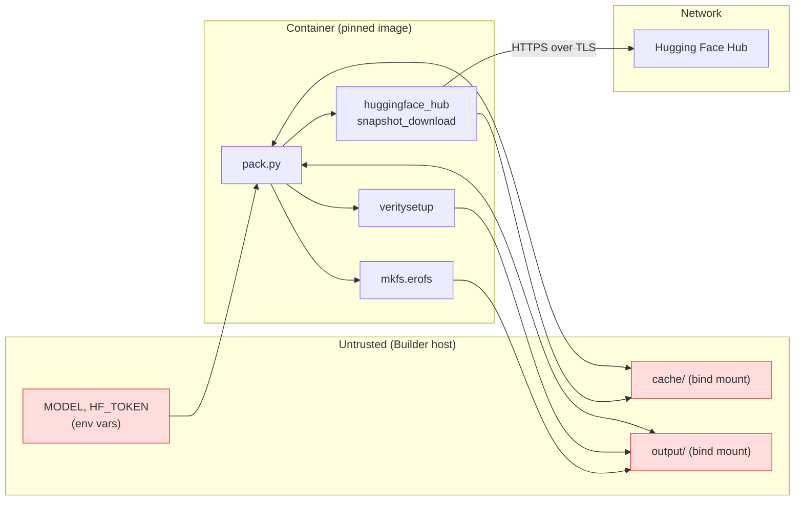
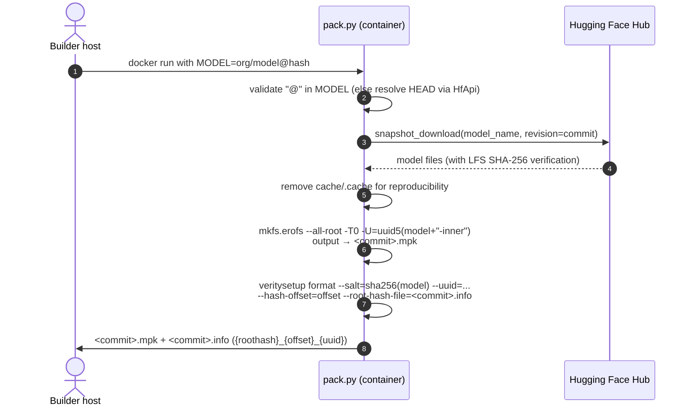
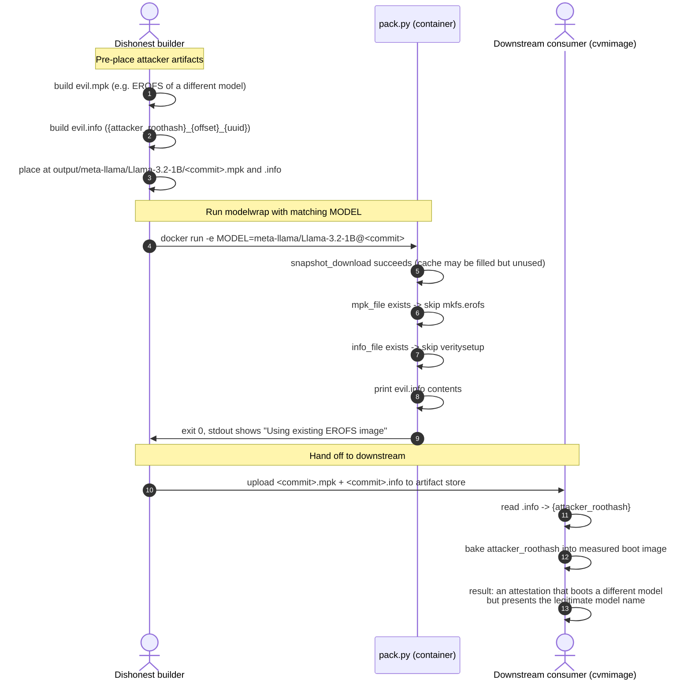

# Modelwrap: Soundness Findings

**Subject:** Tinfoil `modelwrap`, `github.com/tinfoilsh/modelwrap`. Build-time
tool that produces reproducible dm-verity EROFS images of Hugging Face models
for downstream embedding into Tinfoil CVM images.

**Scope:** Soundness of the *build-time prover*. That is: a party that runs
`modelwrap` and ships the resulting `.mpk`/`.info` files to downstream
consumers (e.g. `cvmimage`, which embeds the root hash into a measured boot
image). Can a dishonest builder produce an output that downstream consumers
treat as "this image is the dm-verity-protected EROFS of `org/model@commit`"
when in fact it is something else?

**Headline:** Modelwrap's reproducibility guarantee is "given the same inputs,
the same outputs," but its idempotency check (skip-if-output-exists) silently
trusts whatever files already sit in `output/`. Combined with the fact that
the resulting `.info` file carries no model identity and is unsigned, a
dishonest builder can produce well-formed but unrelated artifacts that a
careless downstream consumer cannot distinguish from a legitimate build.

All findings refer to commit at the time of cloning (`depth=1` snapshot).

---

## Roles

- **Builder (Prover, P)** — runs the `modelwrap` Docker container,
  produces `<commit>.mpk` and `<commit>.info` in the host's `output/`
  directory. Controls the container's environment variables (`MODEL`,
  `HF_TOKEN`), bind-mounted volumes (`cache/`, `output/`), and the host
  filesystem state at start time.
- **Downstream Consumer (Verifier, V)** — typically `cvmimage` or another
  Tinfoil component that reads `<commit>.info` and embeds the root hash
  into a measured CVM boot image. May also be an auditor who wants to
  reproduce the build to confirm a published root hash corresponds to a
  named HF model.
- **Hugging Face Hub** — third-party that serves the model files. Trusted
  by modelwrap to return correct bytes for a given `org/model@commit`.
- **Model Publisher** — the entity who uploaded the model to HF Hub. Modelwrap
  does not authenticate the publisher; identity is inherited from HF Hub.

---

## Components and trust boundary

| Component | Where it lives | Trust |
|---|---|---|
| `pack.py` (105 LOC) | Inside the container image, immutable | Trusted by the consumer once the image hash is known |
| `mkfs.erofs`, `veritysetup` | Pinned `apt` versions inside the image | Trusted; reproducibility depends on these being the pinned versions |
| `huggingface_hub.snapshot_download` | Python package, pinned in `requirements.txt` | Trusted to follow LFS integrity checks |
| `cache/` (bind mount) | **Host filesystem** | **Untrusted** — host can pre-populate |
| `output/` (bind mount) | **Host filesystem** | **Untrusted** — host can pre-populate |
| `MODEL` env var | Set by host launcher | **Unmeasured at runtime** |
| `HF_TOKEN` env var | Set by host launcher | **Unmeasured at runtime**, controls which gated content is accessible |
| `org/model@commit` ↔ bytes mapping | Hugging Face Hub | **External trust** |

Modelwrap is a *build-time* tool, so there is no SGX/SEV-SNP boot measurement
in play. The only integrity the output carries is what flows from
(a) the deterministic mkfs.erofs/veritysetup invocations, and (b) the file
contents read from the HF Hub. Everything else — the inputs, the working
directories, and the absence of a tampered `.mpk` already on disk — depends
on the builder being honest.



---

## Honest flow



The intended downstream consumption is for `cvmimage` (or equivalent) to read
`<commit>.info`, embed the root hash into a kernel command line / dm-verity
table, and bake that table into a measured boot image. At VM boot, the kernel
mounts the `.mpk` via dm-verity using the embedded root hash, so any block
divergence from the build-time state causes a read error.

---

## Vendor response (June 2026): the `tinfoil-config.yml` + reproducible-build defense

After our disclosure, Tinfoil (Tanya, co-founder) pointed out a deployment-
side gate we had not credited on first read: modelwrap's outputs are not
consumed by `cvmimage` directly. They flow through a `tinfoil-config.yml`
that pins `(model_name, hf_repo@revision, mpk_root_hash, cvm-version,
container_image@sha256)`, and that config's SHA-256 is itself part of the
launch measurement.

We verified the chain end-to-end against the source:

- `tinfoil/confidential-model-router/tinfoil-config.yml` and
  `tinfoil/verifiable-reviewer/tinfoil-config.yml` are real examples that
  pin the deployment artefacts (container image `@sha256:...`,
  `cvm-version`, etc.) for each Tinfoil-hosted service.
- `tinfoil/cvmimage/tinfoil/cmd/boot/config.go:142-167`
  (`loadAndVerifyConfig`) reads the config from a virtio disk
  (`/dev/disk/by-id/scsi-0QEMU_QEMU_HARDDISK_tinfoil-config`), SHA-256
  hashes the bytes, and rejects boot unless the hash matches the
  `tinfoil-config-hash` parameter on the kernel command line.
- The kernel cmdline is part of the launch measurement, so a verifier who
  pins `MEASUREMENT` transitively pins the config's hash, which pins the
  mpk root hash, which dm-verity-binds the served model bytes.

In addition, modelwrap is deterministic per `(model, revision,
modelwrap_version, pinned_tool_versions)` so any third party can rebuild
the mpk and confirm the published root hash. Reproducibility is the
out-of-band integrity check; the in-band check is the
config-hash-on-cmdline chain above.

**Implication for the findings below.** M-1 through M-4 are *correct as
structural observations about `pack.py`'s behaviour*, and the PoC drives
the real script unmodified to demonstrate them. But the consequence
chain to "verifier accepts attacker bytes" requires *also* corrupting
`tinfoil-config.yml`, which requires CI/repo write access on the
deployment-config repo *and* defeats reproducible-build verification. We
have accordingly reframed M-1…M-4 from soundness findings to
**build-host hygiene + auditor-convenience** findings. The findings still
hold under any deployment that does *not* sit behind a measured signed
config + reproducible build (e.g., third-party adopters of modelwrap who
copy the tool but not the surrounding pipeline). For Tinfoil's deployed
services specifically, the integrity argument routes through the config
chain above.

The one residual composition concern that remains is whether M-1 can
chain with the `tinfoil-go` SDK's proxy-mediated rollback
(`tinfoil_sdk_soundness_finding.md`, Finding Tinfoil-1): a historical
signed `tinfoil-config.yml` that happens to reference a historical mpk
root hash that an attacker can match would defeat both gates. Tinfoil
has indicated a planned monotonic CVM-version floor in the SDK; we have
asked whether that floor will also apply to deployment-config-repo
versions, since otherwise the composition remains open.

---

## Finding M-1 — Pre-existing output files bypass the build

**Severity (as-deployed, Tinfoil pipeline):** Build-host hygiene. Per the
vendor-response section above, escalation to verifier-accepting attestation
requires *also* corrupting the signed `tinfoil-config.yml` (CI/repo write
access) and survives only if the reproducible-build cross-check is skipped.

**Severity (third-party adopters of `modelwrap` without the surrounding
signed-config + reproducible-build pipeline):** High. The core "build-time
integrity" claim of the standalone script collapses if the builder can
place outputs in `output/` before invoking modelwrap.

**Location:** `pack.py:58-71` and `pack.py:77-102`

```python
# pack.py:58
if not os.path.exists(mpk_file):
    mkfs_cmd = ["mkfs.erofs", ...]
    subprocess.run(mkfs_cmd, check=True)
    os.rename(mpk_file+".tmp", mpk_file)
else:
    print(f"Using existing EROFS image {mpk_file}")

# pack.py:77
if not os.path.exists(info_file):
    veritysetup_cmd = ["veritysetup", ...]
    subprocess.run(veritysetup_cmd, check=True)
    ...
else:
    print(f"dm-verity volume already exists at {mpk_file}")
```

**Mechanism:** The script is idempotent by skipping work when the output
files already exist. But the "output files" live in a host-bind-mounted
directory the builder controls. The skip path performs no integrity check
on the pre-existing files.

**What the attacker can do:**

1. Pre-place a `<commit>.mpk` and `<commit>.info` of their choosing at
   `output/org/model/<commit>.mpk` and `.info`.
2. Run modelwrap with the matching `MODEL=org/model@commit`.
3. `snapshot_download` still runs (so the cache may even be populated with
   the legitimate model), but mkfs.erofs and veritysetup are *skipped*.
4. The script prints "Using existing EROFS image …" and "dm-verity volume
   already exists at …" — both look like normal idempotent re-runs — and
   exits 0.
5. The final `print(f.read())` faithfully outputs the attacker-supplied
   root hash, completing the illusion of a successful build.

**What the verifier cannot detect:**

The downstream consumer that ingests `.info` has no signal distinguishing a
freshly built file from a pre-placed one. The Docker run exit code is 0,
the stdout looks normal, the file format is valid.

**Mitigation:**

- Refuse to start if either output exists, or always rebuild and replace.
- Or: compute root hash from a fresh mkfs+veritysetup run, then compare to
  the existing file's root hash, and fail on mismatch.

---

## Finding M-2 — Optional `@revision` lets HEAD float

**Severity (as-deployed, Tinfoil pipeline):** Deployment-config-lint. The
deployment-side `tinfoil-config.yml` pins the full commit, so the
modelwrap-time HEAD resolution does not propagate to the verifier. The
right hardening is to require the version pinned in `tinfoil-config.yml`,
which Tinfoil already does in practice.

**Severity (standalone use):** Medium. Lets a builder produce an
"official-looking" output for a moving target.

**Location:** `pack.py:25-31`

```python
if "@" not in model:
    api = HfApi(token=hf_token)
    info = api.model_info(model)
    if not info.sha:
        raise Exception(...)
    print(f"Resolved {model} default branch HEAD -> {info.sha}")
    model = f"{model}@{info.sha}"
```

**Mechanism:** If `MODEL=org/model` (no `@hash`), `pack.py` resolves the
default-branch HEAD at build time. The resulting root hash depends on
whatever HEAD was, and the downstream consumer who later sees the root
hash has no way to know which commit it corresponds to.

The README explicitly warns about this, but the script does not refuse to
proceed.

**What the attacker (or careless builder) can do:**

- Build at time t1 when HEAD = commit_A → root hash R_A. Publish "this image
  contains org/model" referencing R_A.
- Hugging Face publisher later pushes a malicious commit that becomes
  HEAD. Anyone re-running modelwrap without `@hash` to "verify" gets R_B,
  not R_A. The verifier cannot reconcile.
- Or: the builder claims R_B corresponds to a benign HEAD when actually a
  hostile commit was HEAD at build time.

**Mitigation:**

- Refuse to run without `@revision`, or always log the resolved commit hash
  into the `.info` file (see Finding M-5).

---

## Finding M-3 — HF Hub LFS integrity is the entire data trust root

**Severity:** Acknowledged-by-design but worth being explicit about.

**Location:** `pack.py:38-43` (call to `snapshot_download`)

The reproducibility claim "given `org/model@commit`, the root hash is
deterministic" holds *only if* HF Hub returns deterministic bytes for that
revision. The chain is:

- `org/model@commit` is a git commit hash → uniquely identifies the
  pointer-file tree.
- Pointer files reference LFS blobs by their own SHA-256.
- `snapshot_download` is expected to fetch LFS blobs and verify their
  SHA-256 against the pointer files.

If `snapshot_download` ever ships a version that skips LFS verification, or
if HF Hub serves different LFS bytes for the same hash (which would be a
content-addressed-storage bug), modelwrap silently produces a different
root hash.

**What the attacker can do:** Mostly nothing directly — this is a
third-party dependency. But: a dishonest model publisher who has API write
access to a public LFS object could (in theory) rotate the LFS pointer to
new bytes if HF Hub's CAS guarantees were violated. More realistic risk:
`huggingface_hub` library bugs in LFS verification.

**Mitigation:**

- Pin a known-good `huggingface_hub` version in `requirements.txt` and
  bake the pin into the image hash.
- Optionally: independently re-verify every downloaded file's SHA-256
  against a manifest before packing.

---

## Finding M-4 — Output artifacts are unsigned

**Severity (as-deployed, Tinfoil pipeline):** Hygiene. The signing happens
one layer up at `tinfoil-config.yml`, which is what the verifier ultimately
checks. An artefact-level signature on `.info` / `.mpk` would not block
the CI/repo-compromise scenario that an attacker would need anyway.

**Severity (third-party adopters who do not have an equivalent signed
upper-layer config):** Medium.

**Location:** `pack.py` produces `.mpk` and `.info`; the script does not
sign either.

**Mechanism:** Between the build container and the downstream consumer
(`cvmimage`), the `.mpk` and `.info` traverse the host filesystem and
possibly object storage. Any link in that path can substitute the files.
The consumer has no way to verify that the file it embeds came from a
legitimate modelwrap run.

**What the attacker can do:**

- Run modelwrap legitimately, then swap the output files on the build
  host's `output/` directory before they are uploaded to whatever artifact
  store cvmimage pulls from.
- Or: skip the build entirely (per Finding M-1) and just place arbitrary
  files in `output/`.

**Mitigation:**

- Sign `.info` (or a manifest covering both `.info` and the `.mpk` root
  hash) with a build-time key whose public counterpart is pinned in
  cvmimage. Verify the signature before embedding.
- Alternatively: drive modelwrap from CI with provenance attestations
  (in-toto / SLSA), and have cvmimage require provenance.

---

## Finding M-5 — `.info` carries no model identity

**Severity:** Low (informational gap, not exploitable on its own).

**Location:** `pack.py:99-100`

```python
with open(info_file, "a") as f:
    f.write(f"_{offset}_{verity_uuid}")
```

The `.info` file format is `ROOTHASH_OFFSET_VERITYUUID`. It records:

- Root hash (output of veritysetup)
- Hash-tree offset within the `.mpk` file
- Verity UUID

It does **not** record:

- The model name (`org/model`)
- The HF revision/commit
- The mkfs/veritysetup tool versions
- The publisher signing key (if any)

**Consequence:** A consumer of the `.info` file cannot link the root hash
to a named model without an external mapping. Any incident response or
audit must reconcile an opaque hash against an out-of-band manifest.

This is part of what makes Finding M-1 silent: the file format gives the
consumer no field that would tell them "this hash should correspond to
`meta-llama/Llama-3.2-1B@4e20…`."

**Mitigation:** Extend `.info` to a JSON or TOML structure that includes
model name, revision, image-tag digest, and (per M-4) a signature.

**Vendor response (accepted, June 2026):** Tinfoil has committed to
recording the modelwrap commit + model commit alongside the root hash in
`tinfoil-config.yml`, which addresses the substance of the auditor-
convenience concern at the upper-layer artefact rather than at `.info`.

---

## Finding M-6 — `HF_TOKEN` is unmeasured and selects content

**Severity:** Low. Relevant for gated or private models.

**Location:** `pack.py:11`, `pack.py:42`

```python
hf_token = os.getenv("HF_TOKEN")
...
snapshot_download(model_name, local_dir=model_dir, token=hf_token, revision=model_commit)
```

The token is an unmeasured environment variable. For public models this is
irrelevant; for gated or private models, the token controls *what content
is accessible*. A builder with a different `HF_TOKEN` may resolve
`org/private-model@commit` to different files (e.g., if HF Hub permissions
have changed, or the token has access to a different fork).

Reproducibility claim "same MODEL + same HF state → same output" implicitly
requires "same token-derived view of HF state." A consumer who attempts to
reproduce a build with their own token may not see the same bytes.

**Mitigation:** None straightforward for private models; document the
token-as-input dependency explicitly. For public models, omit the token.

---

## Finding M-7 — Cache directory is bind-mounted

**Severity:** Low. Mitigated by `huggingface_hub`'s content-addressed cache,
but worth checking the version behaviour.

**Location:** `pack.py:9, 34`, Dockerfile `ENV CACHE_DIR="/cache"`,
Makefile `-v $(pwd)/cache:/cache`.

If `snapshot_download` reuses cached files when their content hashes match
HF Hub's pointers, this is fine. If it ever reuses cached files without
re-checking the hash (older library versions sometimes did this), a
pre-poisoned cache directory could cause modelwrap to pack attacker
bytes.

**Mitigation:**

- Either use `tmpfs` for cache, or document the requirement that cache
  must not be pre-populated.
- Pin a `huggingface_hub` version known to verify content on every cache
  hit.

---

## Composed end-to-end attack

The most direct chain is M-1 alone. M-5 and M-4 amplify it because the
downstream consumer has no name-bound or signed artifact to cross-check.



The verifier downstream has a measured boot image whose dm-verity root hash
matches what was in `.info`. The kernel mounts the `.mpk` cleanly because
the attacker's verity tree is internally consistent. The end-user attestation
chain looks valid; the user gets a different model under the legitimate
name.

---

## Summary table

Two columns are shown for severity: *as-deployed (Tinfoil pipeline with
signed `tinfoil-config.yml` + reproducible build)* and *standalone /
third-party adopter (no equivalent upper-layer config)*.

| # | Title | Sev. (Tinfoil pipeline) | Sev. (standalone) | Root cause | One-line fix |
|---|-------|------------------------|--------------------|------------|--------------|
| M-1 | Pre-existing outputs bypass build | Build-host hygiene | High | Idempotency check trusts host-mounted output dir | Refuse if output exists, or rebuild and compare |
| M-2 | Optional `@revision` | Deployment-config-lint | Medium | Script resolves HEAD when omitted | Require `@hash`, record resolved hash in `.info` |
| M-3 | HF Hub LFS integrity is trust root | Acknowledged | Acknowledged | External dependency | Pin `huggingface_hub` version, re-verify LFS hashes |
| M-4 | Outputs unsigned | Hygiene | Medium | No signature on `.info` / `.mpk` | Sign `.info` with build-time key, verify downstream |
| M-5 | `.info` carries no model identity | Resolved (Tinfoil to record commits in `tinfoil-config.yml`) | Low | Format is `roothash_offset_uuid` only | Extend `.info` with model name + commit + signature |
| M-6 | `HF_TOKEN` unmeasured | Low | Low | Env var selects content view | Document, or refuse token for public models |
| M-7 | Cache dir bind-mounted | Low | Low | Host can pre-populate | Use tmpfs, or pin huggingface_hub LFS-verify version |

---

## Suggested headline framing

> *Modelwrap's reproducibility is conditional on the builder being honest
> about the working directory. The script never asserts that its outputs
> were produced by its own invocations of `mkfs.erofs` and `veritysetup`,
> and the output format carries no model identity or signature, so a
> downstream consumer who only sees the `.info` file cannot distinguish a
> legitimate build from a hand-crafted artefact. In Tinfoil's own
> deployment pipeline the root-hash → model binding is rescued by an
> upper-layer signed `tinfoil-config.yml` (whose SHA-256 is on the kernel
> cmdline and therefore in the launch measurement) plus deterministic
> reproducibility, so M-1…M-4 reduce to build-host hygiene + auditor
> convenience for first-party Tinfoil services. For any third party who
> adopts `modelwrap` without inheriting that surrounding pipeline, the
> same findings remain soundness-level: the standalone tool ships an
> opaque, unsigned, name-less `.info` whose only integrity comes from
> the builder's good intentions.*
