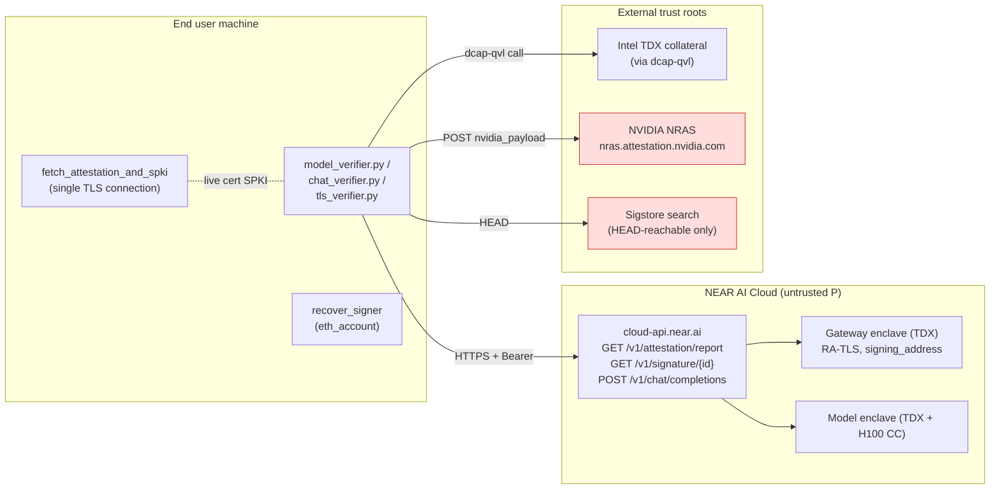
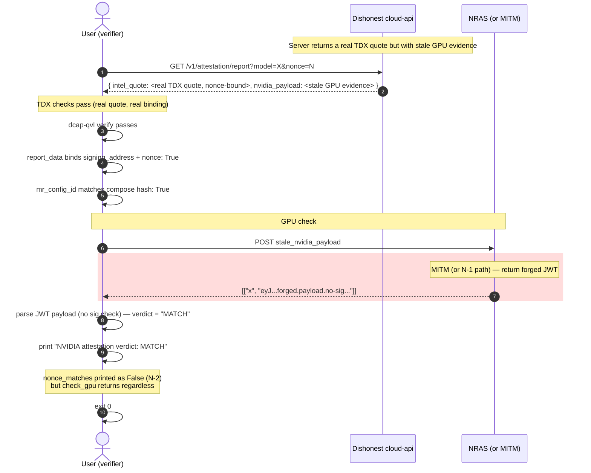

# NEAR AI Cloud Verifier: Soundness Findings

**Subject:** `github.com/nearai/nearai-cloud-verifier`. Client-side
verification tools (Python + TypeScript) for NEAR AI Cloud attestation
reports and signed chat responses. The target service is
`https://cloud-api.near.ai` (Intel TDX VMs + NVIDIA H100 CC GPUs, with
ECDSA / Ed25519 response signing and optional TLS PEM binding).

**Scope:** Soundness of the *client-side verifier* — that is, the code
the user runs to check that an AI request was processed inside a genuine
TEE running the expected code. This is the reverse direction of the
earlier reports: the prover is `cloud-api.near.ai` (a service we do not
have source for), the verifier is this repository's code, and the
question is whether a dishonest prover can craft responses the verifier
accepts.

**Headline:** The verifier composes several strong primitives — DCAP
quote verification via `dcap-qvl`, `mr_config_id` binding to a compose
hash, SHA256(signing_address || tls_spki) in `report_data[0..32]`,
gateway TLS PEM compared against a live socket.

**Reframe after the maintainer's disclosure response (2026-06):** NEAR AI
established that the platform binds the properties we tested into the TEE
evidence — model identity via `mr_config_id` + Sigstore-pinned compose
digests, the NRAS verdict over CA-verified TLS to NVIDIA, the TLS
fingerprint in `report_data`, and a shared nonce + compose across the CPU
and GPU attestations. We accept those corrections. The residual gaps are
not platform soundness breaks but **under-enforcement in the published
verification client** — shipped as "Cryptographic Verification Tools,"
i.e. what a user is directed to run: it reads the NRAS verdict with no
JWT check of its own (defense-in-depth on the TLS channel; N-1), prints
the GPU-nonce match rather than enforcing it (N-2), accepts `"OutOfDate"`
TDX status (N-3), gates live-channel binding behind opt-in flags (N-4),
and surfaces results as `print` lines rather than fail-closed gates
(N-9). The gap is between what the evidence binds and what the tool a
user actually runs enforces. (There is no MITM position on the NRAS call:
the client itself fetches the verdict from NVIDIA over CA-verified TLS.)

All findings refer to the repository state at the time of cloning
(`depth=1` snapshot).

---

## Roles

- **NEAR AI Cloud service (Prover, P)** — operates the TDX gateway and
  H100 CC model enclaves at `cloud-api.near.ai`. Generates the
  attestation report (`GET /v1/attestation/report`), the GPU evidence
  payload, and per-response signatures (`GET /v1/signature/<chat_id>`).
- **End User (Verifier, V)** — runs `model_verifier.py` /
  `chat_verifier.py` / `tls_verifier.py` /
  `encrypted_chat_verifier.py` / `domain_verifier.py`. Trusts only the
  code in this repo plus the hardware roots (Intel TDX collateral via
  `dcap-qvl`, NVIDIA NRAS for GPU, public CAs for domain mode).
- **Intel TDX trust chain** — verified via `dcap_qvl.get_collateral_and_verify`.
- **NVIDIA NRAS** — remote attestation service at
  `nras.attestation.nvidia.com/v3/attest/gpu`. Returns a JWT containing
  the verdict.
- **Sigstore / Rekor** — used for container-image provenance display
  (HEAD reachability only — see Finding N-7).
- **Public CAs** — used by `domain_verifier.py` for ACME / DNS CAA.

---

## Components and trust boundary

| Component | Where it lives | Trust |
|---|---|---|
| `dcap-qvl` quote verification | Inside the Python verifier process | Trusted (cryptographic library, returns `status`) |
| Intel TDX root keys / collateral | Fetched via `dcap-qvl` internals | Trusted by root |
| NVIDIA NRAS HTTPS endpoint | External; reached via `requests.post` | **Reached via plain `requests`; the returned JWT signature is never verified locally** |
| `cloud-api.near.ai` HTTPS endpoint | External; reached via `requests` | TLS via system CA bundle (default) |
| `report_data[0..32]` = SHA256(signing_addr ‖ tls_fp) | Computed inside the TDX quote | Trusted (quote-signed) |
| `report_data[32..64]` = nonce | Echoed by enclave into TDX user_data | Trusted (quote-signed) |
| `mr_config_id` | Trusted (quote-signed); checked startswith("01"+sha256(app_compose)) | Trusted |
| `app_compose` / `tcb_info` JSON | Returned in the attestation HTTP body alongside the quote | Trusted **only via `mr_config` match** — see Finding N-8 |
| Sigstore links | Extracted via regex from compose, then HEAD-checked | **Reachability only — not provenance** |
| Signed `text` from `/v1/signature/<chat_id>` | Server-supplied string | Bound to a hash pair the client recomputes |



---

## Honest flow

```mermaid
sequenceDiagram
    autonumber
    actor V as User (verifier scripts)
    participant API as cloud-api.near.ai
    participant Intel as Intel TDX collateral
    participant NV as NVIDIA NRAS

    V->>V: nonce = secrets.token_hex(32)
    V->>API: GET /v1/attestation/report?model=X&nonce=N (+include_tls_fingerprint)
    API-->>V: { gateway_attestation: {...}, model_attestations: [...], tls_certificate: PEM }

    V->>Intel: dcap_qvl.get_collateral_and_verify(intel_quote_bytes)
    Intel-->>V: { status: UpToDate | OutOfDate | ..., report.TD10.report_data, mr_config_id }

    V->>V: check_report_data: report_data[0..32] == SHA256(signing_address || tls_fp)?
    V->>V: check_report_data: report_data[32..64] == nonce?
    V->>V: show_compose: mr_config_id startswith "01" + sha256(app_compose)?
    V->>NV: POST nvidia_payload
    NV-->>V: [["jwt_token", "..."]]
    V->>V: parse JWT payload (no signature check)
    V->>V: read "x-nvidia-overall-att-result" verdict

    Note over V: signed-chat path
    V->>API: POST /v1/chat/completions {...}
    API-->>V: { id: chat_id, ... }
    V->>API: GET /v1/signature/{chat_id}
    API-->>V: { text, signature, signing_address }
    V->>V: parse text "x:request_hash:response_hash"
    V->>V: recompute hashes; assert match
    V->>V: ecrecover(signature, text) == signing_address?
```

---

## Finding N-1 — NVIDIA NRAS JWT signature is not verified (defense-in-depth)

**Severity:** Low / defense-in-depth (downgraded after the maintainer's
response). The client fetches the GPU verdict directly from
`nras.attestation.nvidia.com` over **CA-verified TLS**, so the verdict's
authenticity rests on that channel to NVIDIA, and there is no MITM
position to swap it. Re-checking the JWT signature against NVIDIA's JWKS
is sound hardening for anyone writing their own verifier, but its absence
is not a soundness break given the TLS channel. (Originally filed as
High; corrected here.)

**Location:** `py/model_verifier.py:37-39, 129-149`, mirrored in
`ts/model_verifier.ts`.

```python
# py/model_verifier.py:37
def fetch_nvidia_verification(payload):
    """Submit GPU evidence to NVIDIA NRAS for verification."""
    return requests.post(GPU_VERIFIER_API, json=payload, timeout=30).json()

# py/model_verifier.py:42
def base64url_decode_jwt_payload(jwt_token):
    """Decode the payload section of a JWT token."""
    payload_b64 = jwt_token.split(".")[1]
    padded = payload_b64 + "=" * ((4 - len(payload_b64) % 4) % 4)
    return base64.urlsafe_b64decode(padded).decode()

# py/model_verifier.py:140
body = fetch_nvidia_verification(payload)
jwt_token = body[0][1]
verdict = json.loads(base64url_decode_jwt_payload(jwt_token))["x-nvidia-overall-att-result"]
```

**Mechanism:** `fetch_nvidia_verification` POSTs the GPU evidence to
NRAS and reads back a JSON. The first element of the response is
`[<key>, <jwt_token>]`. The verifier then **base64-decodes only the
payload section** of the JWT and reads `x-nvidia-overall-att-result`.
JWT signature verification — checking the `<sig>` against NVIDIA's
JWKs — is never performed.

**What the attacker can do (corrected after the maintainer's response):**

- The MITM scenario originally described here **does not apply**: the
  client fetches the verdict from `nras.attestation.nvidia.com` over
  **CA-verified TLS**, so a network attacker cannot swap the JSON body,
  and a hostile fork replacing `GPU_VERIFIER_API` is out of the
  threat model (it is the user's own client). The JWKS check is sound
  hardening but its absence is not a soundness break.
- The residual, narrower point is freshness/binding, not authenticity:
  the verifier does not enforce that the GPU payload's nonce matches the
  request nonce (it prints it; see N-2), so a stale-but-NRAS-signed
  payload for an unrelated GPU could be replayed. That is an
  under-enforcement gap in the client, addressed by N-2, not by a JWT
  signature check.

**What the verifier cannot detect:** The cryptographic NRAS-vouches-for-this
chain is not authenticated end-to-end; the verifier trusts whatever
JSON arrives at the socket.

**Mitigation:**

- Fetch NVIDIA's JWKS once (e.g., from
  `https://nras.attestation.nvidia.com/.well-known/jwks.json` or
  equivalent), pin the signing keys, and use a JWT library that
  verifies the signature before trusting any claims.
- Alternatively, use NVIDIA's official Python attestation SDK rather
  than reimplementing the JSON unwrap.

---

## Finding N-2 — GPU nonce mismatch is informational, not enforcing

**Severity:** Medium.

**Location:** `py/model_verifier.py:129-149`

```python
def check_gpu(attestation, request_nonce):
    payload = json.loads(attestation["nvidia_payload"])
    nonce_matches = payload["nonce"].lower() == request_nonce.lower()
    print("GPU payload nonce matches request_nonce:", nonce_matches)

    body = fetch_nvidia_verification(payload)
    jwt_token = body[0][1]
    verdict = json.loads(base64url_decode_jwt_payload(jwt_token))["x-nvidia-overall-att-result"]
    print("NVIDIA attestation verdict:", verdict)

    return { "nonce_matches": nonce_matches, "verdict": verdict }
```

**Mechanism:** `nonce_matches` is computed and printed. The function
returns a dict containing it. **The function never raises if
`nonce_matches == False`**, and the caller (`verify_attestation`) does
not check the returned value at all (`check_gpu(attestation,
request_nonce)` is invoked for its side-effects).

**What the attacker can do:**

- Return a `nvidia_payload` whose `nonce` was generated for a
  *different* client request — e.g., reuse a previously-generated GPU
  attestation that has a valid NRAS signature (so even Finding N-1
  doesn't help an attacker who doesn't control NRAS, but can still
  replay a stale-but-valid attestation).
- The terminal output will print `False`, but the script continues
  and the final user impression is "attestation succeeded."

**Mitigation:**

- Raise on nonce mismatch (or have the caller treat the returned dict
  as authoritative).

---

## Finding N-3 — TDX status `"OutOfDate"` is treated as a pass

**Severity:** Medium. By design, with debatable consequences.

**Location:** `py/model_verifier.py:181-188`

```python
_tdx_status_ok = frozenset({"UpToDate", "OutOfDate"})
_status = getattr(result, "status", None)
_verified = _status in _tdx_status_ok if _status else False
if _status == "OutOfDate":
    # Quote still verifies; Intel marks OutOfDate when the platform TCB level
    # is below their current advisory baseline—not a cryptographic failure.
    print("Intel TDX quote status: OutOfDate")
```

**Mechanism:** Intel returns the quote status as one of
`UpToDate`, `OutOfDate`, `Revoked`, etc. `dcap-qvl` surfaces these.
The verifier explicitly accepts `OutOfDate`. The code comment
acknowledges this is a policy choice.

**What the attacker can do:**

- Operate a platform whose TCB is below the current Intel security
  baseline, including platforms where the listed advisory IDs
  describe exploitable bugs in the TDX module / microcode. The
  verifier accepts the quote as valid even though Intel has marked
  the platform as carrying known unpatched issues.

**Mitigation:**

- Default to rejecting `OutOfDate`. Provide an explicit
  `--accept-outofdate-tcb` flag for migration windows, and surface the
  list of `advisory_ids` so the user sees what they are accepting.

---

## Finding N-4 — `tls_verifier.py` disables CA verification by design

**Severity:** Acknowledged but worth tracing through.

**Location:** `py/tls_verifier.py:80-82`

```python
context = ssl.create_default_context()
context.check_hostname = False
context.verify_mode = ssl.CERT_NONE  # Trust comes from TEE binding, not CA
```

**Mechanism:** The `tls_verifier` deliberately doesn't validate the
TLS chain against the system CA bundle. The justification is correct
*in principle* — the TEE-binding (`SHA256(signing_address || spki)`
inside `report_data`) is a stronger property than CA trust.

**The chain of trust then becomes:**

1. The script connects with no certificate validation, accepting
   *any* certificate from `hostname:port`.
2. It extracts that certificate's SPKI hash (`live_spki_hash`).
3. It fetches an attestation from the same socket.
4. It checks that `report_data[0..32] == SHA256(signing_address ||
   tls_cert_fingerprint)` *and* that `live_spki_hash ==
   tls_cert_fingerprint`.

If (3) and (4) both succeed, the certificate's public key is the same
one the TDX attestation is binding. The CA bypass is fine.

**Where this can break:**

- If the attestation report can be replayed against a different live
  certificate. The script uses *the same TLS connection* for both
  fetches (`fetch_attestation_and_spki`), which prevents the simplest
  replay. But if the script were ever refactored to use separate
  connections (e.g., to add retries), the binding silently breaks.
- If `signing_address` is attacker-supplied and not pinned (it isn't —
  the script reads it from the attestation response and uses it as
  input to its own check), then a server can supply
  `signing_address = X`, `tls_cert_fingerprint = F`, and a TDX quote
  with `report_data[0..32] = SHA256(X || F)`. This passes binding
  trivially. The check is only meaningful when the user *also* pins
  `signing_address` to a known good value — which the CLI does not
  encourage (`--signing-address` is optional).

**Mitigation:** Require `--signing-address` and refuse to run without
an externally-pinned expected value. Add a comment in the file warning
that a refactor away from single-socket fetch breaks the security
argument.

---

## Finding N-5 — Encrypted-chat: ECDSA "encryption" is ECIES with secp256k1, surprising key reuse

**Severity:** Low / informational.

**Location:** `py/encrypted_chat_verifier.py:92-172`

The "ECDSA encryption" path uses the model's secp256k1 *signing*
public key to do ECDH-derived AES-GCM encryption (ECIES). That is, the
same long-term key the model uses to sign responses is also used as
the recipient public key for client→model encryption.

**Why this matters:**

- secp256k1 is an *ECDSA signing* curve. Using it as the recipient key
  for ECIES is unconventional. Most projects use a separate X25519
  encryption key.
- HKDF info is the literal string `b"ecdsa_encryption"` — no domain
  separation per-session or per-purpose.
- Key compromise on one side leaks both signing and decryption
  authority.

This is a design choice on the server side. The verifier code mirrors
it; the concern is that a user reading the verifier might assume
"ECDSA = signatures, separate from encryption" and not realize the
service uses one key for both. The Ed25519 path correctly uses an
X25519 conversion via PyNaCl.

**Mitigation:** Either document that the secp256k1 key is dual-use, or
have the server publish a separate X25519 encryption key alongside the
signing key.

---

## Finding N-6 — Withdrawn

**Status:** Withdrawn after review — not a soundness gap.

This finding originally concerned the signed `text` returned by
`/v1/signature/{chat_id}`: that the verifier discards the leading field
(`parts[0]`) of `<field>:request_hash:response_hash`. On review we
concluded it is not a soundness issue and have excluded it. The
integrity guarantee is carried entirely by the `request_hash` /
`response_hash` pair plus the `signing_address`↔hardware binding, so a
replayed signature validates only for byte-identical content (a genuine
TEE-produced response to the client's exact request), and the
chat-signature path asserts no freshness property to violate. Even
binding the `chat_id` would not change this — it is server-assigned, and
what the server does with it cannot be observed client-side. We keep the
identifier N-6 as withdrawn so the remaining findings (N-7…N-9) retain
the numbers used in the disclosed report.

---

## Finding N-7 — Sigstore "provenance" check is reachability-only

**Severity:** Low (informational presentation, not enforcement).

**Location:** `py/model_verifier.py:236-268`

```python
def check_sigstore_links(links):
    """Check that Sigstore links are accessible (not 404)."""
    results = []
    for link in links:
        try:
            response = requests.head(link, timeout=10, allow_redirects=True)
            accessible = response.status_code < 400
            results.append((link, accessible, response.status_code))
        except requests.RequestException as e:
            results.append((link, False, str(e)))
    return results
```

**Mechanism:** The verifier extracts `@sha256:<digest>` strings from
the attested compose file and produces
`https://search.sigstore.dev/?hash=sha256:<digest>` URLs. It then
HEAD-checks each URL and prints a checkmark on HTTP < 400.

**What it does not do:**

- Does not fetch the actual Sigstore bundle.
- Does not verify the in-toto / DSSE attestation against the digest.
- Does not check that the signer identity (Fulcio cert) matches an
  expected GitHub repo / workflow.

**Consequence:** The "✓" output appears authoritative to a casual
reader but only proves that `search.sigstore.dev` returns a 200 for
that URL — which it will for any well-formed query, even for digests
the user has never published. A malicious compose can list arbitrary
`@sha256:` digests and as long as the user can browse Sigstore, the
links will "verify."

`version_verifier.py:50` does it correctly for the cloud-api image
specifically (decodes the DSSE payload and pulls the git commit), but
it isn't wired into `model_verifier.py`.

**Mitigation:** Either remove the Sigstore section (it provides no
verification), or replace it with the `version_verifier.py`-style
DSSE-decoded provenance check, gated on a known publisher identity.

---

## Finding N-8 — `mr_config_id` prefix is a magic "01" the verifier accepts

**Severity:** Low / acknowledged.

**Location:** `py/model_verifier.py:284-287`

```python
mr_config = intel_result["quote"]["body"]["mrconfig"]
expected_mr_config = "01" + compose_hash
print("mr_config matches compose hash:", mr_config.lower().startswith(expected_mr_config.lower()))
```

**Mechanism:** TDX `mr_config_id` is a 48-byte field. The verifier
checks `startswith("01" + compose_hash)`. The "01" is a versioning /
marker byte that the *enclave* writes at boot when committing to its
compose hash. The remainder beyond `compose_hash` is unchecked.

**What goes wrong:** If a future enclave version puts something
meaningful in the trailing bytes (e.g., a policy version, a
sub-environment ID), the verifier silently ignores it. A dishonest
operator could commit `"01" + compose_hash + <attacker_payload>` and
this verifier would still print "matches: True." Not directly
exploitable (the TDX quote itself binds the value), but a verifier
that ignores fields it doesn't understand is a "fail-open on unknown
state" pattern.

**Mitigation:** Require strict equality or check that the trailing
bytes are zero. Document the expected layout.

---

## Finding N-9 — Verifier defaults emit `print` lines, never `raise`

**Severity:** Operational / UX, but soundness-relevant.

**Location:** Throughout `py/*.py` — almost every check is `print(...,
result)` rather than `assert` / `raise` / non-zero exit.

```python
print("Report data binds signing address:", binds_address)
if not binds_address:
    print("  expected:", expected_address.hex(), "actual:", embedded_first32.hex())
```

```python
print("Report data embeds request nonce:", embeds_nonce)
if not embeds_nonce:
    print("  expected:", request_nonce)
    print("  actual:  ", embedded_second32.hex())
```

**Mechanism:** A failed check prints a `False` and the script
continues. The final exit code is 0 unless an uncaught exception
fires. A user wrapping these scripts in CI (`set -e`) gets no signal
that verification failed — they have to grep the output for `False`.

**Mitigation:** Either accumulate failures and `sys.exit(1)` at end,
or raise on the first failed binding. The TypeScript equivalents have
the same pattern.

---

## Composed end-to-end attack

The strongest single chain is **N-1**: a network position between the
user and NRAS lets the attacker fabricate the GPU verdict, and the
verifier never checks the JWT signature.



Variant without MITM: even an honest NRAS will sign a real attestation
for any GPU the server presents. If the model enclave is no longer
running but the server has cached a prior valid GPU attestation, it
can replay that into `nvidia_payload`. The verifier's nonce check would
detect this — but N-2 means the detection is printed, not enforced.

---

## Summary table

| # | Title | Severity | Root cause | One-line fix |
|---|-------|----------|------------|--------------|
| N-1 | NRAS JWT signature unverified | Low / defense-in-depth (NRAS fetched over CA-verified TLS) | `base64url_decode_jwt_payload` skips signature | Fetch JWKS, verify JWT (hardening) |
| N-2 | GPU nonce mismatch is informational | Medium | `check_gpu` doesn't raise on mismatch | Raise / propagate failure |
| N-3 | `OutOfDate` TDX accepted as pass | Medium | Allowlist includes both | Default-reject; opt-in flag |
| N-4 | `CERT_NONE` in tls_verifier | Acknowledged | Single-socket fetch carries the safety | Pin `signing_address` |
| N-5 | secp256k1 used for both sign & encrypt | Low | Single key dual-use | Separate X25519 encryption key |
| N-6 | *Withdrawn after review — not a soundness gap* | — | — | — |
| N-7 | Sigstore HEAD-check, not provenance | Low | Reachability ≠ verification | Use `version_verifier`-style DSSE check |
| N-8 | `mr_config_id` prefix-match | Low | `startswith` ignores trailing bytes | Strict equality |
| N-9 | Failures `print` instead of `raise` | Operational | Side-effecting `print` style | Accumulate + `sys.exit(1)` |

---

## What this verifier does well

- **Quote verification via `dcap-qvl`** — proper Intel collateral
  fetching, no hand-rolled crypto.
- **Report-data layout binding** — explicit
  `SHA256(signing_address || tls_fp)` plus 32-byte nonce slot, with
  zero-padding awareness.
- **Single-socket `fetch_attestation_and_spki`** — the only correct
  way to bind an attested fingerprint to a live cert when DNS or load
  balancers may interpose.
- **`version_verifier.py` does proper DSSE decoding** of the
  cloud-api image's GitHub-attested provenance back to a git commit.
  Use this as the template for fixing N-7.
- **Ed25519 encryption path** uses PyNaCl's
  `crypto_sign_ed25519_pk_to_curve25519` correctly.

---

## Suggested headline framing

> *The verifier scripts implement the right binding for the CPU side
> of the chain — TDX quote, report_data layout, live-TLS check — but
> trust the GPU side via an unverified JWT pulled from NVIDIA NRAS.
> The CPU half is cryptographic; the GPU half is "trust the JSON the
> network returned." A dishonest service that can manipulate either
> the NRAS response or the cached GPU payload it forwards to the
> client can produce reports that the verifier prints as fully
> successful.*
