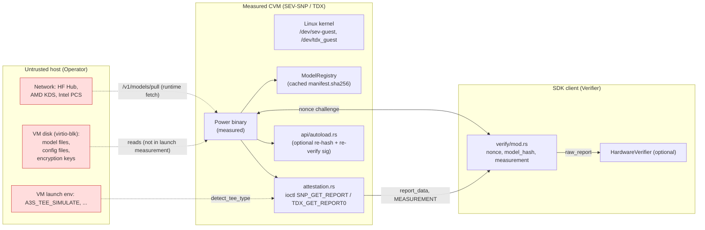
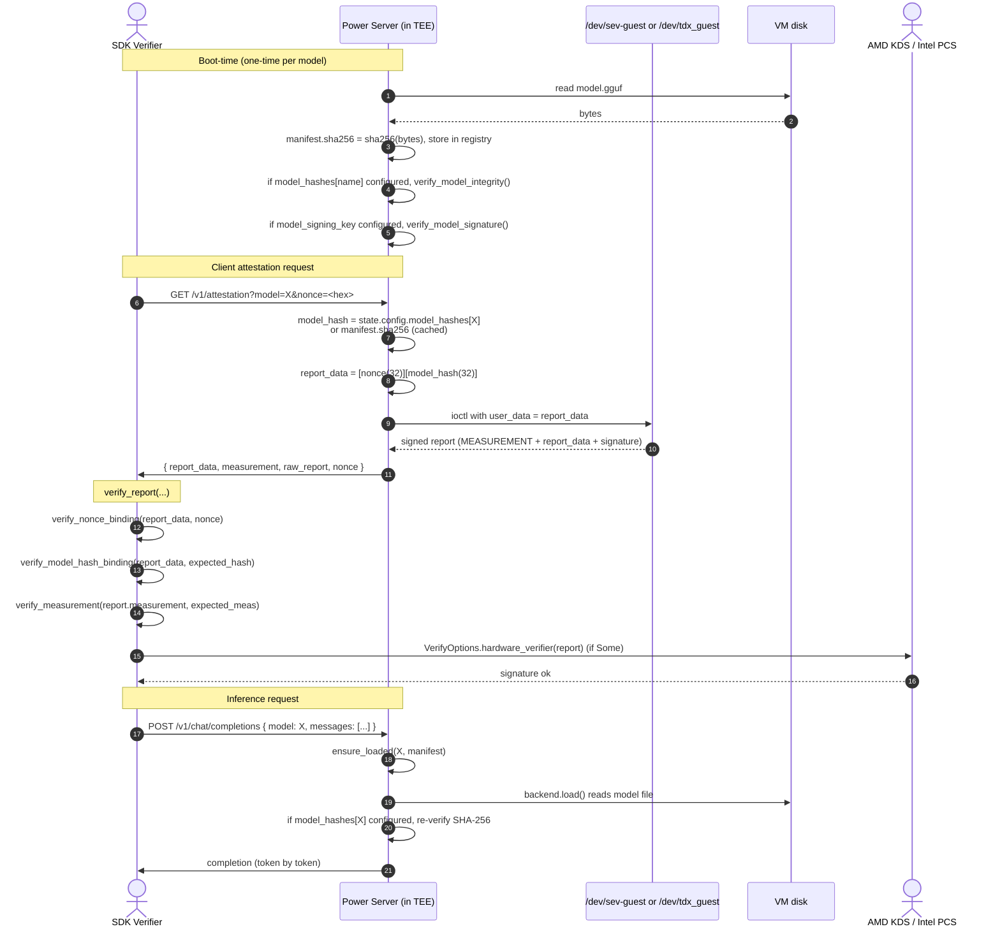

# A3S Power: Soundness Findings

**Subject:** A3S Power (`github.com/A3S-Lab/Power`), "The Only LLM Inference
Server You Don't Have to Trust." Pure-Rust OpenAI-compatible inference
server designed to run inside AMD SEV-SNP or Intel TDX VMs, with
client-side attestation verification (`a3s-power-verify`) that checks
nonce binding, model-hash binding, platform measurement, and (optionally)
hardware signatures.

**Scope:** Soundness of the *runtime prover* — the Power server running
inside the TEE — and the verification surface exposed to the SDK client.
That is: can a dishonest operator produce attestation reports that pass
`verify_report(...)` while serving a model that differs from what the
verifier believes is bound by `report_data`, **without breaking SEV-SNP
or TDX**?

**Headline:** Power's design is substantively stronger than Laminator's:
no pickle execution, real hardware ioctl attestation, nonce + model-hash
bound into `report_data`, optional RA-TLS, and a separate client-side SDK
that re-checks each binding. The remaining soundness gaps are concentrated
in three places: (1) the attestation endpoint returns *cached* hashes
rather than re-hashing the file in use, (2) post-registration integrity
checks are *opt-in* via config, and (3) the verifier-side `VerifyOptions`
makes the hardware-signature check a caller responsibility. A deployment
that misses any of these can produce reports that the SDK happily accepts
even though the bound model hash does not match the bytes actually feeding
inference.

All findings refer to the repository state at the time of cloning
(`depth=1` snapshot).

---

## Roles

- **Operator (Prover, P)** — owns the bare-metal or hypervisor host that
  runs the SEV-SNP / TDX VM. Controls disk images attached to the VM,
  network egress, and any environment variables / config files supplied
  at VM launch. Per the SEV-SNP / TDX threat model, P cannot read VM
  memory at runtime and cannot tamper with running code or memory; P
  *can* tamper with anything the VM reads from disk or network.
- **Power Server** — the in-VM Rust process. Trusted-by-measurement: its
  binary contributes to the SEV-SNP `MEASUREMENT` / TDX `MRTD` launch
  digest (assuming the build is reproducibly pinned into the boot image).
- **Hardware Vendor (AMD or Intel)** — root of trust. AMD KDS issues
  VCEK certificates for SEV-SNP signatures; Intel PCS issues PCK
  certificates for TDX signatures.
- **End User (Client / Verifier, V)** — application code using `a3s-power`
  or the `a3s-power-verify` CLI. Submits a fresh nonce, expects a report
  bound to it and to the model the user thinks they are talking to.
- **Model Publisher** — the entity that produced the model weights and
  optionally signed them with an Ed25519 key whose public counterpart is
  configured into Power.
- **Tenant Admin** — whoever wrote the Power configuration (HCL config,
  `model_hashes`, `model_signing_key`, `model_key_source`, etc.). Decides
  *which* integrity checks fire at runtime.

---

## Components and trust boundary

| Component | Where it lives | Trust |
|---|---|---|
| SEV-SNP / TDX silicon, AMD KDS / Intel PCS | CPU hardware + vendor PKI | Root of trust |
| `/dev/sev-guest`, `/dev/tdx_guest` | Linux kernel inside the VM | Trusted (kernel is part of measured boot image) |
| Power binary, kernel, initrd, rootfs | Measured at VM launch into `MEASUREMENT` / `MRTD` | Trusted by measurement |
| `src/tee/attestation.rs`, `src/tee/model_seal.rs`, `src/api/...` | Part of the Power binary | Trusted (in the launch measurement) |
| Model files (`.gguf`, `.safetensors`, `.enc`) on the VM's disk | Backing storage controlled by the host | **Untrusted** — bytes the kernel reads from disk |
| `state.config.model_hashes` (HCL) | Loaded at startup from disk / env | Trust depends on whether config-load itself is in the measurement |
| `state.config.model_signing_key` | Loaded at startup | Same |
| `state.config.model_key_source` (decryption key) | File / env / KeyProvider | Same — and may be rotated at runtime |
| `manifest.sha256` per model | Cached in `ModelRegistry` at registration time | Trusted as long as not stale relative to the file on disk |
| Client-side `verify_report` (`src/verify/mod.rs`) | Runs on the end user's machine | Trusted by the end user |
| `VerifyOptions.hardware_verifier` | Plugged in by the SDK caller | **Optional**; `None` skips signature check |
| `A3S_TEE_SIMULATE` env var | Set by whoever launches Power | **Unmeasured**; flips real attestation to fake |



---

## Honest flow



The five things the verifier ends up trusting:

1. `nonce` echoed in `report_data[0..32]` proves the report is fresh.
2. `model_hash` echoed in `report_data[32..64]` proves the server's
   *cached* hash for the requested model matches the verifier's expectation.
3. `MEASUREMENT` / `MRTD` proves the boot image matches a known-good
   measurement.
4. The hardware signature (if `hardware_verifier` is set) proves the
   report came from a genuine Intel/AMD CPU.
5. *Implicit:* the cached model hash corresponds to the bytes the backend
   actually feeds to inference. **This implication is where the
   findings below live.**

---

## Finding P-1 — Attestation returns a cached hash, not a re-hash

**Severity:** Medium. Soundness depends on the cached hash never drifting
from the file in use.

**Location:** `src/api/openai/attestation.rs:91-105`

```rust
let model_hash_bytes: Option<Vec<u8>> = if let Some(ref model_name) = params.model {
    match state.registry.get(model_name) {
        Ok(manifest) => {
            let hash_str = state
                .config
                .model_hashes
                .get(model_name)
                .cloned()
                .unwrap_or_else(|| manifest.sha256.clone());

            let hex = hash_str.strip_prefix("sha256:").unwrap_or(&hash_str);
            decode_hex_nonce(hex).ok()
        }
        Err(_) => { return 404; }
    }
} else { None };
```

**Mechanism:** When the client requests `GET /v1/attestation?model=X`, the
server takes the model's expected hash from either (a) the operator's
config (`model_hashes`) or (b) the manifest's `sha256` field set at
registration. **Neither value is recomputed from the file on disk at
attestation time.** The signed `report_data` therefore binds to a hash
that *was* the file's hash at some earlier moment.

**Attack:** The operator can:

1. Register or boot the server with a legitimate model whose hash is `H_good`.
2. Generate an attestation report binding `H_good`.
3. Replace the on-disk model with attacker bytes whose hash is `H_evil`.
4. Issue inference. If `model_hashes[X]` is *not* configured, no re-hash
   fires at load time (see Finding P-2), so the backend loads `H_evil`
   bytes. The client previously verified an attestation binding `H_good`
   and now talks to a model whose bytes are `H_evil`.

This attack requires the operator to win a race against the VM's page
cache (the kernel may serve cached pages from the prior good read). In
practice the model gets unloaded after `keep_alive` expires
(`api/autoload.rs:38-72`) and reloads later, at which point the kernel
re-reads from disk and the swap takes effect.

**Mitigation:**

- At the attestation endpoint, recompute `sha256(file)` instead of using
  the cached `manifest.sha256`, OR
- Require `model_hashes[X]` to be set whenever attestation is enabled, and
  re-verify on every load (Finding P-2 fix).
- Better: bind the *currently-loaded* model's hash (i.e., the hash that
  was verified at the last successful `ensure_loaded`) so that the
  attestation answers "what is the server currently serving" rather than
  "what does the registry say."

---

## Finding P-2 — `model_hashes` and `model_signing_key` are opt-in

**Severity:** High. A deployment with neither configured loses the
post-boot integrity story.

**Location:** `src/api/autoload.rs:152-177`

```rust
// Re-verify model integrity if a hash is configured for this model.
if let Some(expected_hash) = state.config.model_hashes.get(model_name) {
    let ok = crate::tee::model_seal::verify_model_integrity(&load_manifest.path, expected_hash)
        .map_err(...)?;
    if !ok { return Err(...) }
    tracing::debug!(model = %model_name, "Model integrity verified");
}

// Re-verify model signature if a signing key is configured.
if let Some(ref signing_key) = state.config.model_signing_key {
    crate::tee::model_seal::verify_model_signature(&load_manifest.path, signing_key)
        .map_err(...)?;
    tracing::debug!(model = %model_name, "Model signature verified");
}
```

**Mechanism:** Both checks are gated on configuration. If the tenant
admin did not populate `model_hashes` or `model_signing_key`, the
backend loads whatever bytes are at `manifest.path`. The hash in
`manifest.sha256` is a one-shot read taken at registration via
`storage::compute_sha256_file()`.

**Attack:** The simplest case. With no `model_hashes` configured:

1. Operator boots the VM. Power computes `manifest.sha256` from the
   legitimate model bytes on first registration / load.
2. Operator later modifies the file on the host's backing storage, then
   triggers an unload (e.g., by waiting for `keep_alive` to expire, or
   loading enough other models to evict via LRU — `autoload.rs:58-72`).
3. On next request, `ensure_loaded` re-reads from disk into the backend.
   With `model_hashes` unset, no integrity check fires. The backend now
   serves attacker bytes.
4. Subsequent `/v1/attestation` calls still report the *cached*
   `manifest.sha256` (Finding P-1), so the verifier sees no change.

**Severity reasoning:** This is the same class of issue as Laminator's
"datasets are `allowed_files`" finding — the security story depends on
configuration that the prover controls. Unlike Laminator's case, Power
*has* a fix mechanism (configure `model_hashes` + `model_signing_key`),
but the defaults don't activate it.

**Mitigation:**

- Refuse to enable TEE mode (`tee_mode: true`) unless `model_hashes` is
  populated for every model.
- Or: always re-hash on load and reject mismatches, with the expected
  hash coming from `manifest.sha256` if `model_hashes` is unset (so at
  least within a single VM uptime, post-registration drift is caught).

---

## Finding P-3 — Model weights are not in the launch measurement

**Severity:** Fundamental property of the design, not a bug.

**Location:** Architectural. See `src/tee/attestation.rs:332-334`
(SEV-SNP `MEASUREMENT` offset 0x90) and `src/tee/attestation.rs:483-485`
(TDX `MRTD` offset 528).

**Mechanism:** SEV-SNP `MEASUREMENT` and TDX `MRTD` cover the VM image at
launch: firmware, kernel, initrd, rootfs. Model files are read from disk
at runtime by the Power process; they are not part of the launch
measurement.

**Consequence:** The verifier's `verify_measurement(report.measurement,
expected)` proves the boot image is a known good Power build, but says
nothing about which model weights exist on the VM's disk. The
model-to-attestation binding lives entirely in the post-boot hash chain
(registration → `manifest.sha256` → `report_data[32..64]` → SDK
verification).

This is intrinsic to TEE technologies that don't pre-load weights into a
read-only mount. Tinfoil's `modelwrap` addresses the same gap with a
dm-verity-protected EROFS bound to the boot image; Power instead relies
on SHA-256 + Ed25519 enforced in software.

**Mitigation (architectural):**

- Adopt a modelwrap-style dm-verity mount whose root hash is embedded in
  the launch measurement, so model bytes inherit launch-time integrity.
- Or: tighten Findings P-1 and P-2 so the post-boot chain has no opt-out
  gaps.

---

## Finding P-4 — Encrypted-model hash semantics are ambiguous

**Severity:** Medium.

**Location:** `src/api/autoload.rs:99-147`, `src/tee/encrypted_model.rs`,
`src/api/openai/attestation.rs:91-105`.

**Mechanism:** For `.enc` models, the flow is:

1. Registration: `manifest.sha256 = sha256(.enc bytes)`.
2. Load: decrypt into one of three modes (`DecryptedModel` writes a `.dec`
   file; `MemoryDecryptedModel` keeps mlock-pinned RAM; `LayerStreaming`
   keeps chunks).
3. For `DecryptedModel` only, `load_manifest.path` is updated to the
   `.dec` path before the integrity check runs (`autoload.rs:140`). So
   `verify_model_integrity(&load_manifest.path, expected_hash)` ends up
   comparing `expected_hash` against `sha256(.dec)`.
4. For `MemoryDecryptedModel` / `LayerStreaming`, the path is unchanged,
   so the integrity check compares `expected_hash` against `sha256(.enc)`.
5. The attestation endpoint always returns `manifest.sha256`, which is
   `sha256(.enc)`.

**Consequence:** The semantics of "model hash" differ between code paths:

- For `DecryptedModel`: load-time check is over plaintext, attestation
  endpoint reports ciphertext hash. The verifier must know to compare
  against the ciphertext hash, which depends on the operator's encryption
  key.
- For the other two modes: both load-time and attestation reference the
  ciphertext hash, which is consistent but means the verifier's
  "expected model hash" is a function of the operator's key, not of the
  publisher's plaintext model identity.

A verifier with only the publisher's published plaintext hash cannot
verify the encrypted form. They must obtain the operator-specific
ciphertext hash, which couples verification to a specific deployment's
encryption key — defeating the goal of model identity being a publisher
property.

**Mitigation:**

- Always re-hash the *plaintext* bytes after decryption and use that
  hash in both the integrity check and the attestation endpoint.
- Document clearly that `model_hashes` for `.enc` models refer to the
  ciphertext.

---

## Finding P-5 — TOCTOU between attestation and inference

**Severity:** Medium. Subsumed by P-2 if `model_hashes` is unset.

**Location:** `/v1/attestation` (`src/api/openai/attestation.rs:124-130`)
and `ensure_loaded` (`src/api/autoload.rs:149-179`).

**Mechanism:** The attestation endpoint and the inference endpoint read
the same on-disk file independently. Between the two reads, the file
contents can change (the operator controls the host's virtio-blk
backing store; Linux page cache mitigates this within a single VM
uptime but does not eliminate it).

Even with `model_hashes` configured:

1. `/v1/attestation?model=X&nonce=N` reads from `state.config.model_hashes[X]`
   (a string in config) — no disk read at all, so TOCTOU does not apply
   to this hash.
2. `ensure_loaded` reads the file from disk and re-verifies SHA-256.
3. **The two values that should be equal are: `model_hashes[X]` (used in
   attestation) and `sha256(file)` (used at load).** As long as
   `verify_model_integrity` enforces equality at load time, a mismatch
   prevents the model from loading and the inference path fails closed.

So with `model_hashes` set, the TOCTOU window is closed: a swapped file
either matches `model_hashes[X]` (in which case the attacker pre-planned a
collision, which is infeasible for SHA-256) or it fails to load.

**Without `model_hashes` set**, there is no enforcement linking the
attestation-reported hash (= `manifest.sha256` from registration) to the
bytes the backend reads at load time. P-1 + P-2 + P-5 compose into a
trivial swap attack.

**Mitigation:** Same as P-2: make `model_hashes` non-optional whenever
attestation is enabled, and re-hash on load.

---

## Finding P-6 — `A3S_TEE_SIMULATE` flag swaps real attestation for fake

**Severity:** Low / acknowledged.

**Location:** `src/tee/attestation.rs:147-154`, `src/tee/attestation.rs:278-289`

```rust
if std::env::var("A3S_TEE_SIMULATE")
    .map(|v| v == "1" || v.eq_ignore_ascii_case("true"))
    .unwrap_or(false) {
    return TeeType::Simulated;
}
```

```rust
fn simulated_report(nonce: Option<&[u8]>) -> AttestationReport {
    AttestationReport {
        version: default_report_version(),
        tee_type: TeeType::Simulated,
        report_data: embed_nonce(nonce, 0xAA),
        measurement: vec![0xBB; 48],
        raw_report: None,
        timestamp: chrono::Utc::now(),
        nonce: nonce.map(|n| n.to_vec()),
    }
}
```

**Mechanism:** Setting `A3S_TEE_SIMULATE=1` makes Power emit fake reports
with a constant measurement (`0xBB * 48`) and no `raw_report`. The fake
reports are structurally identical to real ones except for `tee_type ==
"simulated"`.

**Attack:** An operator who launches the VM with this env set (or who
patches in a similar branch) gets a "TEE-enabled" server whose
attestations are meaningless. The SDK's `verify_report` does *not*
automatically reject `TeeType::Simulated` — it only checks the bindings
the caller asked for (`VerifyOptions.nonce`, `expected_model_hash`,
`expected_measurement`, `hardware_verifier`).

A caller who:

- supplies `expected_measurement = Some(0xBB; 48)` (because they didn't
  pin the real one)
- omits `hardware_verifier`

will accept a simulated report as valid.

**Mitigation:**

- Add an explicit `reject_simulated: bool` field to `VerifyOptions`,
  defaulting to `true`, that fails verification when
  `report.tee_type == Simulated`.
- Or: make `verify_report` refuse `TeeType::Simulated` unless an opt-in
  flag is set.

---

## Finding P-7 — Hardware signature verification is optional

**Severity:** High. The most load-bearing check in the chain is a
caller-supplied option.

**Location:** `src/verify/mod.rs:64-91`, `src/verify/mod.rs:142-149`

```rust
pub struct VerifyOptions<'a> {
    pub nonce: Option<Vec<u8>>,
    pub expected_model_hash: Option<Vec<u8>>,
    pub expected_measurement: Option<Vec<u8>>,
    pub hardware_verifier: Option<&'a dyn HardwareVerifier>,
}
...
// 4. Hardware signature verification (optional)
if let Some(verifier) = opts.hardware_verifier {
    verifier.verify_hardware_signature(report)?;
    result.hardware_verified = true;
}
```

**Mechanism:** Without a `HardwareVerifier` plugged in, `verify_report`
checks only that the bytes inside `report` are internally consistent
with the caller's expected nonce / model hash / measurement. It does
**not** check that the report was actually signed by AMD KDS or Intel
PCS. An attacker who fabricates a JSON payload with arbitrary
`report_data` and `measurement` fields, then forwards it through their
own infrastructure, can satisfy a no-hardware-verifier client.

The README claims "Hardware Signature Verification" as one of Power's
moats; the implementation has it as a `#[cfg(feature = "hw-verify")]`
trait the caller must remember to wire in. The `verify_report`
documentation calls this out as expected behaviour, but the doc
example (`src/verify/mod.rs:28-49`) shows the path with
`hardware_verifier: None`.

**Attack:** A user copies the doc example and calls `verify_report` with
`hardware_verifier: None`. The operator then forges arbitrary JSON
reports — they need only echo the client's nonce, write the expected
model hash, and write the expected measurement. All four `verify_*`
checks pass.

**Mitigation:**

- Make `HardwareVerifier` non-optional (require a verifier or an
  explicit `SkipHardwareVerification` marker type the caller must
  construct deliberately).
- Or: have the SDK provide a `DefaultHardwareVerifier` plugged in by
  default that fetches AMD KDS / Intel PCS certs at first use.
- Update the doc example to show hardware verification on.

---

## Finding P-8 — `/v1/models/pull` extends the trust surface to HF Hub

**Severity:** Medium.

**Location:** `src/model/pull.rs` (alluded to in README:132,
"HuggingFace Hub Pull: `POST /v1/models/pull` with SSE progress, Range
resume, concurrent dedup, HF token auth").

**Mechanism:** Models are not all baked into the boot image. Power can
fetch them at runtime from HF Hub. The fetched bytes are hashed and
registered (`manifest.sha256`), then made available for inference.

**Attack surface:**

- The HF Hub TLS chain inside the VM is rooted in whatever CA bundle the
  VM image was built with. As long as the VM image is correctly built
  and measured, the operator cannot MITM HF traffic.
- However: model identity at HF Hub is by name (`org/model`), not by
  publisher signature. An attacker who compromises a publisher's HF
  account can replace the bytes for a given name, and Power will pull
  the new bytes and register them under the same `model_name`. The hash
  changes, but the verifier may not know to re-check.
- The pull endpoint also accepts `HF_TOKEN` from request context (or
  config). A privileged token can access gated content the verifier may
  not expect.

This is analogous to modelwrap's M-2/M-6 findings but at runtime: name
→ bytes mapping is mutable, and the binding to a specific publisher key
is not enforced by Power.

**Mitigation:**

- Require `model_signing_key` to be set whenever `/v1/models/pull` is
  enabled.
- Pin (`name`, `commit_hash`) tuples for all pullable models in config,
  and reject any pull whose resolved commit differs.
- Echo the resolved commit hash into the attestation payload alongside
  the model hash so verifiers can pin both.

---

## Composed end-to-end attack

The cleanest chain is **P-1 + P-2** (cached attestation hash + opt-in
load-time check), with **P-7** (no hardware verifier) optional but useful
if the operator wants to forge reports out of band.

```mermaid
sequenceDiagram
    autonumber
    actor Op as Dishonest operator
    participant Pwr as Power (in real TEE)
    participant K as /dev/sev-guest
    actor V as SDK Verifier

    Note over Op: Configuration: model_hashes NOT set for model X
    Op->>Pwr: boot VM with legitimate model.gguf at /models/X
    Pwr->>Pwr: register: manifest.sha256 = sha256(legit_bytes) = H_good

    Note over V,Pwr: Client gets a clean attestation
    V->>Pwr: GET /v1/attestation?model=X&nonce=N
    Pwr->>Pwr: model_hash = manifest.sha256 = H_good  (cached, no re-read)
    Pwr->>K: ioctl with report_data = [N(32)][H_good(32)]
    K-->>Pwr: signed report
    Pwr->>V: { report_data, measurement, raw_report }
    V->>V: verify_report passes (nonce ok, H_good ok, measurement ok)

    Note over Op: Swap bytes on the host's backing store
    Op->>Op: write evil.gguf to the host LV behind /models/X
    Op->>Op: wait for keep_alive expiry → Power evicts X

    Note over V,Pwr: Subsequent inference loads attacker bytes
    V->>Pwr: POST /v1/chat/completions { model: X, messages }
    Pwr->>Pwr: ensure_loaded(X): X not currently loaded → re-load
    rect rgb(255, 220, 220)
        Note over Pwr: model_hashes[X] is unset → no re-verify
        Pwr->>Pwr: backend.load(manifest.path) reads evil_bytes
    end
    Pwr->>V: completion produced by evil model

    Note over V: Client believes report.H_good binding still holds
    V->>V: (no re-attestation issued; trusts earlier verified report)
```

The attestation chain is signed by genuine hardware. The Power code in
the launch measurement is unchanged. The model file's bytes on disk are
different from what they were when `manifest.sha256` was first computed.
No software check fires because the tenant admin did not configure
`model_hashes[X]`. The client's "verified" attestation references a hash
that no longer corresponds to the bytes producing the completion.

A more sophisticated attacker who additionally wants to forge fresh
attestations binding `H_good` indefinitely needs P-7 — but if the client
already accepted one valid report and reuses it for subsequent sessions
(common SDK behaviour: "verified once, then cache"), even P-7 is
unnecessary.

---

## Summary table

| # | Title | Severity | Root cause | One-line fix |
|---|-------|----------|------------|--------------|
| P-1 | Attestation returns cached hash | Medium | `manifest.sha256` is one-shot at registration | Re-hash at attestation endpoint |
| P-2 | Integrity / signature checks opt-in | High | `if let Some(...)` gates `verify_model_integrity` / `verify_model_signature` | Require `model_hashes` when TEE mode is on |
| P-3 | Model weights not in launch measurement | Fundamental | Models loaded at runtime | dm-verity model mount (modelwrap-style) |
| P-4 | Encrypted-model hash ambiguity | Medium | `manifest.sha256` is ciphertext hash, sometimes plaintext | Always hash plaintext post-decrypt |
| P-5 | TOCTOU attestation ↔ inference | Medium (subsumed by P-2) | Two independent reads of the same file | Bind currently-loaded hash to report |
| P-6 | `A3S_TEE_SIMULATE` is a string env var | Low | No verifier-side rejection of `TeeType::Simulated` | `reject_simulated: true` default in `VerifyOptions` |
| P-7 | `hardware_verifier` is optional | High | `Option<&dyn HardwareVerifier>` defaulted to `None` | Require hardware verifier; provide a default |
| P-8 | `/v1/models/pull` adds runtime trust on HF Hub | Medium | Runtime fetch with name-only identity | Require commit pin + signing key for pulled models |

---

## What Power does well (relative to Laminator)

It is worth stating these explicitly because Power's design has clearly
internalised several of the lessons the Laminator analysis surfaces:

- **No pickle execution path.** Models are GGUF / SafeTensors, parsed by
  Rust crates. There is no Laminator Finding 1 equivalent.
- **Hardware report is a real ioctl**, not a placeholder. The Linux ABI
  parsing in `src/tee/attestation.rs:296-451` and `:458-568` is direct
  and audited against AMD / Intel spec offsets.
- **Nonce is bound into `report_data`** at the kernel level via the
  ioctl `user_data` field. No application-layer hashing involved.
- **Model hash binding has a dedicated 32-byte slot** at
  `report_data[32..64]` and is documented in code.
- **Verifier is a separate Rust crate** with explicit `verify_*`
  functions, constant-time comparisons, and a zero-padding check that
  refuses non-zero bytes in the nonce padding region
  (`src/verify/mod.rs:178-187`). That zero-padding check is unusual and
  good — it prevents a server from sneaking extra bits into `report_data`.
- **Constant-time comparisons** in `verify_nonce_binding`,
  `verify_model_hash_binding`, and `verify_measurement`.
- **`raw_report` is included** for downstream hardware verification.
- **Ed25519 publisher signatures supported** for supply-chain model
  identity (`src/tee/model_seal.rs:70-134`), even if optional.

The findings above are not "the design is broken." They are "the
defaults and the verifier ergonomics make it easy to deploy a
configuration whose security guarantee is weaker than the marketing
implies." The fixes are small.

---

## Suggested headline framing

> *Power's runtime integrity story collapses to "the cached
> `manifest.sha256` matches the current bytes" — a property that only
> holds when `model_hashes` is configured and `verify_report` is called
> with a real `HardwareVerifier`. Both are opt-in defaults. A deployment
> that uses Power's TEE-mode without these explicit configurations
> produces attestations that pass the SDK's checks even when the model
> bytes on disk have been swapped under the running VM.*

The architecture is right; the defaults are wrong.
