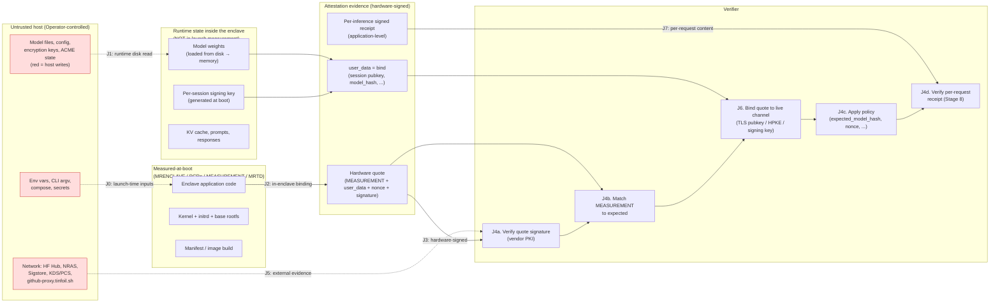

# A Unified View of Soundness Gaps in TEE-Based AI Attestation Systems

> **Revision note (post-disclosure, 2026-06).** Vendor responses revised the
> NEAR AI items: the **"no model-identity binding" attack (F1) is withdrawn**
> (model identity is bound via `mr_config_id` = 01‖SHA256(app_compose) with
> Sigstore-pinned image digests), and **N-1 (NRAS JWT) is downgraded to
> defense-in-depth** (the client fetches the verdict over CA-verified TLS).
> The **standing PoC count is 18** (19 demo scripts on disk; one withdrawn); the canonical paper numbering is **P1--P18** (see [`POC_INDEX.md`](POC_INDEX.md));
> mentions of "nineteen"/"19 PoCs" below refer to the demo set. $F_1$ is now
> anchored by Laminator (with A3S/Power's `A3S_TEE_SIMULATE` flag as a second
> instance). NEAR AI's remaining findings are recast as under-enforcement in
> its published verification client (advertised as "Cryptographic Verification
> Tools").

**Status:** Working synthesis across six systems we have examined in
detail. Not yet a paper — the framing below is the candidate
backbone of one. Reviewers should expect the empirical regularities
claimed here to hold across the surveyed systems and to recur in
nearby systems we have not yet read.

**Surveyed systems** (in order of first read):

| System | Type | Trust target | Findings doc |
|---|---|---|---|
| Laminator | Academic prototype (CODASPY 2025) | Intel SGX, Gramine, Python/PyTorch in-enclave | `laminator_soundness_finding.md` |
| Tinfoil `modelwrap` | Industry build-time tool | dm-verity EROFS over HF model | `modelwrap_soundness_finding.md` |
| A3S Power | Industry runtime (crates.io) | SEV-SNP / TDX, Rust inference | `power_soundness_finding.md` |
| NEAR AI cloud verifier | Industry client-side verifier | TDX + H100 CC against `cloud-api.near.ai` | `nearai_cloud_verifier_soundness_finding.md` |
| EphemeralML / Cyntrisec | Industry runtime + AIR v1 spec | Nitro Enclaves (primary), TDX, H100 CC | `ephemeralml_soundness_finding.md` |
| Tinfoil SDK (`tinfoil-go`) | Industry verifier SDK | Sigstore-backed code-measurement + RA-TLS for inference.tinfoil.sh | `tinfoil_sdk_soundness_finding.md` |

The remainder of the Tinfoil stack — `confidential-model-router`,
`verifiable-reviewer`, `cvmimage` — was partially examined and is
referenced in the cross-system matrix below as context, but is not
the subject of a dedicated finding doc. The `tinfoil_sdk_*` finding
covers the client-side verifier surface that mediates trust in any
of those services.

**Companion docs in this workspace:**

- `attack_catalog.md` — catalogs the nineteen runnable PoCs, one
  per attack instance, mapped to the F1–F9 taxonomy defined here.
  **Every F-class is anchored by ≥2 PoCs across ≥2 surveyed
  systems** (F5 has 3 PoCs).
  Read this doc for the taxonomy and cross-system synthesis; read
  the catalog for "which file demonstrates which gap, and what
  exactly does running it show."
- `model_switching.md` — focuses on the three attacks (Laminator
  switchable, nearai no-binding, Power stale cache) that
  literally keep an identity field constant across a model
  change. Useful when the paper's framing leans on the
  "identity-vs-bytes desynchronization" thesis.
- `<system>_soundness_finding.md` (six files, one per surveyed
  system) — per-system writeups with file-and-line citations,
  individual findings labelled by severity, and mitigation
  recommendations. Read these for ground truth on a particular
  system.

**How to read this document.** The sections are designed to be
read in order on a first pass and then dipped into individually
later. Recommended reading paths by goal:

- *I want the conceptual framework only.* §1 (architecture +
  joints) + §2 (workflow + attack injection points) gives you the
  coordinate system. The rest is supporting evidence.
- *I want a one-page summary.* Skim §1.1 (problem statement),
  §3.1 (at-a-glance taxonomy), §4 (cross-system matrix). About
  100 lines total.
- *I want to find a specific attack's mechanism.* §2.3
  (setup/trigger/consequence per attack) → §3.4–§3.12 (per
  F-class detail, F1–F9) → `attack_catalog.md` (runnable PoC,
  F1–F9; 19 PoCs total).
- *I want to audit a system I'm building.* §5 (designer
  checklist) is organised by area; cross-references in each item
  point back to the F-class and attack numbers it closes.
- *I want to frame a paper.* §6 (novelty story), §7 (what to do
  with this), §8 (headline framings at four lengths). §4.6
  (density read) gives the reviewer-credibility punch line.
- *I'm new to TEE jargon.* §9 (glossary) defines MRENCLAVE,
  MRTD, PCRs, DCAP, NSM, COSE_Sign1, DSSE, RA-TLS, HPKE,
  dm-verity, EROFS, Gramine, and the rest of the vocabulary the
  doc uses throughout. Open it side-by-side with §1–§4 on first
  read.

The doc is self-contained: every cross-reference to a sibling
file (`attack_catalog.md`, `<system>_soundness_finding.md`) is
optional reading that adds depth, not context required to
understand the claims here.

---

## 1. The common architectural pattern

### 1.1 What problem these systems solve

A TEE-AI attestation system answers a single question for a remote
verifier: *"the AI inference you are about to consume — was it
produced by the model you expected, running the code you expected,
inside hardware-isolated memory you can trust?"*

The answer is supposed to be a cryptographic chain rooted in a CPU
vendor's hardware key (Intel SGX/TDX, AMD SEV-SNP, AWS Nitro)
rather than in operator promises. The chain commits to a measurement
of the launched enclave image; everything the in-enclave software
does afterwards (load a model, accept a prompt, sign a response) is
*not* directly measured but is supposed to be tied back to the
measured code via in-enclave hashing and binding logic.

The short summary: hardware signs `(MEASUREMENT, user_data,
nonce)`; in-enclave code chose what to put in `user_data`; the
verifier checks the signature, the measurement, and the
`user_data` fields against expectations.

### 1.2 The five actors

Every system in the survey has the same cast:

| Actor | Controls | Cannot control | Trust |
|---|---|---|---|
| **Operator (Prover)** | the host machine, the disk, the network, env vars, CLI args, model files, the build pipeline | the contents of running enclave memory, the hardware attestation key | Adversarial. The whole point of TEE-AI is that the verifier doesn't have to trust this party. |
| **TEE Hardware** | the launch measurement, the attestation signing key, memory encryption | nothing application-level; doesn't know what the enclave's code "means" | Root of trust. Failure here (e.g., AMD SEV bugs, BadRAM) is out of scope; assumed correct. |
| **Enclave Code** | session keys (generated at boot), how the model is loaded, which fields go into `user_data`, which bytes go into receipts | only what the launch measurement promises; can't reach outside the enclave | Trusted-by-measurement: trustworthy iff the launch measurement matches a verifier-pinned expected value. |
| **Verifier (Client / SDK / Auditor)** | which expected measurements / hashes to pin, which policy fields to enforce, which live endpoints to talk to | what the operator runs, what bytes the enclave actually saw | The endpoint of the whole chain — the party for whose benefit the attestation exists. |
| **External Services** | NVIDIA NRAS verdicts, Sigstore TUF / Rekor, AMD KDS / Intel PCS cert chains, HF Hub model files, GitHub release metadata | bytes inside the enclave, the operator's intent | Third-party trust roots. The verifier inherits trust from each of these via the SDK's signature checks. |

### 1.3 The five categories of state

Where state lives, and whether it's covered by the launch
measurement, is the single most important property for reasoning
about soundness gaps.

| Category | Examples | In launch measurement? | Operator can change at runtime? |
|---|---|---|---|
| **Measured boot state** | Kernel, initrd, enclave binary, manifest, root filesystem (with hashes) | YES | NO (would invalidate measurement) |
| **Unmeasured launch inputs** | CLI argv, env vars, mount points (allowed_files in Gramine, virtio-blk volumes elsewhere) | NO | YES, at launch time |
| **Runtime disk reads** | Model weight files, config files, encryption keys read after launch | NO | YES, between reads |
| **Per-session ephemeral state** | Session keypair generated inside enclave, KV cache, in-memory model weights after load | NO, but inherits trust from "measured boot state" because the code that generated it is measured | NO once generated (memory is encrypted) |
| **Network-fetched evidence** | Sigstore bundles, NRAS GPU verdicts, AMD VCEK / Intel PCK certs, HF Hub bytes | NO | YES (operator controls the network the enclave or the verifier sees) |

The measured-boot category is the only one with hardware integrity.
Every other category gets its integrity from the in-enclave code,
which itself only has integrity because it's in the measured-boot
category. Every soundness gap in this survey is a place where that
inherited-integrity chain has a weak link.

### 1.4 The architectural picture, with joints labelled



### 1.5 The joints where soundness lives

Every soundness gap in the survey is at one of eight joints (J0
through J7) between the categories of state. J3 (hardware signing)
is the only one assumed correct by construction; the other seven
are software-mediated and are where every PoC in this workspace
lands. Reading them in order from operator to verifier:

- **J0 — Launch-time inputs → measured code (`Untrusted host → M`).**
  Argv, env vars, and any "allowed_files" the manifest permits flow
  into the running enclave at startup. The launch measurement
  covers the *code that reads* these inputs, not the inputs
  themselves. **F1** soundness gaps live here.

- **J1 — Runtime disk reads → in-enclave state
  (`Untrusted host → R`).** After boot, the enclave reads model
  weights, config, ACME keys, etc. The bytes on disk are not
  measured; the in-enclave code is supposed to hash them. **F2
  (cached / stale)** and **F5 (behavior not bounded by the
  measurement)** soundness gaps live here.

- **J2 — In-enclave binding (`R → A.user_data`).** The enclave
  decides what to put in the hardware quote's `user_data` field.
  This is the single most load-bearing step: it's where session
  keys, model hashes, and policy intent get cryptographically tied
  to a hardware-signed quote. **F1 (unmeasured inputs that flow
  into user_data verbatim)** soundness gaps live here.

- **J3 — Hardware signing (`A → A.quote signature`).** The TEE
  ioctl produces a vendor-rooted signature over
  `(MEASUREMENT, user_data, nonce)`. This is the joint that
  hardware enforces; the survey assumes it works.

- **J4 — Verifier checks the attestation (`A → V`).** The verifier
  validates the hardware signature against vendor PKI (J4a),
  matches MEASUREMENT against an expected value (J4b), applies
  policy against the claim fields (J4c), and later verifies the
  per-request receipt against the session pubkey extracted from
  user_data (J4d, revisited at Stage 8). This is the inflection
  point where hardware trust becomes software trust. **F3 (opt-in
  policy)** soundness gaps live in J4c and J4d: the verifier *can*
  pin every claim but isn't forced to. **F1** gaps surface here
  because the verifier reads as authoritative whatever the
  enclave put in user_data, even though some of those fields were
  echoed from unmeasured operator inputs.

- **J5 — External-evidence consumption (`Network → V.A`).** The
  verifier needs vendor cert chains, code-measurement allowlists
  (Sigstore), GPU attestation verdicts (NRAS). Each is a separate
  signed artefact the verifier must verify on its own. **F4
  (unauthenticated external)** soundness gaps live here.

- **J6 — Live channel pinning (`V → R via TLS / HPKE`).** Once the
  verifier has accepted an attestation, it opens a runtime channel
  to the enclave. The live channel's key must equal the attested
  session key. **F6 (channel unbound)** soundness gaps live here.

- **J7 — Per-request content binding (`R → A.receipt`).** Receipts
  bind hashes of request and response bytes, plus the model
  identity. They are signed by the session key whose trust comes
  from J2. **F7 (sampling unattested)** soundness gaps live here:
  the receipt schema doesn't include sampling parameters even
  though those parameters drive what the response bytes are.

A reader who walks J0 through J7 in order has the entire soundness
story. The next section makes this concrete by tracing it through
a chat-completion workflow with attack-injection points labelled.

---

## 2. The common workflow, stage by stage

The workflow below is what every surveyed system implements, with
small variations in transport format and receipt schema. Each
stage is annotated with which joint it traverses, what trust
property it relies on, and which attack(s) can break it.

### 2.1 Overview diagram with attack-injection points

```mermaid
sequenceDiagram
    autonumber
    actor Op as Operator (untrusted)
    actor V as Verifier (SDK / client)
    participant Disk as Host disk / virtio-blk
    participant Enc as Enclave application
    participant HW as TEE hardware
    participant Ext as External services<br/>(Sigstore, NRAS, KDS/PCS)

    Note over Op,Disk: Stage 0a — Auxiliary artefact build (e.g. modelwrap)
    Op->>Op: download model, run mkfs.erofs + veritysetup<br/>→ produce (.mpk, .info root hash) pair
    Note over Op,Disk: Attack 4 (modelwrap, F2-build) fires HERE:<br/>idempotency-skip emits attacker-chosen root hash

    Note over Op,Disk: Stage 0b — CVM image build
    Op->>Op: bake (kernel, initrd, rootfs, enclave bin, 0a root hash)<br/>→ produce signed CVM image whose hash = launch MEASUREMENT
    Note over Op,Disk: Attack 4's consequence lands HERE:<br/>attacker root hash from 0a is now inside MEASUREMENT

    Note over Op,Enc: Stage 1 — Enclave launch (J0)
    Op->>Enc: start enclave with argv, env vars, mounts
    HW->>HW: compute MEASUREMENT over boot image
    Note over Enc: Attack 1, 7 entry point — Laminator's<br/>argv-unmeasured (F1) flows in here

    Note over Enc,Disk: Stage 2 — In-enclave bootstrap (J1)
    Enc->>Enc: generate session keypair (Ed25519 + X25519)
    Enc->>Disk: read model file
    Disk-->>Enc: model bytes
    Enc->>Enc: torch.load / safetensors / GGUF parse
    Note over Enc: Attack 1, 7 fire here (F5 — pickle RCE)
    Note over Enc: Attack 10 fires here (F5-narrow — Jinja in GGUF meta)
    Enc->>Enc: compute model_hash; cache it in manifest

    Note over Enc,HW: Stage 3 — Attestation generation (J2 → J3)
    Enc->>Enc: build user_data = (session_pubkey, model_hash, nonce_slot)
    Enc->>HW: ioctl (NSM_GET_REPORT / SNP_GET_REPORT / TDG_MR_REPORT)
    HW-->>Enc: signed quote = sign((MEASUREMENT, user_data, nonce), vendor_key)
    Enc->>V: attestation document

    Note over V,Ext: Stage 4 — Verifier checks (J4 + J5)
    V->>Ext: fetch vendor cert chain (KDS / PCS / Nitro CA)
    Ext-->>V: cert chain
    V->>V: verify quote signature
    V->>Ext: fetch expected code measurement (Sigstore)
    Ext-->>V: Sigstore bundle
    V->>V: verify Sigstore bundle, extract codeMeasurement
    Note over V,Ext: Attack 6 (nearai NRAS JWT, F4): the NVIDIA<br/>side of this fetch is unverified
    Note over V,Ext: Attack 11 (Tinfoil rollback, F4): the<br/>github-proxy.tinfoil.sh side is unverified
    V->>V: MEASUREMENT == expected?
    V->>V: report_data fields match policy?
    Note over V: Attack 5 (EphemeralML default policy, F3):<br/>policy may default to skipping pins

    Note over V,Enc: Stage 5 — Live channel binding (J6)
    V->>Enc: open TLS / HPKE connection
    V->>V: live TLS cert SPKI == attested tls_cert_fingerprint?
    Note over V,Enc: Attack 8 (nearai channel unbound, F6):<br/>default flow skips this comparison

    Note over V,Enc: Stage 6 — Per-request processing (J1 revisited)
    V->>Enc: POST /v1/chat/completions { messages, sampling_params }
    Enc->>Enc: ensure_loaded(model) — may re-read file from disk
    Note over Enc,Disk: Attack 3 fires here (F2 — file swap between<br/>registration and load; cached manifest.sha256<br/>masks the change if model_hashes unset)
    Enc->>Enc: render chat template (operator-supplied)
    Note over Enc: Attack 10 also has runtime effect here<br/>(rendered prompt is the attacker's, not the user's)
    Enc->>Enc: sample with temperature / top_p / seed
    Note over Enc: Attack 9 fires here (F7 — sampling parameters<br/>don't enter any signed structure)
    Enc->>V: response bytes

    Note over Enc,V: Stage 7 — Receipt generation (J7)
    Enc->>Enc: compute request_hash, response_hash
    Enc->>Enc: build signed receipt (DCAP report / AIR / DSSE)<br/>binding (request_hash, response_hash, model_hash, nonce)
    Enc->>Enc: sign with session key from Stage 2
    Enc->>V: signed receipt

    Note over V: Stage 8 — Receipt verification (J4 revisited)
    V->>V: receipt signature valid against session pubkey?
    V->>V: claim fields match policy?
    Note over V: Attacks 2 (no model_hash binding) and 9 (sampling)<br/>land here: the receipt is structurally honest<br/>but the field the verifier wants doesn't exist
```

### 2.2 Stage-by-stage walkthrough

**Stage 0 — Build / Image creation** (offline, before any enclave
runs)

This stage actually has two sub-phases, and the difference between
them is where modelwrap-style attacks land.

*0a — Auxiliary artefact builds (where modelwrap lives).* Some
systems separate "build the model artefact" from "build the CVM
image." Tinfoil does this most explicitly: a customer wants to
ship a Llama-3.2-1B service, so they (i) run modelwrap, which
downloads the HF model and produces `<commit>.mpk` (an EROFS
image of the model) plus `<commit>.info` (a dm-verity root hash
over the EROFS); then (ii) hand `<commit>.info`'s root hash to
`cvmimage`, which bakes it into the CVM image's kernel command
line. Power's `model_signing_key`-signed model files and
EphemeralML's KMS-encrypted models follow the same pattern. The
output of 0a is a (model artefact, identity-binding number)
pair: the identity-binding number is what the CVM image at 0b
will commit to as "the expected model identity for this
service."

*0b — CVM image build.* The downstream image-builder takes the
kernel + initrd + base rootfs + enclave application code + any
0a outputs (e.g., dm-verity root hashes embedded in the kernel
cmdline or initrd), and produces a launch-measurable image. The
image's hash becomes the `MEASUREMENT` / `MRENCLAVE` / `MRTD` /
`PCR_set` value verifiers will pin. The 0a output is now
cryptographically inside the 0b measurement.

- *Trust property created.* "When the enclave boots, the code
  AND the model-identity binding committed to in 0a are what was
  hashed at 0b. dm-verity will refuse to serve any block that
  doesn't match."
- *Where attacks fire.* **Attack 4 (modelwrap F2-build).** The 0a
  build tool is itself operator-controlled. modelwrap's
  idempotency-skip lets a malicious builder pre-place an arbitrary
  `<commit>.mpk` + `<commit>.info` pair *before* running modelwrap;
  the tool sees the outputs already exist, skips `mkfs.erofs` and
  `veritysetup` entirely, and exits 0 with the attacker's chosen
  root hash. The 0b builder then bakes that root hash into the
  measured CVM image. At Stage 1 the enclave boots; at Stage 6
  inference runs over attacker bytes. The dm-verity chain at
  runtime is honest about the bytes it binds — *what's
  compromised is which bytes the chain commits to*.
- *Critical detail for reviewers.* This attack is fully effective
  only when the verifier's `expected_measurement` comes from a
  trust path that also originates with the operator (e.g.,
  Tinfoil publishes both the modelwrap output AND the expected
  measurement allowlist for its own services). An independent
  verifier who derived `expected_measurement` from a third party
  would reject the operator's measurement. In the surveyed
  Tinfoil deployment model, the operator IS the trust root for
  both the artefact and the allowlist, so this reduces to
  "operator chose what gets measured" — a single-party trust
  decision masquerading as a multi-party attestation.

**Stage 1 — Enclave launch (J0: launch-time inputs)**

- *What happens.* The operator starts the enclave. The hardware
  computes `MEASUREMENT` over the boot image and stores it in
  attestation context. The enclave process starts with
  argv + environment supplied by the operator, plus access to
  whatever mounts the manifest allows (Gramine's `allowed_files`,
  Nitro's vsock mounts, virtio-blk volumes on SEV-SNP / TDX).
- *Trust property created.* "Code in the launch measurement runs
  now. argv, env, and mount contents are not in the measurement."
- *Where attacks fire.* **F1** — every system has unmeasured
  launch-time inputs that flow into the signed payload later.
  Concrete instances: Laminator's
  `loader.insecure__use_cmdline_argv = true`; Power's
  `A3S_TEE_SIMULATE=1` env var; modelwrap's `MODEL=...@HEAD`;
  EphemeralML's `mock` build feature. Attack 1 (Laminator
  switchable) depends partly on this — the choice of which
  side-channel file the loader reads is operator-supplied.

**Stage 2 — In-enclave bootstrap (J1: runtime disk reads, J2:
in-enclave binding setup)**

- *What happens.* The enclave generates a per-session keypair
  (most commonly Ed25519 for receipt signing and X25519 for HPKE
  transport). It reads the model file from disk and parses it
  through whatever format-specific loader the application uses:
  `torch.load` (Laminator), llama.cpp / mistralrs GGUF loader
  (Power), candle SafeTensors (EphemeralML), etc. The model is
  hashed; that hash will go into Stage 3's `user_data`.
- *Trust property created.* "The session key the enclave will
  sign receipts with was generated inside the enclave and never
  left in plaintext. The model_hash committed downstream is
  faithful to the bytes the enclave loaded."
- *Where attacks fire.*
  - **Attack 1, 7 (Laminator F5 — pickle RCE).** `torch.load`
    deserialises pickle from a host-supplied `.pth` file. A
    `__reduce__` payload runs arbitrary code inside the enclave
    *at parse time*, before `load_state_dict` is even called.
    Attack 7 uses this to hot-patch `utils.test` (metric forgery);
    Attack 1's switchable variant uses it to read a side-channel
    file on every load.
  - **Attack 10 (Power F5-narrow — Jinja).** GGUF model files
    contain `tokenizer.chat_template` metadata. Power's
    `chat_template::render_jinja` evaluates that template through
    minijinja. The sandbox prevents shell execution but doesn't
    prevent the template from rewriting user prompts —
    consequential when those prompts feed an LLM.

**Stage 3 — Attestation generation (J2: in-enclave binding, J3:
hardware sign)**

- *What happens.* The enclave assembles `user_data`: a fixed-size
  buffer (typically 32 or 64 bytes) holding (session_pubkey,
  model_hash, nonce_slot, optional tls_cert_fingerprint). Some
  schemes (EphemeralML) wrap this in CBOR; others (Power) lay it
  out as raw byte slices. The enclave then ioctls the TEE driver
  to get a hardware-signed quote over (MEASUREMENT, user_data,
  nonce).
- *Trust property created.* "Hardware vouches that the
  MEASUREMENT and user_data shown in the quote came from a
  legitimate enclave instance on a legitimate vendor's CPU."
- *Where attacks fire.* **F1 reappears here.** Whatever
  unmeasured argv / env / config value flowed into the code that
  builds `user_data` gets bound by the hardware signature.
  Laminator's `--dataset CENSUS` argv string ends up in the
  payload at this stage; the hardware signs it without knowing
  it's operator-typed.

**Stage 4 — Verifier checks the attestation (J4: verifier checks,
J5: external evidence)**

- *What happens.* The verifier receives the attestation document.
  It fetches vendor PKI from AMD KDS, Intel PCS, or AWS Nitro CA,
  then verifies the quote's signature. It also fetches the
  expected code measurement from Sigstore (Tinfoil), or it
  trusts an operator-pinned value (Power, EphemeralML). For
  GPU-backed systems, it additionally fetches NVIDIA's NRAS
  verdict. The verifier compares MEASUREMENT to expected and the
  `user_data` fields to whatever policy was provided.
- *Trust property created.* "The session pubkey extracted from
  user_data is the one the enclave generated; the model_hash
  bound there is what the enclave saw."
- *Where attacks fire.*
  - **Attack 6 (nearai F4 — NRAS JWT).** The verifier reads NVIDIA's
    verdict out of a JWT without verifying its signature against
    NVIDIA's JWKS. An attacker who can interpose between the
    verifier and `nras.attestation.nvidia.com` returns any verdict.
  - **Attack 11 (Tinfoil F4 — proxy rollback).** Tinfoil's SDK
    routes every "current release of repo X" query through
    `github-proxy.tinfoil.sh`. The Sigstore bundle's signature is
    verified downstream, but the bundle the SDK ends up verifying
    is whatever the proxy returned. A malicious proxy serves a
    historically-valid old bundle and the SDK pins to it.
  - **Attack 5 (EphemeralML F3 — opt-in policy).** Even when
    the verifier *can* pin every claim,
    `AirVerifyPolicy::default()` leaves expected_* fields as
    `None`. The corresponding policy checks return `Skip`, which
    is not in the critical-check set. `verified = true` results
    from a structurally-well-formed receipt regardless of
    semantic content.

**Stage 5 — Live channel binding (J6: TLS pinning)**

- *What happens.* The verifier opens an HTTPS or HPKE channel to
  the enclave for live traffic. The attested `user_data` told it
  what the enclave's TLS cert SPKI fingerprint or HPKE public key
  should be. The verifier compares the live channel's actual key
  to the attested one.
- *Trust property created.* "The bytes I'm sending over this TLS
  socket are arriving at the enclave I just verified, not at some
  TLS-terminating proxy in front."
- *Where attacks fire.* **Attack 8 (nearai F6 — channel unbound).**
  The comparison is opt-in. NEAR AI's default verifier
  (`model_verifier.py` without `--verify-tls`) checks
  `report_data` internally but never compares it to the live
  socket. An MITM with a different cert succeeds; the
  Sigstore-verified attestation remains honest about the
  enclave's identity at the document layer.

**Stage 6 — Per-request processing (J1 revisited)**

- *What happens.* The user sends a request through the bound
  channel. The enclave may need to (re-)load the model: if it
  was evicted under `keep_alive` expiry or LRU pressure, the file
  is re-read from disk. The enclave renders the chat template,
  samples from the model under whatever `temperature`/`top_p`/
  `seed` parameters the request asked for, and produces a
  response.
- *Trust property created (or expected).* "Inference uses the
  same bytes the enclave bound into `user_data` at Stage 3."
- *Where attacks fire.*
  - **Attack 3 (Power F2 — stale cache).** Between Stage 2's
    file-read-and-hash and Stage 6's re-read, the operator can
    overwrite the file on the host's backing storage. Power's
    attestation endpoint returns `manifest.sha256` cached at
    Stage 2; the load-time re-hash gate at Stage 6 is opt-in
    (`model_hashes` config). With default deployment, the
    backend serves attacker bytes while the attestation endpoint
    keeps reporting the original hash.
  - **Attack 10 (Power F5-narrow) revisited at runtime.** The
    Jinja chat template loaded at Stage 2 runs here against the
    user's actual messages. A malicious template rewrites the
    system prompt and injects suffixes per request.
  - **Attack 9 (EphemeralML F7) lurks here.** Sampling parameters
    drive the response bytes, but nothing in this stage records
    them anywhere a future verifier could pin them. The receipt
    in Stage 7 will commit to `response_hash` but not to the
    sampling regime that produced it.

**Stage 7 — Receipt generation (J7: per-request content binding)**

- *What happens.* The enclave hashes request bytes and response
  bytes. It builds an application-level signed structure (Power's
  DCAP-report-data layout, EphemeralML's AIR v1 CWT/COSE_Sign1,
  NEAR AI's `<field>:request_hash:response_hash` Ed25519 text, Tinfoil
  reviewer's in-toto DSSE) binding `(request_hash, response_hash,
  model_hash, nonce)`. It signs with the session key from Stage 2.
- *Trust property created.* "I cryptographically attest that the
  bytes I returned are what hashed to `response_hash`, that the
  bytes I received are what hashed to `request_hash`, and that
  the model whose hash is committed in `user_data` produced
  them."
- *Where attacks fire.* No new attacks land here as long as the
  enclave's measured code is honest about the hash inputs. But
  this stage is *what makes Attack 9 invisible*: nothing in the
  receipt schema binds sampling parameters, so the operator's
  Stage 6 sampling choice doesn't leave a trail.

**Stage 8 — Receipt verification (J4 revisited)**

- *What happens.* The verifier checks the receipt's signature
  against the session pubkey it extracted in Stage 4. It applies
  policy: are the claim fields (`model_id`, `model_hash`,
  `request_hash`, etc.) what the verifier expects?
- *Trust property created.* "The (request, response) pair I see
  is what the attested enclave actually processed."
- *Where attacks fire.*
  - **Attack 2 (nearai F1 — no model binding) — WITHDRAWN.** The
    `report_data` buffer names no model weights, but model identity
    is bound elsewhere (the `mr_config_id` register over the
    Sigstore-pinned compose), so this attack does not hold and is
    withdrawn (see revision note).
  - **Attack 5 (EphemeralML F3) lands here too.** The default
    policy passes any model_hash and any model_id because the
    `expected_*` fields are `None`.
  - **Attack 9 (EphemeralML F7) lands here.** A verifier that
    wanted to pin sampling parameters has no field to pin them
    against. The receipt verifies cleanly even though the
    operator-chosen sampling regime is opaque.

### 2.3 Setup, trigger, and consequence — when each attack actually happens

The stage walkthrough above tells you where each attack *lands*,
but most attacks have three temporally separate moments:

1. **Setup** — the operator does something pre-runtime
   (positions a malicious file on disk, configures the build
   pipeline, deploys a service with a particular schema).
2. **Trigger** — the in-enclave or in-verifier code path executes
   the operator's bytes and the attack actually fires.
3. **Consequence** — the verifier accepts a result it should have
   rejected.

This separation matters for two reasons. First, it shows that
some attacks are pure pre-runtime forgery (modelwrap, Attack 4)
while others are pure runtime mismatch (Power stale cache, Attack
3) — same F-class, different time-shape. Second, it tells a
defender where to install controls: a control at the *setup*
stage (signed publisher manifests) blocks more attacks more
cheaply than a control at the *consequence* stage (more
verifier-side policy fields), but the latter is often the only
option if the operator can't be constrained.

| # | Attack | F-class | Setup (when, what) | Trigger (when, what) | Consequence (verifier-observable) |
|---|---|---|---|---|---|
| 1 | Laminator switchable | F5 + F2 | Stage 0/1: operator places evil `census_model.pth` at `./saved_models/` AND a real state_dict at the side-channel path | Stage 2: `torch.load` evaluates the pickle's `__reduce__`, which reads the side-channel and returns its state_dict | Stage 4: attestation `name` field constant across requests; side-channel can be swapped between requests with no field change |
| 2 | nearai no model binding | F1 *(withdrawn)* | — | — | **Withdrawn after maintainer response (2026-06): model identity IS bound, via `mr_config_id` = 01‖SHA256(app_compose) with Sigstore-pinned image digests; `report_data` carries the runtime key + nonce by design.** |
| 3 | Power stale cache | F2 | Stage 2: legitimate boot caches `manifest.sha256 = H_good`. Operator overwrites the file on the host's virtio-blk backing store at some later point | Stage 6: `keep_alive` expires or LRU forces re-load; backend reads new bytes; load-time hash check is skipped because `model_hashes` config is unset | Stage 4: `/v1/attestation` still returns `H_good` (cached). Stage 6's inference output reflects the swapped bytes |
| 4 | modelwrap build forgery | F2-build | Stage 0a (before modelwrap runs): operator pre-places attacker-chosen `<commit>.mpk` + `<commit>.info` in the modelwrap output dir | Stage 0a: modelwrap's idempotency-skip exits 0 without invoking mkfs.erofs or veritysetup. Stage 0b: cvmimage bakes the attacker's root hash into the CVM image. Stage 1: hardware computes MEASUREMENT including that root hash. Stage 6: inference runs over dm-verity-mounted attacker bytes | Stage 4: verifier compares MEASUREMENT to a Tinfoil-published allowlist that includes the attacker's measurement (operator is the trust root for both sides) |
| 5 | EphemeralML opt-in policy | F3 | Stage 0: verifier deployment chooses `AirVerifyPolicy::default()` — every `expected_*` field is `None` | Stage 7: enclave honestly produces a receipt binding its own `model_hash` | Stage 8: receipt verifies under default policy regardless of which model_hash it carries; the MHASH check returns Skip, which isn't critical |
| 6 | nearai NRAS JWT | F4 | Stage 4 (concurrent): operator routes the verifier's NRAS fetch through a malicious endpoint OR returns a stale `nvidia_payload` the real NRAS will sign | Stage 4: verifier calls `base64url_decode_jwt_payload` on the returned JWT and reads its payload segment without checking the signature | Stage 4: verifier prints `NVIDIA attestation verdict: <whatever the operator chose>` |
| 7 | Laminator metric forgery | F5 | Stage 0/1: operator places evil `census_model.pth` whose pickle `__reduce__` patches `utils.test` to return a constant | Stage 2: `torch.load` runs the patch. Stage 6: `accuracy_attestation` calls `utils.test(...)` which returns the constant; payload built with that value | Stage 4: `output_accuracy.json` reports `"value": 0.99` for a random-init model. The Intel-signed SGX quote honestly commits to that payload |
| 8 | nearai channel unbound | F6 | Stage 0: operator publishes an attestation that names key `K_A` in `tls_cert_fingerprint`, but operates a TLS terminator on key `K_B` between client and enclave | Stage 5: verifier (with default flow, no `--verify-tls`) opens TLS to the terminator. Stage 4 still passes (the attestation's internal consistency is honest about `K_A`). The default flow never compares live cert to `K_A` | Stage 6: chat traffic terminates at the operator's MITM; plaintext visible to the operator |
| 9 | EphemeralML sampling | F7 | Stage 0: no setup needed — the AIR v1 CDDL ships without sampling fields | Stage 6: operator chooses `temperature` / `top_p` / `seed` per request, varies them | Stage 8: receipt verifies under any policy (default or strict); `response_hash` is honest but no field tells the verifier the response came from non-default sampling |
| 10 | Power minijinja | F5-narrow | Stage 0: operator ships a malicious chat-template inside GGUF metadata | Stage 2: template loaded into minijinja env. Stage 6: every chat request renders user messages through the malicious template — system prompt overwritten, jailbreak suffix injected | Stage 8: receipt's `request_hash`, `response_hash`, `model_hash` are all honest; rendered prompt isn't covered by any claim |
| 11 | Tinfoil rollback | F4 | Stage 0 (long ago): a previous Tinfoil release was signed by their CI. The historical bundle still exists. Stage 4 (now): operator configures `github-proxy.tinfoil.sh` to return that old release as "current" | Stage 4: SDK fetches latest tag / digest / bundle through the proxy. The proxy returns the historical triple. SDK calls `sigstoreClient.VerifyAttestation(bundle, repo, digest)` against the embedded trust root; Sigstore passes (the historical bundle was honestly signed at the time) | Stage 4: verifier pins MEASUREMENT to whatever the old release's code-measurement was, even though a newer release exists |

**Reading the table.** Each row is one attack. Reading
left-to-right tells you the time-shape: when the operator has to
plant something, when the enclave or verifier code path actually
runs the attack, and what a verifier observes (or fails to
observe). Attacks 1, 7, 10 share a "setup placed on disk, trigger
at Stage 2 model-load" pattern. Attacks 5, 9 share a
"no operator setup, just the verifier accepting a structurally
honest receipt that doesn't pin enough." Attack 4 is unique in
that its setup, trigger, and consequence all happen at *build
time* — long before any enclave runs.

### 2.4 Stage → attack lookup table

The previous table walks one attack at a time. This one walks one
stage at a time, listing every attack that fires at that stage.

| Stage | Joint | F-classes that can fire here | Attacks |
|---|---|---|---|
| 0a Build (artefact build, e.g., modelwrap) | (pre-launch) | F2-build | 4 |
| 0b Build (CVM image) | (pre-launch) | — | — |
| 1 Launch | J0 | F1 (unmeasured argv / env) | (background to 1, 7, 10) |
| 2 Bootstrap | J1, J2 | F5 (deserialisation), F5-narrow (template load), F2 (cache write) | 1, 7, 10 |
| 3 Attestation gen | J2, J3 | F1 (echoed into user_data) | (background to all) |
| 4 Verify attestation | J4, J5 | F3 (default policy), F4 (unauth. external), F4 (currency rollback) | 5, 6, 11 |
| 5 Live channel | J6 | F6 | 8 |
| 6 Per-request | J1 revisited | F2 (cache read after swap), F5-narrow (template runtime), F7 (sampling regime), F1 (model the operator chose to load) | 3, 9, 10, (2 visible here) |
| 7 Receipt gen | J7 | (no new attacks, but F7's *absence-of-field* is set in concrete here) | — |
| 8 Verify receipt | J4 revisited | F1 (missing field), F3 (policy default), F7 (no field to pin) | 2, 5, 9 |

Reading the table top-to-bottom is the lifecycle. Reading it by
F-class column tells you which stage to look at to find each
failure mode.

### 2.5 Why this skeleton holds across the six surveyed systems

All six systems instantiate Stages 0–8, with these variations:

- **Stage 0.** Laminator: SGX manifest hash. modelwrap: dm-verity
  EROFS root hash, baked into a downstream CVM. Power / EphemeralML
  / NEAR AI: Sigstore-attested OCI image digest. Tinfoil:
  GitHub-release-bundle digest published via the Tinfoil proxy.
- **Stage 2's model loader.** Laminator: PyTorch pickle (the F5
  vector). Power, EphemeralML: GGUF / SafeTensors (closed binary
  formats). NEAR AI: closed source; presumed safetensors or
  similar.
- **Stage 3's `user_data` layout.** Power uses
  `[nonce(32) ‖ model_hash(32)]`. EphemeralML uses a
  versioned CBOR struct `[v, sig_pk, model_id, model_hash]`.
  NEAR AI uses `[SHA256(signing_address ‖ tls_fp) ‖ nonce]`.
  Laminator uses SHA-512 of an entire JSON payload as the
  REPORTDATA. Tinfoil's reviewer binds `tls_key_fp` into
  `report_data` and then uses the TLS key to sign DSSE envelopes.
- **Stage 7's receipt schema.** Power: ECDSA signature on response
  text. EphemeralML: COSE_Sign1 over a CBOR claims map. NEAR AI:
  Ethereum-style ECDSA over `<field>:request_hash:response_hash` (the
  leading field is unconfirmed and discarded by the verifier).
  Tinfoil reviewer: in-toto v0.1 statement DSSE-signed and
  published to Rekor. Laminator: no per-inference receipt; the
  attestation IS the receipt for the audit task.

The nine stages (0–8), the eight joints (J0–J7), and the
F1–F9 taxonomy together form a coordinate system. Any new TEE-AI
system maps onto the same axes; any new soundness gap can be
plotted by (stage, joint, F-class) and compared to the entries
already in the matrix.

---

## 3. Taxonomy of failure modes

Across the surveyed systems, soundness gaps cluster into nine
recurring patterns. The pattern is structural: it follows from
where the gap between "code measured at boot" and "behavior at
runtime" is bridged, and how carefully. F1–F7 cover the
single-enclave, single-inference primitive; F8 covers
**vertical composition** (multiple TEE hardware roots in a
chain — e.g., CPU TEE + GPU CC); F9 covers **horizontal
composition** (operator-mediated bytes that wrap the attested
inference call).

### 3.1 At-a-glance: the nine classes in one table

| Class | One-line pattern | Joint(s) | Stage(s) where it fires | Verifier-observable consequence | Attack #s with PoC |
|---|---|---|---|---|---|
| F1 | Configuration is unmeasured and flows into the signed payload | J0, J2 | 1, 3, 8 | Verifier reads operator-typed strings as if they were measured | **14** (Laminator argv); A3S/Power `A3S_TEE_SIMULATE` (instance) — ~~2 (nearai)~~ withdrawn |
| F2 | Cached / registration-time state stands in for runtime state | J1, J2 ↔ J1 | 0a (build cache), 2 → 6 (runtime cache) | Attestation reports stale identity while runtime bytes have changed | 3 (runtime cache), 4 (build-time cache) |
| F3 | Integrity / policy bindings are opt-in | J4c, J4d | 4, 8 | Default verifier passes without performing the check | 5 (EphemeralML default policy), **15** (Power `hardware_verifier: None`) |
| F4 | External evidence is parsed without authenticating it | J5 | 4 | Verifier accepts forged or rolled-back third-party evidence | 6 (NRAS JWT), 11 (Tinfoil rollback) |
| F5 | Measured code's behavior on attacker input escapes the measurement (interpret / corrupt / load-remote) | J1 → J2 | 2 (and 6 for runtime variants) | Measured code runs attacker logic (RCE, or sandboxed semantics-hijack) | 1, 7 (pickle), 10 (Jinja) |
| F6 | Live channel is unbound from the attestation | J6 | 5 | Verifier exchanges traffic with a different endpoint than the one it attested | 8 (nearai tls_verifier opt-in), **16** (EphemeralML signing-key chain) |
| F7 | Output non-determinism is unattested | J7 (absence-of-field) | 6 → 7 → 8 | LLM operator varies sampling parameters per-request without the receipt noticing | 9 (EphemeralML AIR CDDL), **17** (NEAR AI signed text) |
| F8 | Cross-component attestation chain unbound (vertical composition) | J5 + J7 (composition gap) | 4 (consume), 6 (execute) | Verifier accepts independently-valid attestations from CPU and GPU that were not actually paired in this computation | 12 (Power `build_report_data`), **18** (NEAR AI NRAS+TDX) |
| F9 | Application-layer context bytes unattested (horizontal composition) | J7 (absence-of-field) | 6 (operator-mediated context) → 7 (receipt) → 8 (verifier) | Receipt binds (`request_hash`, `response_hash`) but not RAG context, tool outputs, conversation history, or output post-processing the operator controls | 13 (EphemeralML RAG injection), **19** (NEAR AI history injection) |

### 3.2 How the classes relate

**F1–F5 are the classic patterns** from property-attestation
literature (Sadeghi & Stüble 2004) applied to TEE-AI. **F6 and F7
are AI/runtime extensions** specific to TEE-AI: F6 addresses the
attestation-vs-channel gap (an RA-TLS-era concern), F7 addresses
the LLM-sampling regime (a generative-model concern). **F8 and F9
are composition extensions**: F8 captures the multi-hardware-root
(CPU TEE + GPU CC + …) chain-binding problem that didn't exist
when one CPU enclave was the whole trust unit; F9 captures the
operator-mediated bytes wrapping a single inference call (RAG
documents, tool outputs, conversation history, output filters)
that didn't exist when "the model's job" was a single batch
classification. None of F6–F9 appears in the classic framework
because none of the underlying problems existed in their current
form.

**Compositions to watch for.** Some classes are *independent*
(each is its own gap, and closing one doesn't help with the
others). Others *compose* — closing one without the other leaves
the door open:

- **F2 (cached) composes with F3 (opt-in).** Power's stale
  attestation cache (Attack 3) is harmless if `model_hashes` is
  pinned (closing F3); harmless if `/v1/attestation` re-hashes
  (closing F2). The real-world deployment defaults break both, so
  the attack works.
- **F1 (unmeasured) composes with F3 (opt-in).** Power's
  `A3S_TEE_SIMULATE=1` flag (F1) is harmless if `VerifyOptions`
  rejects `TeeType::Simulated` (closing F3). It doesn't by
  default. EphemeralML's `mock` feature has the same shape.
- **F4 (unauthenticated currency) composes with F2 (stale state).**
  Tinfoil's `github-proxy.tinfoil.sh` rollback (F4) works because
  `sigstore-go` doesn't enforce observer-timestamp freshness (F2).
  Closing either would close the attack.
- **F5 (interpreter) composes with F1 (unmeasured input).**
  Power's minijinja template hijack (Attack 10) needs the
  template to be operator-supplied via GGUF metadata (F1) AND the
  measured code to interpret it (F5). Closing either suffices.
- **F8 (composition) composes with F4 (external evidence).**
  A NRAS verdict properly signed by NVIDIA (closes F4 on that
  evidence) still doesn't establish that *this* GPU ran *this*
  computation — F8 lives one joint up. Closing F4 is necessary
  but not sufficient.
- **F9 (application context) composes with F7 (sampling).**
  Even if the receipt commits to `(temperature, top_p, seed)`
  (closes F7), the operator can pick what bytes the model sees
  via RAG/tools and what bytes the user sees via output
  filtering. Closing F7 alone makes the sampling regime
  verifiable but leaves the input/output bytes outside the
  attested envelope.

**Alternatives, not compositions.**

- **F5 RCE vs F5 sandboxed.** Laminator's pickle is full RCE
  inside the enclave; Power's minijinja is sandboxed semantics
  hijack. Same class (interpreter for attacker bytes), different
  severity. Mitigations differ in detail (use weights_only=True
  vs. pin the template hash) but share the same underlying fix
  (bind interpreter inputs to attestation claims).
- **F2 runtime cache vs F2 build-time cache.** Power's cache lives
  inside the enclave at runtime; modelwrap's "cache" is the
  pre-placed output dir at build time. Both are "stale state
  stands in for current state," at very different time scales.

**What each F-class is structurally trying to fix.** F1 closes a
data-flow gap; F3 closes a default-value gap; F4 closes an
external-trust gap; F5 closes a behavior-bounding gap; F2
closes a freshness gap; F6 closes a channel-identity gap; F7
closes a schema-completeness gap (sampling); F8 closes a
multi-component-chain-binding gap; F9 closes another
schema-completeness gap (application-layer context, dual to F7).
The fixes look different in code, but each is a different answer
to the same meta-question: *"how do I make sure the bytes the
verifier checks are the bytes that actually matter?"*

**The boundary all nine classes assume: measured ≠ audited.**
Every F-class above takes for granted that once the measured code
is *identified*, a verifier (or auditor) can *reason about what it
does*. Attestation only ever establishes code **identity** — this
exact hash ran in a genuine TEE — never code **safety**. Two cases
keep the attestation perfectly honest while voiding that
assumption: (a) an opaque precompiled artefact (a `.so`, a fat
binary, an obfuscated blob) baked into the measured image — the
hash is faithful, the behaviour is unknowable without reverse
engineering; and (b) remote code loaded at runtime (the F5
load-remote mechanism, §3.7). A verifier that pins the hash of an
unreviewed binary has soundness with respect to *identity* and
zero assurance about *behaviour*. This is the seam where
attestation meets code audit: the F1–F9 gaps are "the verifier
checks the wrong bytes"; the measured-≠-audited gap is "the
verifier checks the right bytes but no one read them." Closing it
is out of scope for attestation alone and is the premise of
source-audit benchmarks (e.g. code-audit suites for vLLM); we flag
it here because a reader who closes F1–F9 may wrongly conclude the
attested code is therefore trustworthy.

### 3.3 Reading the per-class subsections that follow

Each of §3.4–§3.10 follows the same template:

- **Pattern** — the one-paragraph definition.
- **Joint(s) and stage(s)** — where the class fires in the
  workflow from §2.
- **Instances** — concrete code locations across the surveyed
  systems, each linked to its attack number and severity.
- **Why this recurs** — the design pressure that makes the gap
  reappear.
- **Mitigation pattern** — what the structurally-right design
  looks like.
- **Not the same as** — disambiguation against neighbouring
  classes the reader might confuse with this one.

### 3.4 F1 — Configuration is unmeasured and flows into the signed payload

**Pattern.** The launch measurement covers the code that *reads*
the config, not the config itself. Argv, env vars, mount contents,
and other launch-time inputs are operator-supplied, but the
in-enclave code dutifully echoes them into the signed attestation
payload. The verifier reads them as if they were measured.

Two flavours share this joint. (a) *Echo* — the operator-typed
value is copied into the payload and the verifier treats it as
measured (the cases tabulated below). (b) *Laundering* — the
measured code silently **overrides** a config so the *effective*
setting diverges from the *declared* one a reviewer (or the
payload) shows. Forcing a stock data-leaking switch on (e.g.
`enable_log_requests`), or activating a dormant unsafe code path
that a correct config would never reach, both produce a config the
verifier can neither see nor pin unless the *effective* value is
itself an attested field. Flavour (b) is the soundness reading of
the "misleading config" attack class — config-substitution where
the running config and the inspected config are not the same
object.

**Joint(s).** J0 (launch-time inputs) → J2 (in-enclave binding).
**Stage(s).** Stage 1 (where the operator-typed value enters the
enclave) and Stage 3 (where it gets baked into the hardware
quote); Stage 8 if the receipt schema also echoes the value.

**Instances:**

| System | Concrete location | Severity | Attack # | Detail |
|---|---|---|---|---|
| Laminator | `loader.insecure__use_cmdline_argv = true` | H | (background to 1, 7) | `argv` selects dataset / architecture / epoch count; flows verbatim into PoT payload |
| modelwrap | `MODEL` env, optional `@revision` | M | (setup for 4) | Different env → different root hash; verifier sees only the root hash |
| Power | `A3S_TEE_SIMULATE=1` env var | M | (background) | Swaps real attestation for synthetic one; `tee_type == "simulated"` is not auto-rejected by `verify_report` |
| Tinfoil `verifiable-reviewer` | `LLM_URL`, `LLM_MODEL` env | M | — | DSSE envelope says `model: gpt-oss-120b`; the string came from env, not from the LLM enclave's own attestation |
| nearai cloud-verifier | No `model_hash` slot in `report_data` (model identity bound elsewhere) | — *(withdrawn)* | **2** | Corrected after maintainer response: model identity is committed via `mr_config_id` = 01‖SHA256(app_compose) + Sigstore-pinned image digests; `report_data` holds the runtime key + nonce by design |
| EphemeralML, Power, nearai | `expected_measurement` left unset by caller | M | (background) | Caller never pinned the PCR / MRTD allowlist; verifier accepts any code measurement |
| (general pattern) | Measured code force-sets a leak/RCE switch the declared config hides (`enable_log_requests`, `trust_remote_code`) | — | — | *Laundering flavour.* Effective config ≠ declared config; only catchable if the effective value is an attested, verifier-pinned field. Composes with F5 when the activated path is an interpreter / loader. |

**Why this recurs.** TEE launch measurements are coarse and slow
to update; binding fine-grained policy / config into the
measurement makes deployments brittle. So the design pushes config
to "trusted code, untrusted input." The hard part is *which*
fields of the signed payload are derived from that untrusted
input, and what the verifier infers from them.

**Mitigation pattern.** Either (a) measure the config — hash
config files into the launch measurement, fold argv into MRENCLAVE
via a manifest, or (b) bind the config field into the signed
payload as a *first-class* claim and require the verifier to pin
it. The fail-closed default for a verifier should be: any field
not pinned in the policy is rejected, not accepted.

**Not the same as.** F3 (opt-in policy) is about checks the
verifier *could* perform but doesn't. F1 is about data the
verifier *thinks* is being checked but actually isn't — the
verifier sees a value it believes was measured, when it was just
operator-typed.

### 3.5 F3 — Integrity / policy bindings are opt-in

**Pattern.** The system has the right primitives (model-hash
check, signature check, nonce match, PCR allowlist), but each is
gated on configuration that the caller has to remember to set.
The default code path passes without performing them.

**Joint(s).** J4c (policy check on attestation), J4d (policy
check on receipt). **Stage(s).** Stage 4 (verify attestation),
Stage 8 (verify receipt).

**Instances:**

| System | Concrete location | Severity | Attack # | Detail |
|---|---|---|---|---|
| Power | `state.config.model_hashes.get(model_name)` is `Some` gate at `autoload.rs:152-165` | H | (composes with 3) | Re-hash on load happens only if config maps the model |
| Power | `model_signing_key` is `Some` gate | M | — | Ed25519 publisher signature check only if configured |
| EphemeralML | `AirVerifyPolicy::default()` leaves every `expected_*` as `None`; `MHASH` not in `is_critical_check_name` | H | **5** | Verifier returns `verified = true` on Skip for MHASH / MODEL / ADHASH / NONCE / PLATFORM |
| Power SDK | `VerifyOptions.hardware_verifier: Option<&dyn HardwareVerifier>` | H | — | `None` means signature check skipped; documented but doc example uses `None` |
| Power | `model_hashes` config absent + `manifest.sha256` cached | M | (composes with 3) | `/v1/attestation` returns the registration-time hash; no re-hash at attestation time |
| EphemeralML | `seen_cti: Option<SeenCtiFn>` | M | — | Replay detection only if caller passes a callback |
| Tinfoil SDK / nearai / modelwrap | Sigstore / in-toto provenance check | M | — | Production deployment requires verifier to wire in DSSE decode + signer identity pinning |

**Why this recurs.** Library designers want to be policy-agnostic
("we provide primitives, you decide"). API ergonomics favour
`Option<T>` defaults. The result is that the security-critical
defaults silently fail open. Where the same library defaults a
security-critical flag *correctly* (EphemeralML's
`allow_evaluation_mode: false`), it proves that the authors can
pick fail-closed defaults — they just didn't apply that discipline
everywhere.

**Mitigation pattern.** Invert the default: any check that exists
in the codebase should be on by default, with explicit opt-out
required for the cases where it doesn't apply. Concretely for
EphemeralML, this means promoting `MHASH`, `MODEL`, `ADHASH`,
`PLATFORM` to `is_critical_check_name` so an unset policy field
makes verification fail closed. Equivalent fix for Power: refuse
to start with `tee_mode = true` and empty `model_hashes`.

**Not the same as.** F1 is the verifier accepting an
operator-typed value because there's no check possible. F3 is the
verifier *having* a check available but skipping it because the
default doesn't engage it.

### 3.6 F4 — External evidence is parsed without authenticating it

**Pattern.** The attested chain extends outside the enclave (to
NVIDIA NRAS for GPU attestation, to Sigstore for container
provenance, to HF Hub for model bytes, to AMD KDS / Intel PCS for
hardware certificates, to a Tinfoil proxy for release metadata).
Each is an independent signed artefact the verifier must
*explicitly* check. Where the verifier parses an external response
without verifying its signature, chain, or freshness, anyone who
controls that source of evidence gets to choose what the verifier
sees.

**Joint(s).** J5 (external-evidence consumption).
**Stage(s).** Stage 4 (verifier checks the attestation), where
all external trust-root fetches happen.

**Instances:**

| System | Concrete location | Severity | Attack # | Detail |
|---|---|---|---|---|
| nearai cloud-verifier | `base64url_decode_jwt_payload` reads NRAS JWT, skips signature (`py/model_verifier.py:42-47`) | H | **6** | A MITM (or a malicious gateway forwarding stale GPU evidence) can return any verdict |
| nearai cloud-verifier / Tinfoil compose-display | Sigstore search HEAD-checks the URL, doesn't decode the DSSE bundle | M | — | Reachability ≠ provenance |
| modelwrap | `snapshot_download` trusts HF Hub LFS verification | L | (background to 4) | If LFS verify is bypassed (library bug, version mismatch), wrong bytes get packed silently |
| Power | `/v1/models/pull` resolves HF Hub by name only, not by publisher signature (P-8, `src/model/pull.rs`) | L | (P-8) | Compromise of an HF publisher account swaps bytes under the same `model_name`; the runtime analog of modelwrap's M-3 |
| nearai cloud-verifier | GPU nonce mismatch in `check_gpu` is `print`, not raise | M | (compounds 6) | A replayed GPU attestation with the wrong nonce still flows through to "verified" |
| nearai cloud-verifier | `_tdx_status_ok = {"UpToDate", "OutOfDate"}` (`py/model_verifier.py:181-188`) | M | (background) | Intel-flagged OutOfDate TCB (with known advisories) accepted as pass |
| Tinfoil SDK | `github-proxy.tinfoil.sh` mediates "current release" without independent verification (`verifier/github/github.go:11`) | H | **11** | Sigstore bundles *are* properly verified, but the proxy chooses which bundle the verifier ever sees. Currency sub-flavor: allows silent rollback to historically-valid releases. |

**Why this recurs.** Verifiers want a single boolean ("attestation
ok?") but the actual evidence is a forest of independent signed
artefacts. Wiring up every signature check is engineering work; it
is easy to verify the cosmetic structure (the JSON parses, the URL
returns 200) and assume the rest is fine. The Tinfoil case shows
that even when every downstream signature *is* properly checked,
an unauthenticated upstream intermediary (the proxy) can still
undo the work.

**Mitigation pattern.** Two principles. (1) *No singleton trust
roots.* If a piece of external evidence is critical to the
verifier's accept decision, the verifier should require agreement
between at least two independently-controlled sources (e.g.,
Tinfoil's `github-proxy` and `api.github.com` for tag/digest;
NVIDIA NRAS and the GPU's own ECDSA signature). (2) *Cosmetic
checks are not signature checks.* Any function whose name reads
like "decode" or "fetch" must not be confused with a function
named "verify."

**Not the same as.** F3 (opt-in policy) is about checks the
verifier *should* perform on its own data. F4 is about checks the
verifier *should* perform on someone else's data — typically a
third party (NRAS, Sigstore, the operator's own infrastructure
proxy).

**Bounding rollback at adjacent layers (TCB floors).** Closing F4
currency at the *release / code-measurement* layer is not the only
mitigation surface; an independent floor on the *platform / firmware*
layer bounds how far rollback can travel even when the proxy is
unauthenticated. Tinfoil's `tinfoil-go` SDK is the reference instance:
AMD SEV `MinimumBuild` / `MinimumVersion` / `MinimumTCB` /
`MinimumLaunchTCB` in `verifier/attestation/sev.go:101-127` and TDX
`MinimumTcbEvaluationDataNumber` in `verifier/attestation/tdx.go:33`
mean a proxy-mediated rollback can serve only releases that still
satisfy those floors. The vendor has indicated a planned monotonic
**minimum-CVM-version** floor in the SDK as the next layer, which would
bound rollback at the deployment-image layer too. This is *not* a
substitute for currency at the release layer (the residual finding
Tinfoil-1 still stands), but it is the design pattern that makes the
class survivable in practice: when an upstream evidence source is a
singleton, layer independent floors below it to bound the blast radius.

### 3.7 F5 — Measured code's behavior on attacker-controlled input escapes the measurement

**Pattern.** The most general statement of soundness for
code-measurement attestation: *measuring the code does not bound
its behavior on attacker-controlled input.* The bytes are
host-supplied (model files, templates, configs); they are consumed
inside the trusted boundary; what the measured code does with them
drives downstream behaviour the verifier will accept as
legitimate. Three mechanisms produce the same defect, in
decreasing order of how obviously "code" the attacker bytes are:

1. **Interpretation** (the canonical flavour, and the class's
   namesake). The measured code is an *interpreter* of the bytes —
   pickle `__reduce__`, a Jinja template engine, ONNX custom ops,
   an `eval`-style endpoint. The interpreter's output is
   attacker-chosen.
2. **Memory-safety corruption.** The measured code is *native*
   (C/C++/CUDA) and a crafted input triggers a buffer overflow,
   out-of-bounds write, or type confusion in a parser or kernel.
   The bytes are data, not a program, but the corruption reaches
   the same end state — arbitrary code in the enclave. An auditor
   reading "interpreter" would not look here; the GGUF / tensor
   parsers in `llama.cpp`-class backends are the obvious surface.
3. **Loading code that was never measured.** The measured code
   *fetches and executes* code outside the measurement at
   runtime — HF `transformers` / vLLM `trust_remote_code=True`
   (custom modelling code pulled from a model repo and `exec`'d at
   load), a `dlopen` of an operator-influenced `.so`, or a plugin
   import. The attestation honestly measures a loader whose entire
   job is to run bytes the measurement never saw.

All three share the structural defect and the structural fix:
*bind the input bytes into the attestation (or forbid the unsafe
loader) so the measurement actually bounds what runs.*

**Joint(s).** J1 (runtime disk read) → J2 (in-enclave use).
**Stage(s).** Stage 2 (model load) is the canonical place; Stage 6
(per-request) for runtime variants like Jinja chat-template
rendering.

**Instances:**

| System | Concrete location | Severity | Attack # | Detail |
|---|---|---|---|---|
| Laminator | `torch.load(measured_bytes_model)` on host-supplied `.pth` (pickle deserialization) at `main.py:291` | H | **1, 7** | Pickle `__reduce__` runs arbitrary code inside the enclave at load time. Full RCE. Attack 1 uses it to read a side-channel allowed_file; Attack 7 uses it to hot-patch `utils.test` for metric forgery. |
| Power | `minijinja` renders operator-supplied chat template from GGUF metadata at `backend/chat_template.rs:57-104` | M | **10** | The minijinja sandbox prevents shell/file/system access, but the template engine still evaluates attacker-controlled logic. Result: prompts the model sees can be silently rewritten (jailbreak injection, system-prompt override). Sandboxed semantics-hijack, not RCE. |
| (general pattern) | Custom YAML / compose evaluation, ONNX with custom ops | — | — | Anywhere the enclave loads and *executes* code from disk that wasn't part of the measurement |
| (general pattern) | `eval`-style API endpoints, dynamic module imports | — | — | Same family — measured code running attacker-chosen extensions |
| Power | optional `llama-cpp-2` C++ backend (`Cargo.toml:132`) parses attacker-supplied GGUF | M/H | — (candidate, no PoC) | *Mechanism 2 (corruption).* A heap overflow / OOB in the C/C++ GGUF parser or a kernel, reachable from a malicious model file, yields RCE inside the enclave — same consequence as the pickle path. Present only when the `llama.cpp` feature is built; the pure-Rust `picolm` default avoids it. Counts as a finding only once a reachable bug (or a vulnerable pinned version) is demonstrated. |
| (general pattern) | HF `transformers` / vLLM `trust_remote_code=True`; custom modelling code `exec`'d at load | H | — | *Mechanism 3 (load-remote).* The best-known transformers/vLLM RCE vector. N/A to the surveyed Rust loaders (safetensors / GGUF), but applies to any HF-backed stack — including the out-of-survey vLLM backends NEAR AI (`vllm-proxy`) and Tinfoil (`confidential-model-router`) delegate inference to. Composes with F1/F4: a Category-4-style config that force-enables it, or remote code whose provenance is never authenticated. |

**The F5 severity spectrum.** At one end is full RCE (Laminator's
pickle path, a native-parser overflow, or a remote-code loader);
at the other is sandboxed-interpreter semantics-hijack (Power's
minijinja). All share the same structural defect: the measured
code's behaviour on attacker-chosen bytes is not bounded by the
measurement. Severity ranges from H (RCE inside the trusted
boundary, allowing arbitrary code execution, file exfiltration,
key theft — pickle, a GGUF-parser overflow, or `trust_remote_code`)
to M (sandboxed semantics hijack, where the interpreter cannot
escape but can rewrite prompts / strings the model trusts).

**Why this recurs.** Production ML systems use file formats
designed for flexibility (pickle, ONNX with custom ops, dynamic
graphs, Jinja2 chat templates embedded in GGUF metadata) —
mechanism 1. They also lean on *native* parsers and kernels for
performance (C/C++ GGUF readers, CUDA ops) whose memory-safety is
not part of any measurement — mechanism 2. And they default to
*convenience* loaders that fetch code on demand
(`trust_remote_code`, plugin systems) — mechanism 3. Bringing any
of these into a TEE without restricting to safe loaders
(`weights_only=True`, safetensors, statically-linked operators),
memory-safe / fuzzed parsers, and remote-code-disabled defaults
ports the entire RCE attack surface — or, in the sandboxed case,
the entire semantics-hijack surface — into the trusted boundary.

**Mitigation pattern.** Same fix shape across mechanisms: *make
the measurement actually bound what runs.* (1) For interpretation,
bind the input bytes into the attestation — replace pickle with
safetensors and pin the loader (`torch.load(..., weights_only=True)`),
or add `sha256(chat_template_string)` as a receipt claim that
policy pins. (2) For native corruption, the bytes alone are not
enough — the *parser* must be memory-safe (Rust loaders, fuzzed
C/C++) and its version pinned into the measurement, since a hash
of malicious input doesn't help if any well-formed input can also
trigger the bug. (3) For remote-code loading, the only sound
default is to forbid it (`trust_remote_code=False`, no runtime
`dlopen` / plugin import of operator-influenced code); if remote
code is genuinely required, its identity must be a measured,
verifier-pinned field. The general rule: if the measured code is
going to consume bytes the attacker chose, the measurement must
cover both those bytes *and* the code path that handles them.

**Not the same as.** F1 is the operator handing the *verifier* a
fake value via an unmeasured field; F5 is the operator handing
the *measured code* bytes it interprets, mis-parses, or loads as
code. The two often co-occur but they fail at different joints:
F1 at J0 / J2, F5 at J1 → J2.

EphemeralML, written in Rust with a closed CBOR claims map for
receipts and safe-tensor model loaders, avoids the RCE flavour
of F5. It does not avoid the sandboxed flavour: any chat-template
engine it ships would face the same template-hijack vector
Power's minijinja faces.

### 3.8 F2 — Cached / registration-time state stands in for runtime state

**Pattern.** The attestation reports a hash that was computed at
some past moment, not the bytes the system is currently using. If
the bytes have changed since the hash was computed, the
attestation echoes a stale value. Two time-shape variants exist —
*runtime cache* (the hash was computed at enclave boot or model
registration and is now stale) and *build-time cache* (the hash
was computed by a build tool that trusted operator-supplied
inputs, and is now baked into a CVM image).

**Joint(s).** J1 (runtime disk read) feeds J2 (in-enclave
binding), but J1 is allowed to drift between binding-time and
use-time. **Stage(s).** Stage 0a (build-time variant — e.g.,
modelwrap), Stage 2 → Stage 6 (runtime variant — the cache is
written at Stage 2 and consulted at Stage 6 over potentially
different bytes).

**Instances:**

| System | Concrete location | Severity | Attack # | Variant | Detail |
|---|---|---|---|---|---|
| Power | `/v1/attestation` returns `manifest.sha256` (registration time) at `attestation.rs:91-105` | M | **3** | runtime | TOCTOU between attestation and load; closed only if `model_hashes` is set |
| Power | `manifest.sha256` survives across model unload / reload | M | **3** | runtime | Page-cache eviction → backing store re-read can return different bytes |
| nearai verifier | `mr_config_id` checked as `startswith("01" + compose_hash)` | L | (background) | runtime | Compose hash was computed at boot; trailing bytes unchecked |
| modelwrap | Idempotency: skip if output exists at `pack.py:58-71, 77-102` | H (standalone) / Hygiene (Tinfoil pipeline) | **4** | build-time | Pre-placed outputs bypass the build, no comparison against fresh build. Once the artefact ships, dm-verity binds bytes to root hash strongly, but the root hash itself can be attacker-chosen at build. **Vendor reframing (June 2026):** in Tinfoil's first-party deployments the root hash is pinned in `tinfoil-config.yml`, whose SHA-256 is on the kernel cmdline (`cvmimage/tinfoil/cmd/boot/config.go:142-167`) and therefore in the launch measurement; combined with deterministic reproducibility, M-1 escalates to a verifier-accepting attestation only via CI/repo compromise of the config repo (still exploitable in composition with Tinfoil-1 if a stale signed config gets proxy-replayed). For third-party `modelwrap` adopters without that surrounding pipeline, severity stays H. |
| Tinfoil SDK | Sigstore observer-timestamp can be old | L | (compounds 11) | runtime | `sigstore-go` checks for a non-zero number of observer timestamps but does not enforce freshness; combined with the proxy choosing the bundle, the verifier can be pinned to a stale-but-validly-signed release |

**Why this recurs.** Re-hashing the model on every request is
expensive (GB of weights). Designers cache the hash. The cache
then needs an invalidation story, which is hard. Either the launch
measurement extends to cover the model bytes (dm-verity, modelwrap
approach) or the runtime check has to re-read on every load (and
deal with the page-cache subtleties).

**Mitigation pattern.** Three options, in increasing order of
expense and decreasing order of TOCTOU surface:
(1) *Re-hash on every attestation request* — closes the runtime
variant cleanly but costs CPU. (2) *Bind the in-memory model
buffer's hash* rather than the disk file's hash — survives file
swaps because the in-memory copy is still the bytes the enclave
loaded. (3) *Extend the launch measurement to cover the model
bytes* via dm-verity (modelwrap's intent) — fully closes runtime
F2, but moves the gap to build-time F2 (Attack 4) unless the build
tool is also locked down. Tinfoil's deployed pipeline shows the
build-time F2 itself can be bounded by adding **(3a)** a measured
upper-layer config (`tinfoil-config.yml` whose SHA-256 is on the
kernel cmdline) pinning the dm-verity root hash, plus deterministic
reproducibility as an out-of-band cross-check — leaving the chain
sound as long as the *config-publication path* itself is not
rollback-able (which routes back to F4 currency, §3.6).

**Not the same as.** F1 is unmeasured static config flowing into
the payload. F2 is *measured* state going stale relative to
runtime. The hash exists; it's just out of date.

### 3.9 F6 — Live channel is unbound from the attestation

**Pattern.** The attestation faithfully describes an enclave whose
session key, HPKE public key, or TLS SPKI fingerprint is *K*. The
verifier never re-checks that the live network channel it is
talking to terminates at *K*. Even when every byte of the
attestation is correct, the verifier may be exchanging traffic
with a different endpoint.

**Joint(s).** J6 (live channel pinning). **Stage(s).** Stage 5
(live channel binding). All upstream attestation work succeeds; the
gap is at the moment the verifier opens its actual TLS / HPKE
connection.

**Instances:**

| System | Concrete location | Severity | Attack # | Detail |
|---|---|---|---|---|
| nearai cloud-verifier | `tls_verifier.py` invocation is opt-in (`--verify-tls`) | H | **8** | Default flows in `model_verifier.py` and `chat_verifier.py` validate report_data internally but never compare live TLS cert SPKI to `tls_cert_fingerprint` |
| Tinfoil | Shim terminates TLS outside the container; key bind-mounted in | (positive — fix in place) | — | Verifier must check live cert SPKI against `report_data.tls_key_fp`; the official `tinfoil-go` SDK does this via `TLSBoundRoundTripper` (mandatory), but a hand-rolled HTTP client can skip it silently |
| Power | RA-TLS optional, plain HTTP supported on port 8443 | M | — | Without `tls` feature or pinning the live SPKI against the attested HPKE public key, a load balancer in front of multiple SEV-SNP VMs can route the client to a different VM than the one whose attestation was verified |
| EphemeralML | Receipt-signing pubkey bound to NSM `user_data` but channel binding deferred to caller | M | — | Verifier API and any third-party AIR v1 implementor must establish that they obtained the Ed25519 pubkey from a verified Nitro document; signature-only verification is silent on which channel produced the bytes |

**Why this recurs.** Attestation documents are static; live
network connections are dynamic. Bridging them requires the SDK /
verifier to plumb the attested key from the document layer into
the transport layer at every connection. Where the binding lives
in a helper that isn't called by the default code path, it
silently fails open.

**Mitigation pattern.** Make channel-binding mandatory at the
SDK / verifier layer, not opt-in. Tinfoil's `TLSBoundRoundTripper`
is the reference fix: it intercepts the TLS dial step, pins the
expected SPKI before the first byte of HTTP body is sent, and
rejects any cert that doesn't match. NEAR AI's `tls_verifier.py`
implements the same comparison but as a standalone script the
caller chooses whether to invoke; that's the design difference
that turns the same primitive from a fix into an opt-in.

**Not the same as.** F1 (unmeasured static inputs) and F3 (opt-in
policy on pinned values). F6 is about *current-session* identity
vs. *attested-document* identity. They can match perfectly at the
document layer and still mismatch at the wire layer. Where F3's
"opt-in policy on `expected_model_hash`" is a *receipt-content*
gap, F6's "opt-in TLS binding" is a *transport-identity* gap.

### 3.10 F7 — Output non-determinism is unattested

**Pattern.** LLM-specific. Per-inference receipts carry hashes of
input and output bytes plus a model identity, but they do **not**
carry the sampling parameters that connect input to output:
`temperature`, `top_p`, `top_k`, `seed`, repetition penalty, stop
tokens, decoding strategy. An operator can vary these per request
to manipulate model behavior without any receipt claim becoming a
lie.

**Joint(s).** J7 (per-request content binding), but the gap is the
*absence* of fields in the joint's schema, not a misuse of fields
that exist. **Stage(s).** Stage 6 (sampling happens) → Stage 7
(receipt is built without sampling fields) → Stage 8 (verifier
can't pin what doesn't exist).

**Instances:**

| System | Concrete location | Severity | Attack # | Detail |
|---|---|---|---|---|
| EphemeralML | AIR v1 receipt schema has no sampling fields (`common/src/air_receipt.rs:82-108`) | H | **9** | CDDL defines `model_id`, `model_version`, `model_hash`, `request_hash`, `response_hash`, `policy_version`, `security_mode` — no `temperature`, `top_p`, `seed` |
| nearai cloud-verifier | Signed text is `<field>:request_hash:response_hash` (`chat_verifier.py:79-96`) | M | — | Parser only looks for hashes; no sampling slot |
| Power | OpenAI-compatible API exposes `temperature`, `top_p`, `seed` per request | H | — | Backends honour these per call; nothing in the attestation payload echoes them |
| Laminator | Audit-time benchmark accuracy is per-dataset, not per-prompt | n/a | (7's metric-forgery cousin) | The static-loader attack (Attack 7, F5) demonstrates the receipt-field forgery analogue; sampling unattested is implicit in Laminator's `accuracy_attestation` not recording per-prompt parameters |

**Why this recurs.** Receipt schemas tend to authenticate
*content* (the bytes sent in, the bytes sent out, the model that
processed them) without authenticating *operational regime* (how
the model was sampled, which guardrails were active, which tools
were available). For deterministic ML tasks (classification,
regression), this is sufficient. For generative LLMs whose
behavior depends sensitively on sampling parameters, it leaves
room for operator-side manipulation that no current TEE-AI
receipt schema captures.

**Mitigation pattern.** F7 is *not* fixable by tightening policy
defaults the way F3 is. The verifier cannot pin
`expected_response_hash` in advance because the model's output is
not deterministic — every honest call legitimately produces a
different hash. Closing F7 requires extending the receipt schema
to commit to (a) sampling parameters and (b) the active guardrail
configuration, then having policy pin those values. Concretely for
EphemeralML: add `temperature`, `top_p`, `top_k`, `seed`,
`presence_penalty`, `frequency_penalty`, `stop_tokens_hash`, and
`active_safety_classifier_id` to the AIR v1 CDDL; require the
enclave to populate them from the request; require the verifier's
policy to pin them.

**Not the same as.** F5 (interpreter-of-attacker-bytes) hijacks
the *prompt* the model sees; F7 hijacks the *sampling regime* the
model runs under. Power's Attack 10 (F5-narrow) and Attack 9 (F7)
can both be applied against the same Power deployment and they
chain: F5 rewrites the prompt; F7 ensures the verifier can't see
that the response came from an unusual sampling configuration.
The mitigation is the same shape — bind the missing bytes into
the attestation — but the missing bytes are different: F5 needs
`sha256(chat_template)`, F7 needs the sampling-parameter struct.

F7 is one of the three most paper-relevant failure modes (with
F8 and F9) because it is AI-specific: every other class has
analogues in non-LLM TEE applications (proof-of-training,
verifiable computation, confidential databases). F7 only arises
when the workload is a non-deterministic generative model, and
the field has not converged on a fix.

### 3.11 F8 — Cross-component attestation chain unbound (vertical composition)

**Pattern.** Modern TEE-AI deployments have **more than one
hardware root**: a CPU TEE (Intel TDX, Intel SGX, AMD SEV-SNP,
AWS Nitro) plus a confidential-compute GPU (NVIDIA H100 with
NRAS). Each component independently signs an attestation
describing its own measurement. The verifier checks both
signatures and accepts the pair as authoritative. But
**nothing in the chain forces "this GPU verdict is for the
GPU that ran this specific computation."** The two
attestations are honest; the composition is not.

**Joint(s).** A new composition joint between J5 (external
evidence) and J7 (per-request binding): the verifier consumes
two independently-signed attestation documents and binds them
to the same computation, but the binding edge between them is
not in the receipt schema. **Stage(s).** Stage 4 (the verifier
checks each attestation independently) and Stage 6 (the
computation runs on some pair of CPU + GPU instances, possibly
not the pair the verifier attested).

**Instances:**

| System | Concrete location | Severity | Attack # | Detail |
|---|---|---|---|---|
| Power | NRAS verdict consumed inside `tee/attestation.rs`; no per-request `gpu_uuid` or NRAS-verdict-hash slot in `report_data` | H | — (PoC candidate) | Verifier accepts (TDX quote, NRAS verdict) pair but cannot prove the NRAS verdict refers to the GPU that executed inference. Cached / cross-tenant NRAS verdicts pass. |
| NEAR AI cloud-verifier | NRAS JWT is parsed into a verdict (`py/model_verifier.py:42-47, 142-180`); the verdict's `gpu_uuid` field is not cross-checked against any CPU-side claim | H | — | Even after fixing N-1 (the JWT signature), the verifier doesn't bind the GPU verdict to the specific CPU enclave producing this response |
| EphemeralML | AIR v1 CDDL has `platform: text` (e.g., `"nitro"`, `"tdx"`, `"tdx+h100"`) but no `gpu_attestation_doc_hash` field | M | — | Multi-component deployments cannot prove a per-request GPU attestation; the platform string is a label, not a binding |
| Tinfoil SDK | Trusts the Sigstore bundle for the CPU code-measurement; the H100 verdict for `inference.tinfoil.sh` rides through the proxy as part of the same bundle without an SDK-side binding to a verifier-supplied nonce | M | — | Same proxy-mediated trust path as Tinfoil-1, applied to the GPU half of the chain |

**Why this recurs.** TEE-AI surveys and product marketing
flatten "TEE-attested" into a single property. In reality the
property is a conjunction of several independent attestations,
and conjunction is not the same as cryptographic binding.
Designers verify each component's signature in isolation
because the libraries are organised that way (vendor-specific
SDKs); the binding-across-components question requires extra
fields in the receipt schema that don't exist yet.

**Mitigation pattern.** Three composable options:
(1) *Bind the GPU's attestation document hash into the CPU's
`user_data`*. The CPU enclave receives the NRAS verdict bytes
at runtime, hashes them, and stores the hash in the same
attestation `user_data` slot that already binds the session
pubkey. The verifier checks: NRAS verdict's signature ✓,
`sha256(verdict bytes) == cpu_user_data.nras_verdict_hash` ✓.
This forces "the CPU saw exactly this GPU verdict."
(2) *Per-request NRAS verdicts with a CPU-derived nonce*. The
NRAS API supports nonces; the CPU enclave injects a fresh
nonce per request, includes that nonce in both the CPU
`user_data` and the NRAS challenge. The verifier checks
they match. Forces "the GPU verdict is fresh and tied to
this computation."
(3) *Composite attestation receipts*. The receipt schema gains
a `components: [ComponentAttest]` list, each entry naming a
hardware-root identifier (e.g., TDX MRTD, H100 GPU UUID,
PSP firmware version) and the document hash. Verifier policy
pins all components.

**Not the same as.** F4 (external evidence unauthenticated)
is about whether one external signature was checked at all.
F8 is about whether the *right* external attestation refers
to the same computation as the *primary* attestation —
two signatures both check out, but the composition is wrong.
F6 (channel unbound) is the verifier↔enclave channel; F8 is
the **CPU↔GPU** channel.

F8 will become more relevant as TEE-AI services scale beyond
single-component CPU-only deployments. Every system in the
survey advertising H100 CC has this gap; no system in the
survey ships any of the three mitigations above.

### 3.12 F9 — Application-layer context bytes unattested (horizontal composition)

**Pattern.** Per-inference receipts bind `(request_hash,
response_hash)`. But for any LLM application more complex
than a single-turn raw-prompt chat, the bytes the model
actually consumes and the bytes the user actually receives
are **not** what those two hashes commit to. Operator-
controlled processing happens on both sides of the model:

- Before the model: **RAG** retrieved documents, **tool /
  function-call** outputs, **prior conversation turns**, and
  **system-prompt assembly** are concatenated into the model's
  actual prompt.
- After the model: **content moderation**, **refusal
  rewriting**, **citation insertion**, **format normalization**,
  and **streaming detokenization** transform the model's raw
  output before it reaches the user.

A receipt that hashes (user's request bytes, user's response
bytes) is structurally honest about its endpoints but blind
to everything the operator did inside. F9 is the dual of F7:
F7 is about the *sampling regime* connecting input to output;
F9 is about the *bytes-around-the-model* that wrap input and
output.

**Joint(s).** J7 (per-request content binding), but the gap is
the *absence* of fields covering the application-layer
context — the same shape as F7. **Stage(s).** Stage 6
(operator-mediated context assembly and post-processing
happen here) → Stage 7 (receipt is built with no
context-binding fields) → Stage 8 (verifier cannot pin what
doesn't exist).

**Instances:**

| System | Concrete location | Severity | Attack # | Detail |
|---|---|---|---|---|
| Power | OpenAI-compatible `messages` array (`api/openai/chat.rs`); prior turns are operator-controlled before request_hash is computed | M | — | Multi-turn deployment: operator can insert extra turns into the conversation history beyond what the user typed |
| NEAR AI cloud-verifier | Signed `text` is `<field>:request_hash:response_hash` (`chat_verifier.py:79-96`) | M | — | Multi-turn chat; no slot for retrieved context, tool outputs, or output-pipeline component hashes |
| EphemeralML | AIR v1 CDDL has `request_hash`, `response_hash`, `model_id`, etc., but no `prepended_context_hash`, `tool_call_log_hash`, or `post_processing_pipeline_hash` (`common/src/air_receipt.rs:82-108`) | M | — | Per-inference receipts treat the request as opaque bytes; nothing distinguishes a user's question from a prompt the operator constructed |
| Tinfoil `verifiable-reviewer` (not in surveyed slice; flagged for completeness) | LLM that reads PR files and writes review text; tool calls (`read_file`, etc.) not attested | H | — | Canonical agentic use case: the model's "review" is a function of file-read outputs the operator mediates; receipt binds the final review but nothing about what the model was shown |

(Laminator's audit-time PoT/IOAtt/AccAtt and modelwrap's
build-time pipeline have no application-layer context surface;
they are marked n/a in the matrix. Tinfoil SDK is a verifier,
not an inference endpoint, and is marked n/a as well — though
the Tinfoil-stack component `verifiable-reviewer` would be H
if surveyed as its own row.)

**Why this recurs.** Receipt schemas evolved from the
batch-inference and classification mindset where the unit of
work is one (input, output) pair. Production LLM apps build
the model's actual prompt from multiple operator-mediated
sources (retrievers, tools, history) and process the model's
output before delivery (moderation, formatting). Designers
extend the application around the inference primitive without
extending the receipt around the application.

**Mitigation pattern.** Extend the receipt schema to commit
to the application-layer bytes the operator mediates:

- `prepended_context_hash` — hash of all bytes added to the
  prompt beyond the user's direct input (RAG documents, tool
  outputs, prior conversation turns). Policy pins it.
- `tool_call_log_hash` — for agentic systems, an in-order
  hash of the (tool_name, inputs, outputs) sequence. Each
  tool's identity is also bound (so the operator cannot swap
  `read_file` for a malicious shim).
- `post_processing_pipeline_hash` — an ordered hash of the
  filter / rewriter / formatter components that ran on the
  response, with each component's measured code identity.

These additions also expose the application as a *composition*
of attested sub-components, the natural counterpart to F8's
vertical composition.

**Not the same as.** F5 (interpreter-of-attacker-bytes)
hijacks the *prompt the model sees* via measured code; F9 is
about *unmeasured operator-mediated bytes that flow into and
out of the model* without the measured code's complicity. F7
(sampling) is about the inference regime *given* a fixed
prompt; F9 is about how the prompt and output got that way.

F9 has the cleanest paper framing of any class in the
taxonomy because its severity tracks directly with how
much "application" wraps the inference call. Today's
surveyed systems are mostly single-turn chat (M severity);
tomorrow's agentic services (Anthropic tool use, OpenAI
function calling, Tinfoil's verifiable-reviewer) push it to
H without any mitigation in sight.

---

## 4. Cross-system findings matrix

For each surveyed system, where do the nine failure modes show
up, at what severity, and which cells have a runnable PoC? This
section is the densest cross-reference in the doc; treat it as a
lookup table.

### 4.1 Reading guide

**Severity.** Each cell records a severity per
`<system>_soundness_finding.md`:

- **H** = High. The failure mode is reachable on a default
  deployment with realistic operator behaviour; the verifier
  accepts a bundle it should reject. Cells marked H either
  correspond to a runnable PoC in this workspace or to a
  documented finding with a working code-reading argument.
- **M** = Medium. The failure mode is reachable but requires
  non-default configuration, a specific call path the default
  doesn't take, or operator behaviour outside the typical
  envelope.
- **L** = Low. Acknowledged but exploiting it requires assumptions
  the survey does not substantiate (e.g., third-party library
  bugs, dependency-version drift), or it composes a known
  vulnerability into an attack the default deployment doesn't
  meaningfully expose.

**Other cell markings:**

- **—** (em-dash) = the failure mode was actively checked against
  the system's source and *does not apply* in this surveyed
  configuration. Examples: F5 against EphemeralML (Rust,
  closed-map CBOR, no eval); F3 against Tinfoil SDK (Sigstore
  consensus checks are mandatory in `sigstore-go`).
- **n/a** = the system doesn't have the surface the failure mode
  attacks. Examples: F6 against modelwrap (build-time tool, no
  runtime channel); F7 against Tinfoil SDK (verifier SDK, not an
  LLM endpoint itself).
- **bold** in the cell text = a *runnable PoC* exists for this
  specific finding. The attack number from
  `attack_catalog.md` is given in `[#]`.

### 4.2 The matrix

| | F1 unmeasured config | F3 opt-in policy | F4 unauth. external | F5 trusted code | F2 cached state | F6 channel unbound | F7 sampling unattested | F8 CPU↔GPU chain | F9 app-layer context |
|---|---|---|---|---|---|---|---|---|---|
| **Laminator** | H — `loader.insecure__use_cmdline_argv = true` (`main.manifest.template:17`) | M — manifest covers `*.py` files but not config | — | **H — `torch.load` pickle RCE [1, 7]** (`main.py:291, 384`) | M — registration-time `manifest.sha256` analog | n/a (no live channel; verifies via local SGX quote) | n/a (audit-time accuracy, not per-inference receipts) | n/a (SGX only, no GPU CC in scope) | n/a (audit-time on closed dataset; no multi-turn / RAG / tools) |
| **modelwrap** | Hygiene¹ — `MODEL` env, optional `@revision` (`pack.py:25-31`); deployment-config-lint under Tinfoil pipeline | — (no verifier-side policy surface) | L — trusts `huggingface_hub` LFS verify | — (no in-enclave interpreter at build) | **H (standalone) / Hygiene¹ (Tinfoil pipeline) — pre-existing outputs bypass build [4]** (`pack.py:58-71, 77-102`) | n/a (build-time tool) | n/a | n/a (build-time tool, no GPU) | n/a (build-time tool, no inference) |
| **A3S Power** | M — `A3S_TEE_SIMULATE=1` env var (`tee/attestation.rs:147-154`) | **H — `model_hashes` / `model_signing_key` / `hardware_verifier` all `Option<>`** (`autoload.rs:152-165`; composes with **[3]**) | L — `/v1/models/pull` trusts HF Hub name-not-publisher binding (P-8, `src/model/pull.rs`); analogous to modelwrap M-3 | **M — minijinja chat-template hijack [10]** (`backend/chat_template.rs:57-104`, sandboxed) | **M — attestation returns cached `manifest.sha256` [3]** (`api/openai/attestation.rs:91-105`) | M — RA-TLS / SPKI pinning is feature-gated (`tls` Cargo feature) | **H — no sampling field in payload [9 analog]** | H — H100 CC advertised; no per-request GPU UUID or NRAS-verdict-hash slot in `report_data` (PoC candidate) | M — multi-turn `messages` array; history operator-shaped before request_hash; no RAG/tool slot in receipt |
| **NEAR AI verifier** | — *(withdrawn: model identity bound via `mr_config_id`+compose, not `report_data`)* | M — TLS-mode is opt-in (`--verify-tls`) | **L / DiD — NRAS fetched over CA-verified TLS; verifier does no JWT check of its own [6]** (`py/model_verifier.py:42-47`); also Sigstore HEAD-only; OutOfDate accepted | — (client-side, no in-enclave interpreter) | L — `mr_config_id` prefix match (`startswith("01" + hash)`) | **H — `tls_verifier.py` opt-in; default flow doesn't check live cert [8]** | M — signed `text` is `<field>:request_hash:response_hash`; no sampling slot | H — TDX + H100 CC; NRAS verdict not cross-checked against any CPU-side claim (`py/model_verifier.py:142-180`) | M — multi-turn chat; no slot for retrieved context or tool outputs |
| **EphemeralML** | M — `mock` feature; `expected_measurement` unpinned | **H — `AirVerifyPolicy::default()` leaves every `expected_*` as `None`; `MHASH` not in `is_critical_check_name` [5]** (`common/src/air_verify.rs:283-301, 385-415`) | — (verifier core checks only its own claims) | — (Rust, closed CBOR claims map, no eval) | L — `model_hash` check only if pinned | M — channel binding deferred to verifier-API caller | **H — AIR v1 CDDL has no sampling fields [9]** (`common/src/air_receipt.rs:82-108`) | M — `platform: text` field is a label, not a binding; `gpu_attestation_doc_hash` absent in CDDL | M — AIR v1 CDDL has no `prepended_context_hash` / `tool_call_log_hash` / `post_processing_pipeline_hash` |
| **Tinfoil SDK** | L — embedded `trusted_root.json` requires SDK release to rotate | — (Sigstore consensus checks are mandatory) | **H (release layer) — `github-proxy.tinfoil.sh` mediates currency [11]** (`verifier/github/github.go:11`); platform/firmware rollback already bounded by TCB floors (`sev.go:101-127`, `tdx.go:33`); SAN regex too permissive | — (Go, no eval surface) | L — Sigstore observer-timestamp check exists but freshness not enforced (composes with **[11]**) | — (mandatory `TLSBoundRoundTripper`; reference fix) | n/a (verifier SDK, not LLM endpoint) | M — H100 verdict for `inference.tinfoil.sh` rides through the same proxy as the CPU bundle (Tinfoil-1's surface, GPU side) | n/a (verifier SDK; `verifiable-reviewer` would land H if surveyed) |

¹ **Hygiene-with-caveats** for modelwrap reflects the vendor-response
reframing (June 2026): the M-1/M-2/M-4 PoCs structurally hold but
escalation to verifier-accepting attestation requires also corrupting
the signed `tinfoil-config.yml` (whose SHA-256 is on the kernel cmdline
and therefore in the launch measurement —
`cvmimage/tinfoil/cmd/boot/config.go:142-167`) AND defeating
reproducible-build cross-check. For Tinfoil's first-party deployments
the findings reduce to build-host hygiene + auditor convenience; for
third-party adopters of `modelwrap` without the surrounding signed
config + reproducible-build pipeline, the original H/M severity stands.
The one residual composition is the M-1 + Tinfoil-1 chain via
proxy-mediated rollback to a stale `tinfoil-config.yml`, addressed in
§4.5.

### 4.3 Per-system summary (row totals)

How exposed is each system overall, and where are its
high-severity findings concentrated?

| System | H | M | L | — / n.a. | PoCs anchored here | Posture summary |
|---|---|---|---|---|---|---|
| Laminator | 2 | 2 | 0 | 5 | **1, 7, 14** | F5 pickle RCE; F1 argv unmeasured (both the H finding *and* its PoC); everything else n/a — no live channel, no per-inference receipt, no GPU CC, no application layer wrapping the audit task |
| modelwrap | 0¹ | 0¹ | 1 | 6 | **4** | One H finding *as a standalone tool* (build-time forgery), but reframed to **build-host hygiene** under Tinfoil's first-party pipeline (see ¹ footnote above and `modelwrap_soundness_finding.md` vendor-response section): the `tinfoil-config.yml` + reproducible-build chain bounds the exploit. Stays H for third-party adopters who copy `modelwrap` without inheriting that pipeline. |
| A3S Power | 3 | 5 | 1 | 0 | **3, 10, 12, 15** | Largest attack surface in the survey — every one of the nine cells is graded; four PoCs anchored |
| NEAR AI verifier | 4 | 3 | 1 | 1 | **2, 6, 8, 17, 18, 19** | Four independent H gaps and three M gaps; the most attack-anchored system in the survey at 6 PoCs |
| EphemeralML | 2 | 4 | 1 | 2 | **5, 9, 13, 16** | Two H gaps (F3 default policy, F7 schema absence); F5 actively avoided by Rust + CBOR closed-map design; F8 and F9 add M-severity composition gaps; F6 added via the signing-key chain PoC |
| Tinfoil SDK | 1 | 1 | 2 | 5 | **11** | Best-engineered verifier in the survey (only one H finding — the proxy-mediated F4 rollback); reference fixes for F3, F5, F6 |

### 4.4 Per-class summary (column totals)

How pervasive is each failure mode across systems, and which is
most paper-relevant?

| Class | H findings | M findings | L findings | Systems with a PoC | Universality |
|---|---|---|---|---|---|
| F1 unmeasured config | 2 | 3 | 1 | nearai [2], Laminator [14] | Affects every system; the question is which payload field gets corrupted |
| F3 opt-in policy | 2 | 2 | 0 | EphemeralML [5], Power [15] | Affects every system with a verifier surface; the most pervasive class with a structural fix |
| F4 unauth. external | 2 | 0 | 2 | nearai [6], Tinfoil [11] | Affects every system that consumes third-party signed evidence; mitigation is per-evidence-source signature wiring |
| F5 trusted code | 1 | 1 | 0 | Laminator [1, 7], Power [10] | Affects systems whose measured code runs attacker logic — canonically as an interpreter (the two PoCs), also via native-memory corruption or remote-code load (§3.7); mitigation is to bind those inputs and pin the handling code path |
| F2 cached state | 1 | 2 | 3 | Power [3], modelwrap [4] | Affects systems that cache identity values (runtime or build-time); fixed by re-hashing or extending launch measurement to cover bytes |
| F6 channel unbound | 1 | 2 | 0 | nearai [8], EphemeralML [16] | Affects every system with a live runtime channel; Tinfoil shows the reference fix (`TLSBoundRoundTripper`) is feasible |
| F7 sampling unattested | 2 | 1 | 0 | EphemeralML [9], nearai [17] | **Universal across all LLM-serving systems**; AI-specific; no system in the survey has converged on a fix |
| F8 CPU↔GPU chain | 2 | 2 | 0 | Power [12], nearai [18] | **Universal across multi-component TEE-AI**; no surveyed system ships any of the three mitigations (verdict-hash binding, per-request NRAS nonce, composite receipt) |
| F9 app-layer context | 0 | 3 | 0 | EphemeralML [13], nearai [19] | **Universal across LLM-serving systems with any application layer**; severity tracks how agentic the application is — M today, H for tomorrow's tool-using services |

F3, F4, F7, F8, and F9 are the broadest. F5, F7, F8, and F9 are
the most uniquely TEE-AI-flavoured (F5's
interpreter-of-attacker-bytes is general but the LLM-format
ecosystem makes it acute; F7 is genuinely LLM-specific; F8 is
TEE-AI-specific because multi-hardware-root attestation arose
with CC-GPU; F9 is LLM-application-specific). F2 has the cleanest
mitigation (extend the measurement to cover the bytes, or re-hash
on every binding); F8 and F9 have known mitigation shapes (§3.11
and §3.12) but no shipped reference.

### 4.5 Observations, by failure mode

The matrix supports six structural claims that the paper can
build on:

**F1 is everywhere because measurement is coarse.** Every system
in the survey has *some* F1 finding because TEE launch
measurements are file-granularity or block-granularity, not
field-granularity. Argv, env vars, mount contents — none of them
make it into the measurement. The systems that handle F1 best
either (a) reject every unmeasured field they don't explicitly
pin (Tinfoil's only F1 is the embedded trust root, which is a
data-plane choice not a config-plane one), or (b) hash the
config into the launch image (achievable with reproducible
builds; none of the surveyed systems do it fully).

**F3 is everywhere because library API design favours
`Option<T>` defaults.** Power, EphemeralML, NEAR AI verifier, and
the Power SDK all have at least one `Option<>` policy field
that silently fails open. Where the same library defaults a
security-critical flag *correctly* (EphemeralML's
`allow_evaluation_mode: false`), the authors prove they can pick
fail-closed defaults — they just didn't apply that discipline
uniformly. The structural fix is taxonomic (decide which
defaults are security-critical, then make every one of them
fail closed), not technical.

**F4 + F2 compose, even when each is locally well-handled.** The
Tinfoil SDK does Sigstore signature verification correctly,
including SCT, transparency log, and observer-timestamp checks.
That should close F4 *and* the freshness sub-flavor of F2. But
the upstream `github-proxy.tinfoil.sh` (F4 currency variant)
chooses which bundle the SDK ever sees, so the observer-timestamp
check freshness-protects only the *historical bundle* the proxy
returned — not against rollback. Closing F4 without closing F2,
or vice versa, leaves the gap.

Two June-2026 vendor-response refinements tighten this story
without changing the structural claim:

- Tinfoil's SDK already enforces **AMD/TDX TCB floors** in
  `tinfoil-go/verifier/attestation/sev.go:101-127` and
  `tinfoil-go/verifier/attestation/tdx.go:33`. Rollback is therefore
  *bounded* to the release / code-measurement layer; platform /
  firmware rollback is independently floored. The original wording
  ("any historically-valid release") was overstated.
- The matrix-flagged composition lives one layer up: the modelwrap
  M-1 finding (build-time stale state) escalates to verifier-
  accepting attestation only by also corrupting the signed
  `tinfoil-config.yml` that pins the mpk root hash on the kernel
  cmdline. The natural attack path is to chain modelwrap M-1 with a
  Tinfoil-1 proxy-mediated rollback to a stale `tinfoil-config.yml`
  whose referenced root hash the attacker can match. The vendor's
  planned monotonic minimum-CVM-version floor closes the CVM half;
  whether the same floor extends to deployment-config-repo versions
  is the open question we have raised in follow-up.

Both refinements illustrate the same meta-pattern: **bounding a
rollback at one layer does not automatically bound it at an
adjacent layer**, and the F4 + F2 + (here) F2-build composition
travels along the layer that the floor does not yet reach.

**F5 was previously framed as binary; the survey shows it has a
spectrum.** Laminator's pickle RCE is the canonical end (H,
full RCE inside the enclave). Power's minijinja
chat-template-hijack is the other end (M, sandboxed semantics
hijack). Both fail at the same joint (J1 → J2: the measured
code's behaviour on attacker bytes is not bounded by the
measurement). Severity differs because the interpreter's sandbox
properties differ. That severity spectrum is orthogonal to the
*mechanism* axis (§3.7: interpret / native-memory corrupt /
load-remote) — the two surveyed PoCs are both interpreters, but
the class also covers a GGUF-parser overflow or a
`trust_remote_code` loader at the same H end. The mitigation
guidance is uniform regardless: don't let untrusted bytes drive
trusted code paths without binding those bytes (and pinning the
code path that handles them) into the attestation.

**F6 affects every runtime-channel system.** nearai exposes the
weakest default (channel binding opt-in via a separate script).
Power exposes a moderate default (TLS feature-gated, so plain HTTP
deployments skip the binding by construction). EphemeralML defers
the binding to the verifier-API caller. Tinfoil's `tinfoil-go`
makes channel binding mandatory at the SDK layer via
`TLSBoundRoundTripper`, which intercepts the TLS dial step before
the first byte of HTTP body is sent. **Tinfoil is the reference
fix; the gap in every other system is a deviation from that
pattern.**

**F7 is universal across the LLM-serving systems.** Power,
EphemeralML, and NEAR AI all serve LLM inference; none of their
receipt schemas have a slot for `temperature` / `top_p` / `seed`
/ decoding strategy / active safety classifier. F7 only arises
when the workload is a non-deterministic generative model, and
the field has not converged on a fix. The mitigation pattern
(extend the receipt schema to commit to sampling parameters and
have policy pin them) is straightforward to specify; no system
in the survey ships it.

**F8 is universal across multi-component TEE-AI.** Every system
that advertises CC GPU support — Power (H), NEAR AI (H),
EphemeralML (M), Tinfoil's `inference.tinfoil.sh` consumed via
the SDK (M) — has the cross-component binding gap. The CPU's
attestation and the GPU's NRAS verdict are each independently
valid; the receipt does not prove they were paired in this
specific computation. Three mitigation shapes exist (verdict-
hash binding into CPU `user_data`; per-request NRAS nonce
derived from CPU session key; composite receipts naming each
component) and none of them is shipped. F8 will become more
acute as TEE-AI services scale beyond CPU-only deployments.

**F9 is universal across the LLM-application layer.** Power,
NEAR AI, and EphemeralML all bind `(request_hash,
response_hash)` and nothing else — no RAG context, no tool-call
log, no post-processing pipeline. Today's severity is M because
the surveyed systems are mostly single-turn chat; tomorrow's
severity is H for any agentic, tool-using, or RAG-augmented
LLM service. F9 is the dual of F7: F7 is about the *regime
inside the model* (sampling), F9 is about the *operator-mediated
bytes wrapping the model* (RAG, tools, filters). Together they
account for the entire input→model→output path that current
receipt schemas leave under-specified.

### 4.6 Density read

A density read of the matrix gives the punch line. If a row has
many H/M cells the system has many independent gaps; if a column
has many H/M cells the failure mode is pervasive. Both kinds of
density are present:

- **Highest-density rows** are Power (3H/5M/1L, every one of
  the nine cells graded) and NEAR AI (4H/3M/1L). These are
  the two industry systems most exposed to the attestation-
  soundness lens. Both rows got denser with the addition of F8
  and F9 — neither had a checked-clean cell to spare.
- **Highest-density columns** are F1 (2H/3M/1L across all six
  systems — most pervasive), F4 (2H/0M/2L across four systems),
  F7 (2H/1M across the three LLM-serving systems), F8 (2H/2M
  across four multi-component systems), and F9 (0H/3M across
  the three LLM-serving systems — M today, projected H once
  agentic).
- **The cleanest single-H row** is Tinfoil SDK (1H, 1M, 2L —
  just F4 graded as H, plus an M on F8 for the GPU half of
  the proxy-mediated trust path). It is the best-engineered
  verifier in the survey, with reference fixes for F3
  (mandatory Sigstore consensus checks), F5 (Go, no
  eval-equivalent), and F6 (`TLSBoundRoundTripper`). modelwrap
  also has a single H (build-time F2), but its narrow scope
  (it's a build tool, not a verifier) makes the comparison
  apples-to-oranges.
- **Single-H columns** are F5 (Laminator's pickle RCE),
  F2 (modelwrap's build-time forgery), and F6 (nearai's
  channel binding). In each case the H instance is the
  paradigmatic example of the class even though only one
  system in the survey exhibits that severity.
- **No-H column** is F9: no surveyed system grades H on
  application-layer context today because the surveyed slice
  is mostly single-turn chat. F9 is the class most likely to
  graduate to H as the next round of systems (`verifiable-
  reviewer`, RAG-augmented chat, tool-using agents) is added.

If a single takeaway for reviewers: **the surveyed systems all
have at least one H finding, including the best-engineered one;
the cross-system regularity is what makes this a taxonomy claim,
not a per-system bug report.**

---

## 5. A soundness checklist for designers

Distilled from the six per-system findings docs and nineteen
runnable PoCs in this workspace. Treat as a starter, not
exhaustive.

### 5.1 How to use the checklist

The items are grouped by *what part of the system the designer is
working on* (configuration, integrity bindings, external evidence,
interpreter problem, runtime drift, receipt schema), not by
F-class — because in practice a designer focuses on one subsystem
at a time. Each item carries an annotation `[Fk — closes attack
#n]` so a designer can see which failure mode and which surveyed
attack it would have prevented.

**Priority signal.** Items marked **(P0)** are the
load-bearing ones — every system in the survey has at least one
H-severity finding that an item in this list would have closed.
Items marked **(P1)** are highly recommended; items without a
priority marker are good practice.

**Quick lookup: F-class → checklist sections that close it.**

| F-class | Checklist sections |
|---|---|
| F1 unmeasured config | §5.2 |
| F3 opt-in policy | §5.3, §5.7 |
| F4 unauth. external | §5.4 |
| F5 trusted code | §5.5 |
| F2 cached state | §5.3 (P0), §5.6 |
| F6 channel unbound | §5.7 (one item) |
| F7 sampling unattested | §5.7 (multiple items) |
| F8 CPU↔GPU chain | §5.8 |
| F9 app-layer context | §5.9 |

### 5.2 Configuration / launch measurement (closes F1)

- [ ] **(P0)** `argv`, env vars, CLI flags that affect the signed
      payload are either (a) hashed into the payload as a
      first-class claim or (b) measured into the launch image.
      `[F1 — would have closed setup phase of attacks 1, 7]`
- [ ] **(P1)** Any "simulated" / "mock" mode produces attestations
      the verifier rejects by default (sentinel `security_mode`,
      sentinel PCR, or `tee_type == "simulated"` auto-reject).
      `[F1 + F3 — closes Power's A3S_TEE_SIMULATE gap]`
- [ ] **(P0)** The `MEASUREMENT` / PCR / MRTD allowlist is pinned
      by the verifier from a trust root independent of the
      operator (e.g., not the same proxy that returns the
      quote). `[F1 + F4 — closes attack 4 and attack 11]`

### 5.3 Integrity bindings (closes F3 + the runtime variant of F2)

- [ ] **(P0)** Model file hash is bound into the attestation
      `user_data` (or equivalent slot) and re-checked at runtime
      on every load from disk. `[F2 — closes attack 3]`
- [ ] **(P0)** When a `model_hashes` / `expected_model_hash`
      field exists in policy, its absence either fails closed or
      is documented as developer-only with a runtime warning.
      `[F3 — closes attack 5; would have closed Power's gap too]`
- [ ] **(P0)** The session signing key the receipt is signed
      with is bound into the hardware attestation `user_data`,
      and the verifier checks that binding before trusting the
      key. `[F3 + F6 — closes the EphemeralML/Power signing-key
      chain-of-trust gap]`
- [ ] **(P1)** Each verifier check's "Skip" is intentional and
      classified — either critical (Skip = fail) or opt-out
      (Skip = pass with a visible note). `[F3 — direct fix for
      attack 5; would have promoted MHASH/MODEL/ADHASH to
      critical in EphemeralML]`

### 5.4 External evidence (closes F4)

- [ ] **(P0)** Every external service the verifier consults has
      its response signature verified locally against a pinned
      root (NVIDIA JWKS, AMD KDS root, Intel PCS root, AWS Nitro
      CA, Sigstore Fulcio). `[F4 — closes attack 6]`
- [ ] **(P1)** Sigstore / in-toto / DSSE bundles are decoded and
      verified, not just HEAD-checked or text-matched. `[F4 —
      closes nearai Finding N-7]`
- [ ] **(P0)** Currency-of-evidence is verified by a path
      independent of any single operator-controlled proxy.
      Two-of-two agreement between independent sources (e.g.,
      Tinfoil's proxy AND `api.github.com`) or a freshness floor
      from a Sigstore TSA. `[F4 — closes attack 11]`
- [ ] **(P1)** TCB status values (`UpToDate` / `OutOfDate` /
      `Revoked`) have an explicit policy. `OutOfDate` is rejected
      by default; an explicit opt-in flag listing the accepted
      advisories overrides. `[F4 — closes nearai's
      OutOfDate-accepted finding]`

### 5.5 Trusted code / interpreter problem (closes F5)

- [ ] **(P0)** No pickle or pickle-like deserialization of
      attacker-controlled bytes inside the trusted boundary. Use
      safetensors, GGUF, `weights_only=True`, or equivalent.
      `[F5 — closes attacks 1, 7]`
- [ ] **(P0)** Operator-controlled chat templates (Jinja, etc.)
      either (a) aren't rendered inside the trusted boundary or
      (b) have their template-string hash bound into the
      attestation as a first-class claim. `[F5 — closes attack
      10]`
- [ ] **(P1)** No `eval`, dynamic import, or
      YAML/HCL/JSON-with-references where attacker-controlled
      bytes can extend code paths. `[F5 — generic preventative]`
- [ ] **(P1)** All "configuration" parsers are total functions
      over a closed schema, reject unknown fields, and reject
      duplicate keys. `[F5 — EphemeralML's AIR v1 closed-map
      decoder is the reference]`
- [ ] **(P0)** Native parsers / kernels that touch
      attacker-controlled bytes (GGUF / tensor readers, custom
      CUDA ops) are memory-safe or fuzzed, and their version is
      pinned into the measurement — a hash of the input doesn't
      help if any well-formed input can also trigger the bug.
      `[F5 mechanism 2 — native memory-safety corruption]`
- [ ] **(P0)** Remote-code loading is disabled by default
      (`trust_remote_code=False`, no runtime `dlopen` / plugin
      import of operator-influenced code); if genuinely required,
      the fetched code's identity is a measured, verifier-pinned
      field. `[F5 mechanism 3 — load-remote]`

### 5.6 Runtime drift (closes F2 — both build-time and runtime variants)

- [ ] **(P0)** Attestation endpoints either (a) re-hash on every
      call or (b) bind the *currently loaded* hash (from the
      in-memory model buffer), not the registration-time hash.
      `[F2 — closes attack 3]`
- [ ] **(P0)** Skip-if-output-exists idempotency checks in build
      tools compare a fresh build against the cached output
      before accepting the cache, OR refuse to start if outputs
      exist. `[F2 — closes attack 4]`
- [ ] **(P1)** Disk-backed files inside the enclave are either
      dm-verity-protected (root hash in the launch measurement)
      or integrity-checked on every read. `[F2 — closes Power's
      cache TOCTOU window]`
- [ ] **(P1)** Sigstore bundle freshness is enforced via an
      observer-timestamp window (e.g., bundles older than N
      hours rejected), not just "≥1 observer timestamp present."
      `[F4 + F2 composition — closes attack 11's freshness
      half]`

### 5.7 Receipt / signed-payload schema (closes F3, F6, F7, plus chain-of-trust)

- [ ] **(P0)** Closed claims map; duplicate keys rejected.
      `[F3 + F5 — EphemeralML's AIR v1 is the reference]`
- [ ] **(P0)** Verify-before-parse: signature verification gates
      claim decoding. `[F5 — prevents pre-signature parsing of
      attacker bytes]`
- [ ] **(P1)** Allowlists for enumerable fields (`security_mode`,
      `model_hash_scheme`, `measurement_type`) are fail-closed
      on unknown values. `[F5 — EphemeralML reference]`
- [ ] **(P0)** Replay protection (`cti` + seen-set, or fresh
      nonce) is mandatory in default policy, not opt-in. `[F3 —
      EphemeralML's `seen_cti: None` default gap]`
- [ ] **(P0)** The verifier SDK makes live-channel binding
      mandatory — i.e., a TLS connection or HPKE handshake that
      doesn't match the attested key fails before the first
      application byte is sent. `[F6 — closes attack 8;
      Tinfoil's `TLSBoundRoundTripper` is the reference]`
- [ ] **(P0)** Receipts bind both content (`request_hash`,
      `response_hash`) AND identifier (`chat_id`, `session_id`,
      `cti`) AND time (`iat`, freshness window) AND the model
      identity (`model_hash`, `model_id`). `[F3 + F2 — multiple
      systems' partial-binding gaps]`
- [ ] **(P0, AI-specific)** Receipts for LLM inference commit to
      the **sampling parameters** (`temperature`, `top_p`,
      `top_k`, `seed`, repetition penalty, stop tokens, decoding
      strategy) and the **active guardrail configuration** (e.g.,
      safety-classifier ID/hash). `[F7 — closes attack 9; no
      system in the survey ships this yet]`

### 5.8 Cross-component attestation chain (closes F8)

For any system using more than one hardware root (CPU TEE +
GPU CC, or CPU TEE + a second TEE component). At least one of
the three items below is required; pick whichever your
deployment can support.

- [ ] **(P0)** The CPU enclave hashes the GPU's attestation
      document (e.g., NRAS verdict bytes) at runtime and stores
      that hash in its `user_data` slot alongside the session
      pubkey. The verifier checks both: NRAS verdict signature
      ✓, AND `sha256(verdict bytes) ==
      cpu_user_data.nras_verdict_hash` ✓. `[F8 — forces "the
      CPU saw exactly this GPU verdict"]`
- [ ] **(P0)** Per-request GPU attestation: the CPU enclave
      injects a fresh per-request nonce into both its own
      `user_data` and the NRAS challenge; the verifier checks
      they match. `[F8 — forces "the GPU verdict is fresh and
      tied to this computation"]`
- [ ] **(P1)** The receipt schema gains a `components:
      [ComponentAttest]` list, where each entry binds a
      hardware-root identifier (TDX MRTD, H100 GPU UUID, PSP
      firmware version) + that component's attestation
      document hash. Verifier policy pins every component.
      `[F8 — composite-receipt approach; cleanest for
      heterogeneous chains beyond two components]`
- [ ] **(P1)** Cached cross-tenant NRAS verdicts (or
      cross-request) are rejected by default. If a verdict is
      reused, that reuse is explicitly bounded by a
      configurable freshness window (e.g., 5 minutes) and the
      window is included in the receipt. `[F8 — closes the
      reuse-across-unrelated-requests variant]`

### 5.9 Application-layer context (closes F9)

For any LLM-serving system that does anything beyond a single
turn of raw prompt → response. The items below extend the
receipt schema so the operator-mediated bytes around the
attested inference call are themselves attested.

- [ ] **(P0, AI-specific)** Receipts commit to a
      `prepended_context_hash` — an ordered hash of all bytes
      added to the model's prompt beyond the user's direct
      input (RAG documents, tool outputs, prior conversation
      turns, system-prompt assembly). Verifier policy pins it.
      `[F9 — closes the RAG/history vector for multi-turn and
      retrieval-augmented systems]`
- [ ] **(P0, AI-specific, agentic systems)** For systems that
      invoke tools / functions, the receipt commits to a
      `tool_call_log_hash` — in-order hash of
      `(tool_name, tool_identity_hash, inputs, outputs)`
      tuples. Each tool's measured code identity is bound, so
      the operator cannot swap `read_file` for a malicious
      shim. `[F9 — closes the agentic-tools vector]`
- [ ] **(P1)** Receipts commit to a
      `post_processing_pipeline_hash` — an ordered hash of the
      filter / rewriter / formatter components that ran on the
      model's output before delivery, each with its measured
      code identity. `[F9 — closes the output-filter
      manipulation vector, including silent safety-filter
      swap]`
- [ ] **(P1)** For multi-turn chat, every receipt is chained:
      receipt N includes the hash of receipt N-1. `[F9 +
      partially F3 — prevents operator-side history rewriting
      between turns]`

---

## 6. The novelty story

### 6.1 What is genuinely new

- **The empirical regularity.** Sadeghi & Stüble (2004) introduced
  property attestation. Mo et al. (2024) systematised confidential
  ML. The trusted-computing literature has known for two decades that
  code measurement is not behavior measurement. *The contribution of
  this survey is to show that even when designers know this — and
  these designers do, the citations are in their own papers — the
  same nine failure patterns reappear, because the pressure to make
  TEE-AI systems usable pushes config, identity, policy, currency,
  channel identity, sampling behaviour, multi-component chain
  binding, and application-layer context out of the measurement.*

- **A taxonomy that fits multiple implementations.** F1–F9 above
  fits six different systems built on four different TEE
  technologies (SGX, SEV-SNP, TDX, AWS Nitro), in three languages
  (Python, Rust, Go), with different signed-receipt formats (DCAP
  report_data, AIR v1 CWT, in-toto DSSE, raw Ed25519 + Nitro NSM).
  If the taxonomy holds on six it likely holds on the next six.

- **Four extensions to the classic taxonomy, in two families.**
  F6 (channel binding) and F7 (output non-determinism) don't fit
  cleanly into F1–F5 and don't exist in the property-attestation
  literature, because (a) RA-TLS / HPKE-bound channels are
  relatively new and (b) non-deterministic generative models are
  newer still. F8 (cross-component chain) and F9 (application-
  layer context) are *composition extensions*: F8 captures
  vertical composition (CPU TEE + GPU CC), F9 captures
  horizontal composition (operator-mediated RAG, tools,
  conversation history, output filters around the inference
  call). All four are paper-original contributions on top of the
  classic taxonomy; F6/F7 emerged with TEE-AI's first generation,
  F8/F9 emerge as systems scale to multi-component hardware and
  multi-step applications.

- **The implementation-detail level.** Existing literature gives
  the principles. The findings docs in this survey give the line
  numbers — `pack.py:58`, `air_verify.rs:396-415`,
  `model_verifier.py:142`, `autoload.rs:152-177`. That level of
  specificity is what makes the work actionable.

### 6.2 What is *not* novel

- The `torch.load` pickle issue is a known vulnerability class.
  Placing it inside an enclave makes it more important, not more
  novel.
- "Defaults matter" is well-known in API design. The contribution
  is the specificity of which defaults, in which systems.
- "Verify external signatures" is a CS101 lesson. We are pointing
  out that in 2025–2026, in TEE-AI verification SDKs, the lesson is
  still being skipped.

### 6.3 Comparison to prior work

This subsection situates the survey against the most directly
adjacent literature. The goal is not exhaustive related-work
coverage but a tight comparison along three axes: scope (what the
prior work covers), framing (the lens it uses), and what this
survey adds.

#### 6.3.1 Property-attestation lineage

| Prior work | Scope | What this survey adds |
|---|---|---|
| **Sadeghi & Stüble, "Property-Based Attestation for Computing Platforms" (NSPW 2004)** | Introduces the principle that *properties* (not binaries) are what relying parties care about, and discusses translation. | Concretizes the *property gap* on six modern TEE-AI systems; F1–F9 are an empirical specialization of "the property is not the measurement." |
| **Kil et al., "Remote Attestation to Dynamic System Properties" (DSN 2009)**, and the IMA / TPM2-PCR lineage | Argues for runtime + boot measurement; introduces PCR-extending dynamic measurement. | Shows that even with hardware-rooted runtime measurement (TDX RTMRs, SEV-SNP), nothing forces the *application-level* identity to land in the measurement — F1 and F2 are the modern descendants of this gap. |
| **Coker et al., "Principles of Remote Attestation" (IJIS 2011)** | Lays out semantic-explicitness, fresh-vs-stale, and trust-establishment criteria for attestation protocols. | Maps Coker's principles onto the eight-joint workflow (J0–J7) and shows where each is broken in practice. F3 ≈ semantic-explicitness violation; F2 ≈ fresh-vs-stale violation; F4 ≈ trust-establishment violation. |

#### 6.3.2 AI / ML governance lineage

| Prior work | Scope | What this survey adds |
|---|---|---|
| **Brundage et al., "Toward Trustworthy AI Development: Mechanisms for Supporting Verifiable Claims" (2020)** | Position paper. Argues for third-party auditing of training, supply-chain transparency, and *verifiable claims about ML systems* as a research agenda. | Audits six concrete implementations of "verifiable claim about ML systems" and shows where the claims fall short of the property they purport to attest. |
| **OpenMined, Confidential Computing Consortium reports (2021–2024)** | Surveys TEE platforms for ML, primarily training-side. | Shifts focus to **inference-time** attestation and provides per-system, line-numbered finding docs rather than platform-level overviews. |
| **Mo et al., "Confidential Computing for Machine Learning: A Systematization of Knowledge" (2024)** | Systematizes confidential ML across training and inference, mostly platform-level. | Shifts from "what TEEs can do for ML" (defender-side capabilities survey) to "what TEE-AI verifiers can be tricked into saying" (offender-side gap survey). F5, F6, F7 do not appear in Mo et al. |
| **Sigstore / SLSA / in-toto literature (Newman et al., Lipp et al.)** | Supply-chain integrity for builds. | F4 generalizes Sigstore's "authenticity-without-currency" gap to TEE-AI verifiers, and shows it concretely on Tinfoil and `nearai-cloud-verifier`. |

#### 6.3.3 Soundness vs. confidentiality

Most existing TEE-ML papers focus on *confidentiality* — keeping
model weights or user prompts secret from the operator. The
soundness question — "are the claims the verifier accepts
actually about what was computed?" — is comparatively
under-studied. The closest line of work is:

- **Tramèr et al. on stealing/inverting models via attested
  inference services**: a confidentiality-side analysis with
  similar adversary model.
- **Pasquini et al. on side-channel and prompt-extraction
  attacks on confidential LLM serving**: again confidentiality.

This survey explicitly trades confidentiality for soundness as
the central question. It does not claim novelty in confidentiality
analysis; it claims novelty in showing that even when the
confidentiality story is correct, the **soundness story is broken
in nine characteristic ways**, and giving the runnable
demonstrations (plus PoC candidates for the two composition
classes that arise once systems scale beyond the single-enclave
single-inference primitive).

### 6.4 Claims worth defending (anticipated objections + rebuttals)

A SoK reviewer is likely to push on four things. The rebuttals
below are intended to be precise enough that a co-author can
reuse them in a rebuttal letter.

**Objection 1.** *"These are implementation bugs, not a
systemic issue. Fix them and the systems become sound."*

> **Rebuttal.** The six systems were picked from different
> teams, different stacks, different TEEs, different receipt
> formats, and a four-year span. The same nine patterns
> recurring across six independent implementations is by
> definition not an implementation-quality story; it is a
> story about which decisions are easy to defer and which are
> easy to forget. F1 (unmeasured config) and F3 (opt-in policy
> defaults) recur because the property-to-measurement
> translation has no compiler. F5 (trusted code interprets
> attacker bytes) recurs because no language ecosystem treats
> "this byte stream might be hostile to the deserializer"
> as a default constraint. F7 (sampling unattested) recurs
> because the LLM serving stack predates the receipt format.
> A fix list per system is the right artefact for a CVE
> tracker; the taxonomy is the right artefact for a paper.

**Objection 2.** *"F6 and F7 are AI-specific and the rest is
already covered by property attestation. The paper is mostly
review."*

> **Rebuttal.** Two responses. First, even granting that F1–F5
> are direct descendants of property attestation, the survey's
> empirical contribution — same nine patterns, six systems,
> four TEE technologies — is novel. The property-attestation
> literature is a *guidance* literature; this survey is the
> *evidence* literature it has been waiting on. Second, F6 and
> F7 are not minor refinements: F6 is what makes
> attestation-bound TLS terminate at the *right* enclave (an
> integration concern that did not exist in 2004), and F7
> distinguishes *deterministic* computations (where binding
> input + output suffices) from *non-deterministic* ones
> (where sampling parameters are part of the claim, and no
> surveyed system attests them). Either of F6 or F7 alone is
> a paper-original contribution.

**Objection 3.** *"You picked easy targets. A real production
TEE-AI service would be tighter than these."*

> **Rebuttal.** The six systems include the only academic
> prototype with a published paper (Laminator, CODASPY 2025),
> a YC-backed commercial provider
> serving production traffic (Tinfoil), a published EthCC
> demonstrator with crates.io presence (Power / A3S), a
> public-facing cloud service that backs real chatbot traffic
> (NEAR AI Cloud), an early-access commercial deployment with
> customers (Cyntrisec / EphemeralML), and the SDK end-users
> are actually expected to integrate against (`tinfoil-go`).
> The survey *intentionally* spans academic → research-stage
> commercial → live commercial. If "real production" means a
> hypothetical hardened system the survey didn't see, we are
> happy to be shown it.

**Objection 4.** *"The PoCs run against re-implemented
verifiers, not the original deployed code. The attacks may not
work end-to-end on hardware."*

> **Rebuttal.** Of nineteen PoCs, eight run the *original system
> code unmodified* with only a crafted input file or a small
> mock at the network edge:
> - laminator pickle PoCs drive unmodified `main.py` /
>   `audit_attestation.py` against an evil `.pth`;
> - the modelwrap PoC drives unmodified `pack.py` against a
>   pre-placed output directory;
> - three EphemeralML PoCs (F3 default policy; F6 signing-key
>   chain; F9 RAG injection) drive unmodified `air_verify.rs`
>   against crafted CWTs and operator-supplied verifying keys;
> - two Power PoCs (F8 chain; F3 hardware_verifier:None) drive
>   the unmodified `a3s_power::tee::attestation::build_report_data`
>   and `a3s_power::verify::verify_report` public functions.
>
> The remaining eleven either (a) build a small mock around an
> external service so the system's own verifier logic is what
> accepts the attack (`tinfoil-go/verifier/github`, nearai's
> `model_verifier.py` against a mock NRAS), or (b) port the
> system's logic line-by-line into a runnable artefact when the
> original is deeply-embedded (e.g., Power's minijinja path,
> NEAR AI's `chat_verifier.py` signed-text format). Per-PoC
> "Caveats" sections in the `<system>_poc_dishonest_prover/`
> READMEs identify which of the three categories the demo is
> in, and what would be needed to lift it to end-to-end on
> hardware. The structural claim — that the system's *logic*
> accepts what the attack returns — does not require minting a
> real DCAP quote.

### 6.5 Limitations of this survey

Honest scoping (the paper version should include this):

- **Confidentiality is out of scope.** This survey is about
  what verifiers can be tricked into *saying*, not what
  enclaves can be tricked into *leaking*. A complete picture
  of TEE-AI trust needs both.
- **Some systems delegate inference to an un-surveyed backend.**
  Two of the six are verifiers/routers that front a separate
  model server: NEAR AI's `cloud-verifier` talks to a
  `vllm-proxy`, and Tinfoil's `confidential-model-router` routes
  to vLLM/TGI/llama.cpp. F1–F9 cover their verifier/router code,
  but the code that actually handles user prompts and loads model
  weights — where the F5 load-remote mechanism (§3.7) and the
  whole confidentiality surface live — sits in that backend and
  was not audited here. This is the measured-≠-audited boundary
  (§3.2) at the level of the survey itself, and it is exactly the
  surface a source-audit benchmark for vLLM is built to cover.
- **Side-channel attacks are out of scope.** Software
  fault-injection, microarchitectural side channels, and
  physical attacks are well-studied elsewhere (Bulck et al.;
  ÆPIC; Downfall; ZenBleed). The survey assumes the TEE
  primitive is operating to spec.
- **Only six systems are surveyed.** Every F-class has
  findings in multiple systems (§4.2), and **every F-class is
  anchored by ≥2 PoCs across ≥2 surveyed systems** (19 PoCs
  total; F5 has 3 PoCs). Future work would broaden the
  *systems* surveyed (candidates listed in §7.5) rather than
  backfill PoC coverage of existing systems.
- **The attacks are demonstrated in this lab.** Per-system
  responsible-disclosure dialogues (§7.2) are required before
  publishing the paper version.

---

## 7. What to do with this

This section is organized by audience. Pick the row that fits;
each is meant to be actionable on its own.

| Audience | Where to start | Time horizon |
|---|---|---|
| Paper writer | §7.1 paper-shape plan; §6.4 objection list | 8–16 weeks |
| Security reviewer auditing an in-progress design | §5 checklist + §7.3 audit recipe | 2–10 days |
| Engineer shipping a TEE-AI service | §7.4 ship-it recipe | ongoing |
| Survey extender (new system) | §7.5 extending-the-survey guide | 1–3 days per system |
| Defender already shipping | §7.6 incident-response plan | as needed |

### 7.1 If the goal is a paper

- **Venue framing.** SoK at S&P, USENIX Security, or CCS. The
  framing should foreground the *empirical regularity* result
  (§6.1), use F1–F9 as the lens (§3), and ground every claim in
  the per-system finding docs.
- **Coverage budget.** The current survey covers six systems with
  nineteen runnable PoCs (see `attack_catalog.md`). A SoK reviewer
  might ask for one or two more for breadth — natural candidates
  in §7.5.
- **Coverage gaps.** Every failure mode F1–F9 is anchored by
  **≥2 runnable PoCs across ≥2 surveyed systems** (F5 has 3 PoCs).
  Total PoCs: 19. No F-class is single-system-anchored. Future
  work would broaden the systems surveyed (candidates in §7.5)
  rather than backfill PoC coverage of existing systems.
- **Anticipated rebuttal.** Use §6.4 as the rebuttal scaffold.
  Each of the four objections has appeared in real reviewer
  reports for adjacent work; pre-empting them in §1 and §6 makes
  the rebuttal easier.
- **Suggested paper shape.** §1 motivation; §2 background (eight
  joints framework); §3 taxonomy F1–F9; §4 methodology (system
  selection + threat model); §5 per-system findings (the six
  `<system>_soundness_finding.md` docs, condensed); §6 cross-
  cutting analysis (the §3.6 composition story); §7 mitigations
  (the §5 checklist); §8 limitations + responsible disclosure;
  §9 related work.
- **Suggested page budget for SoK.** 12 pages body + references;
  appendix for the full per-system finding tables and the AIR v1
  CDDL.

### 7.2 Responsible disclosure (template + timeline)

Before publishing, run a 60–90-day disclosure window. The table
below is the suggested per-vendor plan; adapt to each vendor's
stated security-contact policy. **All dates below are placeholders
for "the date this dialogue starts" (T0).**

| Vendor | Severity-summary | Primary contact | Embargo window | Public artifacts |
|---|---|---|---|---|
| Laminator (academic) | M (academic prototype) | Paper authors (corresponding author) | 30d courtesy, no public deployment to gate | Acknowledge in paper; no CVE |
| Tinfoil (commercial, live) | H (F4 rollback, F6 SDK channel) | security contact via `tinfoil.sh` | 90d + extension on request | CVE if applicable; coordinate blog post |
| NEAR AI Cloud (live service) | H (F4 NRAS-signature-skipped; F3 model-hash-skipped) | NEAR AI security contact | 90d | CVE if applicable |
| Power / A3S (crates.io, EthCC demo) | H (F1 simulate-mode; F5 minijinja) | crate maintainer GitHub | 60d | crates.io yank advisory if mitigation requires it |
| Cyntrisec / EphemeralML (early access) | M-H (F3 model-hash defaults; F6 SDK gap) | Cyntrisec security email | 90d | Coordinate joint blog post |
| Tinfoil SDK (`tinfoil-go`) | H (F4 rollback) | same as Tinfoil | 90d | semver-major SDK release |

**Standard disclosure email skeleton.**

> *Subject*: Soundness finding in [system] — [F-class one-liner]
>
> Hi [name],
>
> I am [name], a researcher at [affiliation], conducting a
> survey of soundness gaps in TEE-based AI attestation
> systems. While reviewing [system] (commit/tag [SHA]) I found
> a soundness gap that allows a dishonest prover to [one-line
> consequence]. The finding is technical and reproducible
> against the public source tree; a runnable proof-of-concept
> is attached.
>
> *Affected*: [file:line ranges]
> *Failure class*: F[k] [class name] from the taxonomy in
> [public draft link, if any].
> *Suggested fix*: [one paragraph].
>
> I am planning to disclose this in a SoK paper to be submitted
> on [date]. I would like to coordinate a 60-day embargo
> window, and I am happy to share the PoC, a draft of the
> finding writeup, and to walk a security engineer through the
> reproduction.
>
> Please confirm receipt and the channel you would prefer for
> further correspondence.

**Embargo-window operations.**

- *T0*: vendor acknowledges receipt. Send PoC + finding doc.
- *T0 + 7d*: vendor confirms reproduction or asks for help. If
  silent, send a follow-up.
- *T0 + 30d*: ask for a fix ETA.
- *T0 + 60d*: confirm fix shipped or extension request.
- *T0 + 90d*: publish, regardless. Cite the disclosure
  dialogue and any vendor-coordinated mitigations.

### 7.3 If the goal is a defensive review of an in-progress design

Walk through §5's checklist top-to-bottom. Most items take an
afternoon to audit; the high-leverage ones (F5 pickle
elimination, F3 default policy, F6 SDK channel binding) take
longer to fix than to find. The recipe:

1. **Day 1 — joints map.** Sketch your system's eight joints
   (J0–J7) using the §1.5 framework. Mark which joints have
   unmeasured handoffs.
2. **Day 2 — F-class triage.** For each unmeasured handoff,
   identify the F-class. Use §3 as the rubric.
3. **Day 3 — checklist walk.** Run §5 against each unmeasured
   handoff. Tag each P0 item with `open` / `closed` / `n/a`.
4. **Day 4–N — fixes.** Order by §5 priority: P0 first. For
   each P0 finding, write a regression test before fixing, so
   the fix is durable.
5. **Final day — composition review.** Use §3.6 to check that
   no two single-system mitigations compose into a new
   weakness (e.g., re-hashing on every call combined with
   network model-fetching could turn F2 into F4).

### 7.4 If the goal is to ship a new TEE-AI service

Pick one of the surveyed systems whose failure-mode profile is
closest to your design, and treat the findings doc for that
system as a *regression test list* for your own build.

| Your design shape | Closest surveyed analogue | Findings doc to copy as regression list |
|---|---|---|
| Per-inference signed receipts, single model | EphemeralML | `ephemeralml_soundness_finding.md` |
| Multi-tenant routing fabric, per-tenant attest | NEAR AI Cloud | `nearai_cloud_verifier_soundness_finding.md` |
| Build-time wrapped model image, OCI-style | Tinfoil modelwrap | `modelwrap_soundness_finding.md` |
| Edge / mobile inference with provenance attest | Laminator | `laminator_soundness_finding.md` |
| End-user SDK + verifier-as-a-library | Tinfoil SDK | `tinfoil_sdk_soundness_finding.md` |
| Web2-style cloud chat with TEE backend | NEAR AI Cloud + Power | both |

A starter ruleset:

- Adopt EphemeralML's AIR-v1-style closed-map decoder for your
  receipt format. It is the only surveyed receipt schema that
  rejects unknown fields by default.
- Adopt Tinfoil's `TLSBoundRoundTripper` pattern for SDK side
  channel binding. It is the only surveyed SDK that re-checks
  the live TLS leaf against the attested key.
- Adopt safetensors / GGUF + `weights_only=True` everywhere a
  model file enters the trusted boundary. No surveyed system
  that uses pickle has remained F5-clean.
- Treat *every external-service response* as untrusted bytes
  until a signature is verified locally. The list includes
  NRAS, AMD KDS, Intel PCS, AWS Nitro CA, Sigstore Fulcio,
  GitHub Release API responses, Sigstore TUF metadata, and
  any vendor's own proxy.

### 7.5 Extending the survey (new systems)

The nineteen PoCs cover six systems, all nine F-classes, with
≥2 systems anchored per class. Natural candidates to add a
broader-systems dimension next:

| System | Why it would extend the survey | Expected high-leverage F-classes |
|---|---|---|
| Full Tinfoil stack (`cvmimage` + `confidential-model-router` + `verifiable-reviewer`) | Production end-to-end TEE-AI service; tighter than the surveyed SDK slice; `verifiable-reviewer` is the canonical agentic example | F1, F2, F6, **F9** (verifiable-reviewer) |
| Marlin / Oyster | TEE compute marketplace; multi-tenant attestation | F1, F3, F4 |
| Phala Network | TEE-based decentralized compute; pRuntime + RA-Report | F1, F4 |
| Confidential Containers (CoCo) | Multi-vendor TEE images; Kubernetes-native | F1, F2 |
| AWS Bedrock-CC (if/when opens) | Hyperscaler verifier behavior; multi-component (TEE CPU + custom accelerator) | F3, F6, F7, **F8** |
| OpenMined TEE-Syft | Federated learning + TEE provenance | F5 (autograd serialisation), F7 |
| Vana / Atoma / Inference Labs (DePIN inference) | Decentralized inference with on-chain attestation | F4, F6, **F8** |
| Apple PCC (Private Cloud Compute) | Hyperscaler attestation with public-research transparency; multi-node chain | F1, F2, F7, **F8** |
| Anthropic Claude / OpenAI agentic tool-use endpoints (if TEE-fronted) | Reference agentic systems with tool-call sequences | **F9** primarily |
| RAG-augmented TEE chatbots (any vendor) | Reference RAG context-binding gap | **F9** primarily |

**Per-system survey template** (1–3 days each):

1. Clone the source tree; do not modify.
2. Sketch the eight joints (J0–J7) using §1.5 as the rubric.
3. For each joint, identify what the *implementation* does at
   the handoff (the file:line is the deliverable).
4. Walk §5's checklist; mark each item per system.
5. For each gap that closes a §5 item, write a finding
   (template: any `<system>_soundness_finding.md`).
6. For each H-severity finding, build a `<system>_poc_dishonest_prover/`
   directory with `run_poc.sh` + `README.md` that ends with
   "ATTACK CONFIRMED".
7. Update §4 cross-system matrix.

### 7.6 If you already shipped one of the surveyed systems

This part is for operators who have one of the surveyed systems
in production and need to triage *today*, before any paper
publishes. Do **not** treat this list as a vendor-supplied patch
guide — these are starter mitigations based on a third-party
audit.

1. **First hour.** Read the relevant
   `<system>_soundness_finding.md`. The H-severity findings are
   tagged. Confirm whether your deployed version is affected.
2. **First day.** Disable any opt-in policy bindings that were
   defaulting to skip (the F3 class). The fix is policy-side,
   not code-side, and lives in your verifier configuration.
3. **First week.** Audit any external-service response your
   verifier consumes whose signature is not locally verified
   (F4). Add the verification, even if it requires pinning a
   trust root manually.
4. **First month.** Replace any pickle-class deserialization
   inside the trusted boundary (F5). For LLMs, safetensors or
   GGUF + `weights_only=True` is the standard fix.
5. **Ongoing.** Add the §5 checklist to your secure-development
   lifecycle. The runnable PoCs in this workspace make
   straightforward regression tests.

---

## 8. Headline framing for an external audience

Four lengths, intended for different contexts. Pick the shortest
one that fits the venue.

### 8.1 One sentence (tweet / abstract opening / DM)

> *TEEs measure code, not behavior — and across six 2025–2026
> TEE-based AI attestation systems, the same nine soundness
> gaps show up in every translation from measurement to claim,
> across the single-enclave primitive, the multi-component
> hardware chain, and the application layer that wraps both.*

### 8.2 One paragraph (paper abstract / blog hook / talk teaser)

> *Trusted Execution Environments measure code, not behavior. Six
> independent TEE-based AI attestation systems — one academic
> prototype, five commercial — share the same nine soundness gaps
> in 2025–2026. **Single-enclave primitive (F1–F7):** (F1)
> unmeasured configuration that leaks into the signed payload;
> (F3) opt-in policy bindings whose absence silently passes; (F4)
> external evidence parsed without authentication — including the
> currency-vs-authenticity distinction where a Sigstore-backed
> signature does not protect against proxy-mediated rollback;
> (F5) attacker-controlled bytes interpreted by the measured
> code, ranging from full pickle-RCE down to sandboxed
> template-engine semantics hijack; (F2) cached registration-time
> state standing in for runtime state, with both runtime-cache
> and build-time-cache variants; (F6) the verifier's live channel
> never re-checked against the attested key; (F7) per-inference
> receipts that bind input and output bytes but not the sampling
> parameters that connect them. **Composition extensions (F8,
> F9):** (F8) the CPU TEE and the GPU confidential-compute
> attestation are each independently valid but never bound to
> the same computation; (F9) receipts bind user-input and
> user-output hashes but not the RAG documents, tool-call
> outputs, conversation history, or output-filter pipeline the
> operator inserts on both sides of the model. The fixes are
> local — a stricter default here, a re-hash there, a JWT
> signature check, a closed-set rejection, an extra CDDL field —
> but the regularity is structural: every joint between
> hardware-rooted measurement and application-level meaning has
> to be wired by hand, and in practice it is wired with
> `Option<T>` defaults.*

### 8.3 One page (executive summary / Section 1 motivation)

> **The promise.** A TEE-based AI attestation system gives a
> remote user a signed receipt that says: "this output came
> from this model, running in this configuration, inside a
> hardware-isolated environment, on a real CPU at this date."
> The promise is that no one — not even the cloud operator —
> can lie to the user about what was computed.
>
> **The gap.** What the hardware can sign is the *measurement
> of code*. What the user wants to know is the *meaning of
> the output*. Between those two things sit eight joints — the
> model identity, the config, the system prompt, the
> policy-decoded receipt, the channel binding, the sampling
> parameters, the external-evidence signatures, and the
> freshness of all of the above. Each joint has to be wired
> *by the implementer*, in code, with no language compiler or
> type system to catch a missing wire.
>
> **The finding.** We surveyed six independent TEE-based AI
> attestation systems built between 2022 and 2026, on four
> different TEE technologies (Intel SGX, AMD SEV-SNP, Intel
> TDX, AWS Nitro Enclaves), in three languages (Python, Rust,
> Go), with four different receipt formats (DCAP report_data,
> AIR v1 CWT, in-toto DSSE, raw Ed25519 + Nitro NSM). They
> were:
>
> 1. **Laminator** (academic prototype, SGX, CODASPY 2025)
> 2. **Tinfoil modelwrap** (build-time provenance tool,
>    in-toto DSSE)
> 3. **A3S / Power** (Rust crate + EthCC demo, TDX, NVIDIA
>    H100 confidential compute)
> 4. **NEAR AI Cloud** (live cloud service, multi-tenant,
>    TDX + Nitro)
> 5. **Cyntrisec / EphemeralML** (early-access commercial,
>    AIR v1 CWT receipts)
> 6. **Tinfoil SDK** (`tinfoil-go`, the verifier end-users
>    integrate against)
>
> Across all six, the same nine failure patterns recur. We
> call them F1–F9 (Section 3 of this document is the
> taxonomy): F1–F7 cover the single-enclave inference primitive
> (config, defaults, external evidence, interpreter inputs,
> cached state, channel binding, sampling); F8 covers the
> vertical composition of multiple hardware roots (CPU TEE +
> GPU CC); F9 covers the horizontal composition of operator-
> mediated bytes that wrap the inference call (RAG, tools,
> history, output filters). For each of F1–F9 we built at
> least two runnable proofs of concept (F5 has three) that
> produce attestations a verifier accepts but that do not
> match the underlying computation. **Nineteen PoCs total**,
> all of which print "ATTACK CONFIRMED" against the original
> verifier code or a faithful port of it. Every F-class is
> anchored by ≥2 PoCs across ≥2 surveyed systems.
>
> **Why it matters.** TEE-based AI attestation is the
> mechanism that several recent commercial AI services
> (Apple's PCC, Tinfoil, NEAR AI, Cyntrisec) point at when
> they say "you don't have to trust us." That trust claim is
> only as strong as the soundness of the joints we survey.
> F1, F3, F6, F7, F8, and F9 each apply to systems carrying
> production traffic in 2026. The fixes are local; the
> systemic problem is that *every joint has to be wired by
> hand*, and current language ecosystems do not flag a
> missing wire.
>
> **Contribution.** (a) The F1–F9 taxonomy, with four
> AI-and-TEE-AI-specific extensions on top of the property-
> attestation lineage: F6 channel-binding, F7 sampling-
> attestation, F8 cross-component-chain binding, F9
> application-layer-context binding.
> (b) Six per-system finding docs, line-numbered against the
> public source trees. (c) Nineteen runnable PoCs, end-to-end
> reproducible from this workspace, with every F-class anchored
> by ≥2 PoCs across ≥2 surveyed systems. (d) A soundness
> checklist (Section 5 of this document) with priority and
> F-class annotations on each
> item. (e) A coordinated-disclosure plan (Section 7.2) for
> the affected vendors.

### 8.4 Deep (talk-length / paper introduction)

Three threads of context the audience needs before the result
lands.

**Thread 1 — what TEEs actually measure.**

Hardware-rooted attestation has a sharp definition. An Intel
SGX MRENCLAVE is a hash of the enclave's initial measurement
pages. An AMD SEV-SNP MEASUREMENT is a hash of the initial
guest memory. An Intel TDX MRTD is the cryptographic identity
of the TD's launch image; the four runtime-measurement
registers RTMR0–RTMR3 are PCR-style extensions of that
identity. An AWS Nitro PCR0/PCR1/PCR2 are similar in spirit.
In each case the *measurement* is a hash of the launch
context, not a description of what the code ends up doing.
The signature that wraps this measurement (DCAP quote, SEV
attestation report, Nitro NSM attestation document) carries
two free-form slots — `report_data`, `user_data`, the report
nonce — into which the application can hash a 64-byte digest
of "everything else." That 64-byte slot is the bridge.

**Thread 2 — what AI verifiers actually want.**

What a verifier wants is *property-level claims*: "this output
came from THIS model, with THIS system prompt, sampled at
THIS temperature, on THIS chat ID, at THIS minute." None of
that is in the launch measurement; all of it has to be wired
through the 64-byte bridge, packed into a receipt format
(COSE_Sign1, CWT, in-toto DSSE, ad-hoc JWT), and *verified by
the relying party*. The receipt format is not standardized.
Every system invents its own. The receipt verifier is the
software that takes hardware quote + receipt + external
evidence and decides whether the property claim holds.

**Thread 3 — the eight joints.**

Section 1.5 of this document enumerates them. The short
version: (J0) launch-time inputs flow into measured code;
(J1) runtime disk reads flow into in-enclave state; (J2)
in-enclave code binds session keys, model hashes, and policy
intent into the quote's `user_data`; (J3) hardware signs
`(MEASUREMENT, user_data, nonce)` — the only joint the
hardware itself enforces; (J4) the verifier checks the
quote signature, the measurement against an expected value,
the policy fields, and later the per-request receipt; (J5)
the verifier consumes external-evidence signatures (NVIDIA
NRAS, AMD KDS, Intel PCS, Sigstore); (J6) the verifier pins
its live TLS / HPKE channel against the attested key; (J7)
per-request receipts bind request/response hashes plus model
identity. Each joint except J3 is software-mediated and can
break independently. The F-class taxonomy is just "which
joint broke."

**Thread 4 — the survey.**

Section 4 of this document is the cross-system matrix. Every
cell that says "open" is a soundness gap. Every cell that
says "closed" is the *only* place to look to learn what a
closed mitigation actually looks like in code.

**Thread 5 — what's next.**

(See §7 in full.) Three audiences, three sets of next steps:
paper-writer, defender-reviewer, shipper. The single most
important next step for the community is to agree on a
*standard receipt format* (the way TLS Encrypted ClientHello
or the EAT IETF spec proposes), so that the eight joints stop
being re-invented every time a new TEE-AI system ships. Until
then, this survey is the regression-test list.

---

## 9. Glossary

Acronyms and jargon used throughout this document, grouped by
domain. A reader familiar with TEEs can skip §9.1; one familiar
with attestation receipts can skip §9.3; one familiar with the
AI side can skip §9.5.

### 9.1 TEE platforms and measurement primitives

- **TEE (Trusted Execution Environment)** — A hardware-isolated
  execution environment whose CPU vendor will sign a statement
  about the code measurement that loaded into it. Used in this
  document as a category covering SGX, SEV-SNP, TDX, and Nitro.
- **Intel SGX (Software Guard Extensions)** — User-mode TEE,
  enclave abstraction. Measurement is `MRENCLAVE` (initial enclave
  pages) and `MRSIGNER` (the signer of the enclave). Attestation
  via DCAP (data-center attestation primitives) and a Quoting
  Enclave (QE).
- **MRENCLAVE** — SHA-256 hash of the initial enclave memory
  layout. Functions as the launch-time code identity.
- **MRSIGNER** — Hash of the public key that signed the enclave
  measurement. Functions as the enclave-author identity.
- **AMD SEV-SNP (Secure Encrypted Virtualization — Secure Nested
  Paging)** — VM-level TEE. Measurement is `MEASUREMENT` (initial
  guest memory). Attestation report obtained via the
  `SEV_GET_REPORT` ioctl.
- **Intel TDX (Trust Domain Extensions)** — VM-level TEE,
  successor to SGX for ML workloads. Measurement is `MRTD` (TD
  launch identity) plus four runtime measurement registers
  `RTMR0`–`RTMR3` for post-launch extension. Attestation report
  obtained via `TDX_CMD_GET_REPORT0`.
- **AWS Nitro Enclaves** — AWS-specific TEE built on the Nitro
  hypervisor. Measurement is `PCR0`/`PCR1`/`PCR2` (boot
  components). Attestation via NSM (Nitro Security Module).
- **PCR (Platform Configuration Register)** — TPM-style append-
  only register that holds an extended hash; used as a runtime
  measurement extension in TPM 2.0, TDX RTMRs, and Nitro
  attestation.
- **MR_CONFIG_ID** — SGX-specific field in `EREPORT` that
  carries a 64-byte configuration identity for the enclave;
  intended to carry post-launch config that should be in the
  signed identity but isn't part of `MRENCLAVE`.
- **DCAP (Data Center Attestation Primitives)** — Intel's
  attestation infrastructure for SGX/TDX in datacenter
  deployments. Replaces the older EPID model with ECDSA-based
  quotes verifiable against Intel PCS.
- **QE (Quoting Enclave)** — The Intel-signed enclave that signs
  attestation quotes for other enclaves on the same machine.
- **Quote** — The signed attestation statement produced by a
  Quoting Enclave or equivalent. For DCAP, a binary blob
  containing the report + ECDSA signature.
- **PCS (Intel Provisioning Certification Service)** — Intel-
  operated service that signs platform certificates and TCB
  Info JSONs verifiers consult to check SGX/TDX TCB status.
- **KDS (AMD Key Distribution Service)** — AMD-operated service
  that signs AMD platform certificates for SEV-SNP attestation
  verification.
- **NSM (Nitro Security Module)** — The AWS-internal service that
  signs Nitro attestation documents.
- **TCB (Trusted Computing Base)** — The set of components
  whose correctness is required for the security claim to
  hold. In SGX/TDX, the TCB version is part of the attested
  state and can be reported as `UpToDate` / `OutOfDate` /
  `Revoked`.
- **dm-verity** — Linux device-mapper module that
  cryptographically verifies block-device contents against a
  Merkle-tree root hash. Used to make disk-backed files
  measured-by-extension when the root hash is bound into the
  launch measurement.
- **EROFS (Enhanced Read-Only File System)** — Read-only
  filesystem commonly used inside enclave images, often paired
  with dm-verity.
- **Gramine** — A library OS that runs unmodified Linux
  applications inside SGX enclaves. Used by Laminator.

### 9.2 Hardware-attestation evidence formats

- **report_data** / **user_data** — Free-form bytes (64 or 32,
  depending on platform) the application picks at attestation
  time. The *only* slot that connects the hardware measurement
  to application-level claims.
- **EAT (Entity Attestation Token)** — An IETF spec for
  attestation tokens encoded as CWT/JWT. Aimed at being a
  cross-vendor standard; not universally adopted yet.
- **NRAS (NVIDIA Remote Attestation Service)** — NVIDIA-operated
  service that signs attestation tokens for confidential-compute
  GPU instances (H100, H200). The token is a JWT with NVIDIA's
  JWKS as the trust root.
- **JWKS (JSON Web Key Set)** — A JSON document containing
  public keys used to verify JWT signatures. NRAS publishes
  one; NRAS-verifying code must pin or fetch-and-verify it.

### 9.3 Receipt and signed-payload formats

- **COSE (CBOR Object Signing and Encryption)** — IETF spec for
  signed CBOR objects. **COSE_Sign1** is the single-signer
  variant used in CWT and AIR v1.
- **CWT (CBOR Web Token)** — Compact JWT-equivalent encoded in
  CBOR. EphemeralML's AIR v1 receipts are CWTs.
- **AIR (Attested Inference Receipt) v1** — EphemeralML /
  Cyntrisec's receipt format; a CWT with a closed CDDL schema.
  Notable for being the only surveyed receipt format that
  rejects unknown fields by default.
- **CDDL (Concise Data Definition Language)** — Schema language
  for CBOR. Used in AIR v1 to define a closed-map
  attestation-claims schema.
- **DSSE (Dead Simple Signing Envelope)** — Sigstore's
  signature envelope format for in-toto attestations. Used by
  Tinfoil's modelwrap.
- **in-toto** — Supply-chain integrity framework. Attestations
  are in-toto statements wrapped in DSSE envelopes.
- **JWT (JSON Web Token)** — JSON-based signed token. Used by
  NRAS; also used in some attestation services.
- **JWS (JSON Web Signature)** — The signature half of JWT;
  separable from the claim format.
- **Ed25519** — Edwards-curve digital signature algorithm.
  Public-key signature used in raw-bytes receipt formats in
  several systems.
- **ECDSA (Elliptic Curve Digital Signature Algorithm)** —
  Public-key signature used in DCAP quotes (P-256), AMD KDS
  signatures (P-384), and most TLS leaf certificates.

### 9.4 Channel binding and external evidence

- **RA-TLS (Remote-Attestation TLS)** — A pattern (multiple
  papers, no single spec) where the TLS server's leaf
  certificate contains a TEE attestation report binding the
  server's public key to the enclave measurement.
- **HPKE (Hybrid Public Key Encryption, RFC 9180)** — A
  hybrid-encryption scheme combining KEM + AEAD. Used in some
  TEE-AI systems for inference-payload encryption.
- **X25519** — Elliptic-curve Diffie-Hellman key agreement on
  curve25519. Used as the KEM in HPKE in several surveyed
  systems.
- **AEAD (Authenticated Encryption with Associated Data)** —
  Encryption mode that authenticates ciphertext and additional
  context (e.g., ChaCha20-Poly1305, AES-GCM). The "AE" half of
  HPKE.
- **TUF (The Update Framework)** — Sigstore's trust-root
  rotation mechanism; how Sigstore clients update their
  embedded Fulcio trust roots.
- **Rekor** — Sigstore's transparency log. A Sigstore bundle's
  inclusion proof is anchored to a Rekor log entry.
- **Fulcio** — Sigstore's certificate authority. Signs short-
  lived code-signing certificates bound to OIDC identities.
- **Sigstore bundle** — A protobuf bundle containing the
  signed payload, a Fulcio certificate chain, a Rekor inclusion
  proof, and an observer timestamp.

### 9.5 AI / ML serving terminology

- **Inference** — Running a pretrained model on a single input
  to produce an output. The context for F6 and F7.
- **Sampling parameters** — Knobs that govern non-deterministic
  decoding in LLMs: `temperature`, `top_p`, `top_k`, `seed`,
  repetition penalty, stop tokens, decoding strategy. F7's
  unattested surface.
- **KV cache (key-value cache)** — A per-session cache of
  attention key/value tensors that speeds up multi-turn LLM
  inference. Shared KV cache is a class of side-channel risk.
- **GGUF** — Modern model file format (successor to GGML)
  designed for safe deserialization. Used by llama.cpp.
- **safetensors** — File format for tensor-only model weights
  that does not use pickle, so no arbitrary-code-execution risk
  at load.
- **pickle** — Python's native serialization format; allows
  arbitrary code execution on deserialization. The F5
  archetype.
- **torch.load** — PyTorch's standard load function. Uses
  pickle by default unless `weights_only=True` is passed.
- **chat template** — A Jinja2-style template that wraps user
  messages into the model's expected prompt format. The F5
  surface for Power's minijinja PoC.
- **minijinja** — A Rust Jinja2-compatible template engine.
  Used inside Power for chat-template rendering.
- **system prompt** — A high-privilege prompt prepended to all
  user messages in an LLM session. Often unmeasured (F1
  surface).
- **guardrail** — An auxiliary classifier (safety, toxicity,
  PII) that gates LLM output. F7 surface: receipts rarely
  attest which guardrail was active.

### 9.6 Threat-model terminology

- **Prover** — In attestation, the party producing the
  attestation (the TEE itself plus its surrounding
  application). The "dishonest prover" is the threat model
  used throughout this survey.
- **Verifier** — The party consuming the attestation. Usually
  the relying-party user or their SDK.
- **Soundness** — In this document, the property: "every claim
  the verifier accepts as true was true at the time the
  attested computation happened." The survey's central
  question.
- **Completeness** — The dual property: "every claim that was
  true is accepted." Out of scope for this survey.
- **F-class** — One of F1–F9 in the §3 taxonomy. F1–F7 cover
  the single-enclave inference primitive; F8 covers vertical
  composition (multiple hardware roots); F9 covers horizontal
  composition (application-layer bytes around the inference
  call).
- **Vertical composition** — Multiple TEE hardware roots in a
  chain (e.g., CPU TEE + GPU CC). F8's domain.
- **Horizontal composition** — Operator-mediated bytes that
  wrap a single inference call (RAG documents, tool outputs,
  conversation history, output filters). F9's domain.
- **RAG (Retrieval-Augmented Generation)** — LLM pattern where
  retrieved documents are prepended to the user's prompt. The
  documents are operator-mediated and typically unattested.
  F9 surface.
- **Tool / function calling** — LLM pattern where the model
  emits a tool-call request, the application executes it, and
  the result is fed back to the model. Each tool's execution
  is operator-mediated. F9 surface.
- **Agentic system** — An LLM application that iterates the
  prompt → response → tool-call → context-update loop
  autonomously. F9's most severe target.
- **Joint** — One of J0–J7 in the §1.5 framework. A single
  property-to-measurement translation step.

### 9.7 Cross-reference table

| Term | Defined in | Used most in |
|---|---|---|
| MRENCLAVE | §9.1 | §1, §3 (F1) |
| MRTD | §9.1 | §1, §3 (F1) |
| RTMR | §9.1 | §1.5, §3 (F1) |
| report_data | §9.2 | §1, §2 (joints), §3 (F3) |
| AIR v1 | §9.3 | §3 (F5 reference fix), §5.7 |
| Sigstore bundle | §9.4 | §3 (F4), §6.3 |
| RA-TLS | §9.4 | §3 (F6), §6.1 |
| sampling parameters | §9.5 | §3 (F7), §5.7 |
| dishonest prover | §9.6 | every PoC |
| F-class | §9.6 | every section |
